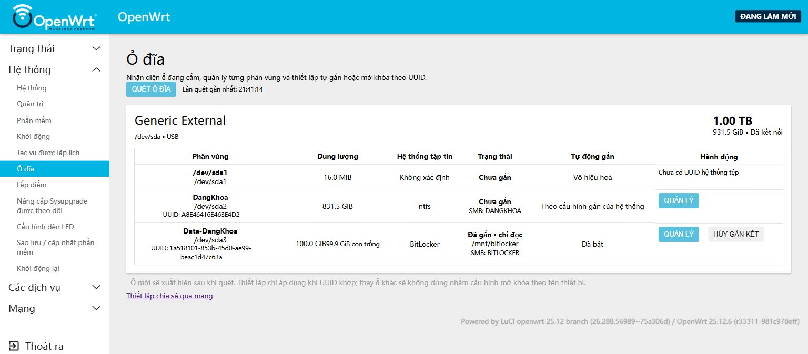

# NAS trên Xiaomi Mi Router 3G — OpenWrt và Tailscale

Cập nhật **30/10/2026**: OpenWrt 25.12.6, kernel 6.12.112. Router có trang **Hệ thống → Ổ đĩa** để nhận ổ/phân vùng đang cắm, chỉnh thiết lập theo UUID và nhập mật khẩu BitLocker ngay trong LuCI. **Các dịch vụ → Hướng dẫn kết nối** có hướng dẫn Windows/Android với IP và share lấy trực tiếp từ router.

## Bắt đầu sử dụng

- **[Truy cập NAS từ xa trên Windows và Android](docs/REMOTE-ACCESS.md)**: cài/kết nối Tailscale, map ổ vào This PC, thêm SMB trên Android và xử lý lỗi kết nối.
- **[Khoa NAS 2 cho Android](software/android/README.md)**: quản lý tệp và ổ đĩa, tích hợp Tailscale ngay trong app.
- **[Báo cáo kiểm thử cuối và hướng dẫn có hình](reports/2026-10-30-final-verification/README.md)**: PDF 11 trang, ảnh thực tế, ma trận kết quả và phạm vi chưa xác minh.
- **[Hướng dẫn quản lý ổ đĩa trong LuCI](router/luci-disk-manager/README.md)**: quét ổ, tùy chỉnh mount, mở khóa/tự mở và cài lại giao diện.
- [Trạng thái đã kiểm chứng](docs/CURRENT-STATE.md) và [báo cáo triển khai 29/10](reports/2026-10-29-disk-manager/README.md).

## Địa chỉ hiện tại

| Mục | Trong LAN | Từ xa khi Tailscale kết nối |
|---|---|---|
| Quản lý ổ đĩa | [Mở trang Ổ đĩa](http://192.168.1.1/cgi-bin/luci/admin/system/disks) | [Mở trang Ổ đĩa qua Tailscale](http://100.114.53.95/cgi-bin/luci/admin/system/disks) |
| Hướng dẫn kết nối | [Mở hướng dẫn](http://192.168.1.1/cgi-bin/luci/admin/services/nas-connect) | [Mở hướng dẫn qua Tailscale](http://100.114.53.95/cgi-bin/luci/admin/services/nas-connect) |
| BitLocker 100 GiB | `\\192.168.1.1\BITLOCKER` | `\\100.114.53.95\BITLOCKER` |
| NTFS khoảng 831,5 GiB | `\\192.168.1.1\DANGKHOA` | `\\100.114.53.95\DANGKHOA` |

**Ngày 30/10: BITLOCKER và DANGKHOA đều đọc/ghi được.** Đã chạy CHKDSK trên ổ cắm trực tiếp vào Windows, xác nhận cả hai không còn dirty, cắm lại router và thử tạo/đọc/xóa tệp qua SMB. Xem trạng thái thực tế trong trang Ổ đĩa; manager vẫn không force dirty NTFS.

Tài khoản SMB là `nas`; nhập mật khẩu trực tiếp trên thiết bị. Mật khẩu SMB, mật khẩu quản trị LuCI và mật khẩu BitLocker là các thông tin độc lập. IP Tailscale tham chiếu là `100.114.53.95`; kiểm tra lại khi đổi/reset router.

## Trang Ổ đĩa

- Quét thiết bị và phân vùng thực tế, nhận thay đổi topology/disk sequence; ổ mới không bị gán nhầm cấu hình theo `sda`/`sdb`.
- Chỉnh tên hiển thị, đường dẫn dưới `/mnt`, chế độ chỉ đọc/đọc ghi và tự gắn/mở khóa theo UUID.
- Mật khẩu nhập trong LuCI, xử lý nền; chỉ lưu khóa đã xác minh khi chọn tự mở, quyền root-only.
- Tháo gắn an toàn, từ chối nếu đang bận; NTFS từ chối RW thì fallback RO, không force.
- Việt/Anh theo ngôn ngữ LuCI; menu Material dài xuống dòng thay vì che nội dung các trang.

Ngày 29/10 đã thử reboot thật: module dm-zero tự nạp, BitLocker tự mở và mount chỉ đọc, KSMBD/cron chạy lại. Windows mở được `BITLOCKER` qua LAN và IP Tailscale; TCP 445 đi qua interface Tailscale. Ngày 30/10 đã thử Khoa NAS 2 trên LDPlayer: SMB nội bộ đọc/ghi và xem trạng thái ổ thật; đăng nhập tailnet và thử 4G/5G còn chờ chủ tài khoản.

## Mã triển khai và module

| Thư mục | Nội dung |
|---|---|
| [router/luci-disk-manager](router/luci-disk-manager/README.md) | View LuCI, RPC/ACL, scan, manager, job nền, boot/hotplug, bản dịch và sửa theme |
| [releases/dm-zero/6.12.112](releases/dm-zero/6.12.112/README.md) | APK tự dựng đúng kernel, SHA-256 và thông tin build |
| [scripts/kernel/dm-zero](scripts/kernel/dm-zero/Makefile) | Mã nguồn/gói module; [workflow tái lập](.github/workflows/build-dm-zero.yml) |
| [docs/REMOTE-ACCESS.md](docs/REMOTE-ACCESS.md) | Windows/Android truy cập NAS từ xa qua Tailscale |

Runtime quản lý được các filesystem có driver trên router; BitLocker còn cần dm-zero đúng kernel. Khi nâng firmware/kernel, kiểm tra và dựng lại module tương ứng. Installer cài lại có hướng dẫn trong thư mục mã; không khôi phục nguyên snapshot cũ cho ổ mới.

## Bảo mật và lịch sử

Không đưa khóa BitLocker, SSH private key, mật khẩu SMB/Wi-Fi, Tailscale state hoặc backup cấu hình chưa audit lên Git. Khóa tự mở nằm trên router: ai có root hoặc đọc được flash/backup chứa khóa có thể lấy mật khẩu. Giữ recovery key riêng. Truy cập từ xa qua tailnet, không port-forward SMB 445 ra Internet. Xem [SECURITY.md](SECURITY.md).

- [Hướng dẫn triển khai 12/10 đã lưu lịch sử](docs/history/README-2026-10-12.md).
- [Nhật ký đầy đủ 12/10](reports/2026-10-11-clean-rebuild/2026-10-12-full-journal.md).
- Các snapshot `router/current`, tài liệu VeraCrypt/NAS1/NAS2/PRIVATE và app Windows/Android cũ là mốc lịch sử, không dùng để suy ra UUID/share đang hoạt động.
