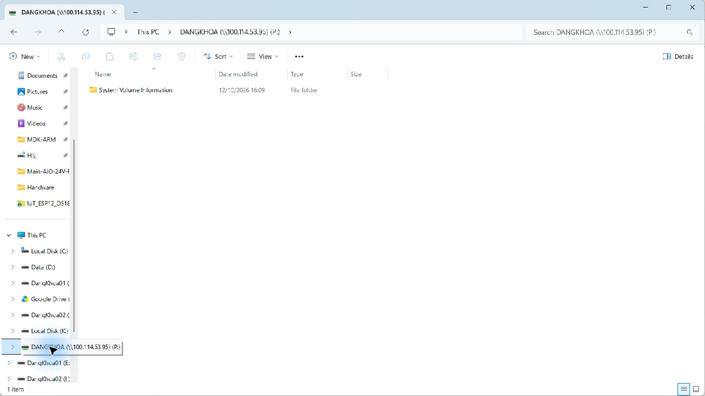
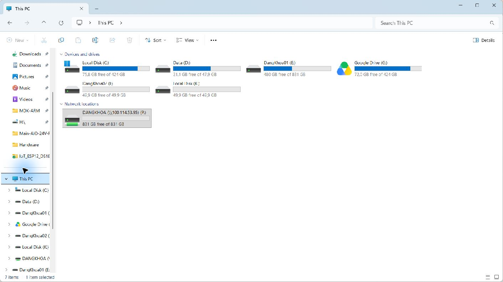
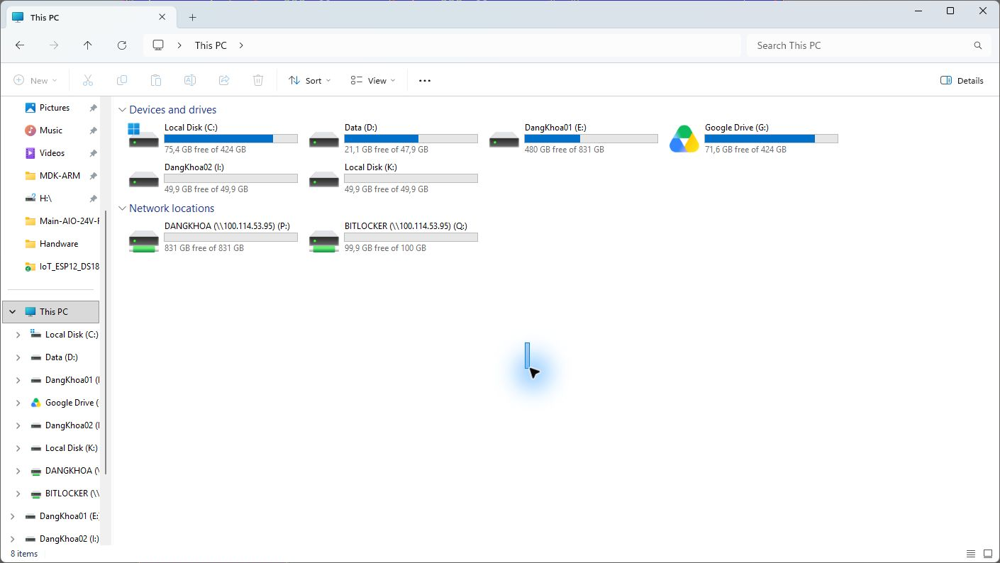
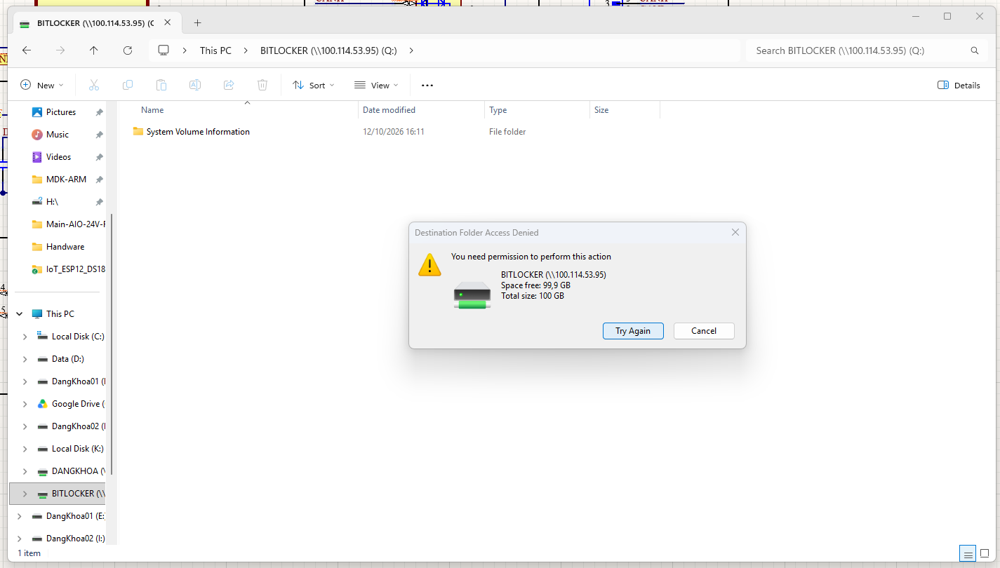
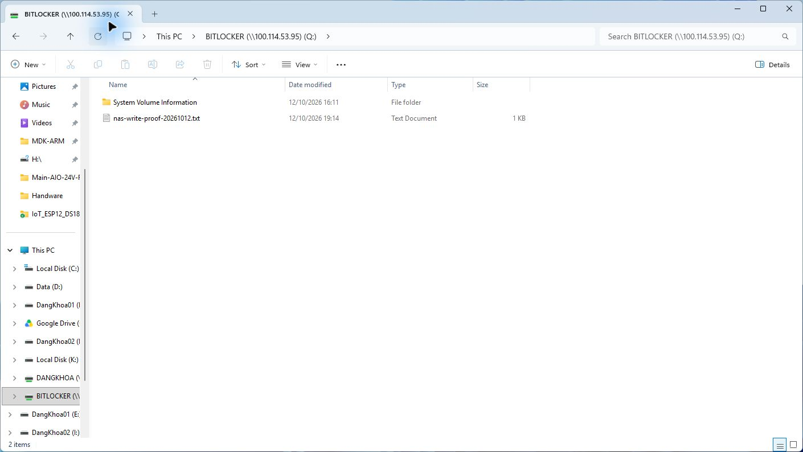
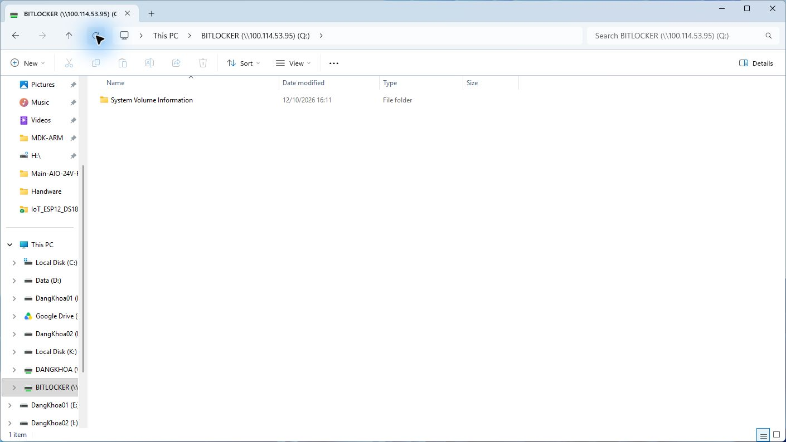
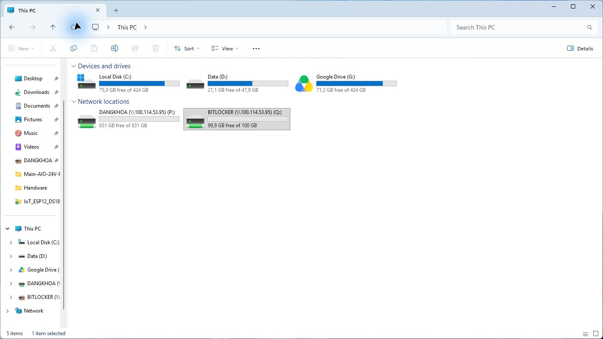
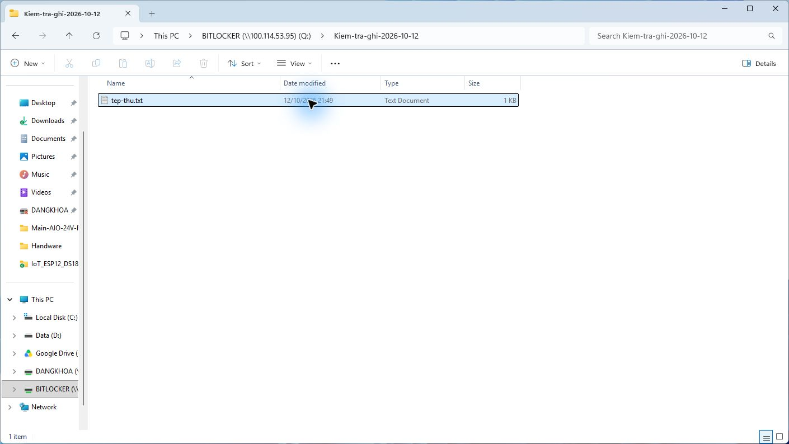

> Bản lưu lịch sử ngày 12/10/2026. Trạng thái hiện tại ở [README chính](../../README.md).

# Dựng NAS trên Xiaomi Mi Router 3G với OpenWrt và Tailscale

Hướng dẫn này ghi lại **cấu hình đã thực hiện và kiểm chứng ngày 12/10/2026** trên Xiaomi Mi Router 3G (MT7621), OpenWrt 25.12.5, kernel 6.12.94. Đi theo các bước từ trên xuống; ảnh ngay dưới từng bước là ảnh chụp thực tế. **Đọc trạng thái hiện tại dưới đây trước khi dùng NAS:** ổ USB đã thay đổi sau các ảnh và phép thử ban đầu. [Nhật ký đầy đủ](../../reports/2026-10-11-clean-rebuild/2026-10-12-full-journal.md) giữ các mốc chẩn đoán và thay đổi trước đó.

> **An toàn dữ liệu:** Cấu hình NAS ba share bên dưới là trạng thái **trước khi ổ USB bị ngắt lúc 16:04 ngày 12/10/2026**. Khi đó ba phân vùng đã được kiểm tra chỉ đọc trước khi dùng làm NAS mới; không thấy tệp NAS cũ. Không format, chia lại phân vùng, chạy `ntfsfix` hoặc gán UUID cũ cho ổ mới. `DATA3` lịch sử là NTFS thường, không phải volume PRIVATE VeraCrypt đã xác nhận.

## Trạng thái hiện tại của ổ thay thế — 12/10/2026

| Hạng mục | Kết quả mới nhất |
|---|---|
| Phạm vi chủ thiết bị chọn cho ổ mới | Truy cập từ xa cả phân vùng NTFS và BitLocker; chủ thiết bị đã nhập kín mật khẩu BitLocker và chọn lưu trên router để tự mở. Cả hai phân vùng hiện hoạt động qua Tailscale |
| `sda2` — DANGKHOA | **PASS sau reboot 21:49:** mount NTFS3 đọc/ghi tại `/mnt/dangkhoa` theo UUID `A8E46416E463E4D2`; KSMBD chỉ cho user `nas`, không guest. Windows ngoài LAN OpenWrt map `P:` tới `\\100.114.53.95\DANGKHOA`; tạo thư mục, tạo tệp, đọc và xóa thành công qua SMB/Tailscale |
| NAS1/NAS2/DATA3 cũ | **ĐÃ NGƯNG:** ổ mang ba UUID cũ không còn hiện diện; ba mục fstab cũ đã tắt và các share cũ được thay bằng `DANGKHOA`. Bản sao cấu hình cũ còn trên router tại `/root/*before-newdisk-20261012` |
| Ổ USB hiện thấy | Chỉ một ổ WDC 1 TB; sau reboot tên kernel đổi từ `/dev/sdb` sang `/dev/sda`, vì vậy cấu hình dùng UUID. `/dev/sda2` là NTFS nhãn `DangKhoa`, UUID `A8E46416E463E4D2`; `/dev/sda3` là BitLocker khoảng 100 GiB, UUID `1a518101-853b-45d0-ae99-beac1d47c63a` |
| BitLocker UUID `1a518101-853b-45d0-ae99-beac1d47c63a` | **PASS sau rút/cắm điện router 22:09:** router tự mở khóa và mount `/mnt/bitlocker` bằng NTFS3 `rw`; share `BITLOCKER` là `read_only=no`. Windows `Q:` tạo thư mục, tạo tệp bên trong, đọc lại và xóa thành công qua SMB/Tailscale. Hook nhận đúng UUID; watchdog nền cũng đã tự khôi phục trong phép thử riêng. Ảnh bước 13 ghi nhận phép thử ghi |
| Lỗi khi ổ cũ rời router | Chủ thiết bị xác nhận **chủ ý thay ổ**. Kernel ghi `USB disconnect` khi còn ghi, mất ghi đồng bộ, `Buffer I/O error` trên `sda2`–`sda4`; `ntfs3` đánh dấu các volume dirty. Khi cắm lại ổ cũ, cần kiểm tra filesystem trước khi cho ghi |
| Tailscale và quản trị | **PASS sau rút/cắm điện router 22:09:** Tailscale tự chạy tại `100.114.53.95`; `rpcd`, `uhttpd`, `ksmbd`, `cron` chạy, SSH và SMB qua tailnet hoạt động. `fw4 check` đạt sau khởi động; WAN công cộng không mở SMB. Kiểm thử từ mạng Internet độc lập vẫn chưa thực hiện |

Chủ thiết bị xác nhận đã **thay ổ có chủ ý**. Ổ mới đã được Windows nhận diện bằng serial `WCC2E6YEU14S`; các bước 1–8 bên dưới là nhật ký triển khai ổ cũ. **Dùng bảng hiện tại để truy cập ổ mới.** Ba map Windows cũ `N:`, `M:`, `Z:` không còn truy cập được; ổ mới là `P:` và `Q:` **đều đọc/ghi** sau kiểm tra ngày 12/10.

## Sơ đồ và địa chỉ đang dùng

| Thành phần | Giá trị đã kiểm chứng |
|---|---|
| Router OpenWrt | LAN `192.168.1.1/24`; Tailscale `100.114.53.95`; MagicDNS ngắn `openwrt` trong tailnet `tail7e45a2.ts.net` |
| Quản trị | LuCI `http://100.114.53.95` hoặc `http://openwrt` khi Tailscale hoạt động; SSH qua tailnet bằng khóa |
| NAS từ máy Windows này | **Hiện tại:** `P:` → `DANGKHOA` (`\\100.114.53.95\DANGKHOA`) đọc/ghi; `Q:` → `BITLOCKER` (`\\100.114.53.95\BITLOCKER`) đọc/ghi. Cả hai `Get-SmbMapping=OK` và đã qua thử tạo thư mục/tệp, đọc/xóa sau reboot. Các map `N:`, `M:`, `Z:` là lịch sử của ổ cũ |
| Bảo vệ | WAN từ chối kết nối vào; firewall chỉ cho TCP 22, 80, 445 và ICMP echo từ Tailscale; SMB yêu cầu user `nas`, không guest |

## Bước 1 — Xác nhận đúng router và kho gói

LuCI sau reset đã xác nhận đúng **Xiaomi Mi Router 3G** và OpenWrt 25.12.5. Kho APK đã cập nhật thành công, báo `11042 distinct packages available`. Giữ nguyên WAN DHCP và LAN `192.168.1.1/24`; không cần reset hoặc flash lại để làm theo các bước này. Tên repository có chữ AC1200 **không** phải tên phần cứng để chọn firmware.

Lệnh kiểm tra lại khi cần: `ubus call system board`, `ip -4 addr`, `ip -4 route`, `apk update`. OpenWrt 25.12 dùng **APK**, không dùng `opkg` cho hướng dẫn này.


## Bước 2 — Cài và bật Tailscale

Đã cài `tailscale 1.102.3-r1`, `kmod-tun` và `luci-app-tailscale-community` từ kho chính thức. Dịch vụ Tailscale được bật tự khởi động. Kiểm tra bằng `apk info tailscale`, `/etc/init.d/tailscale enabled`, `/etc/init.d/tailscale status` và `tailscale version`.


## Bước 3 — Đăng nhập tailnet và bật MagicDNS

Router đã được xác thực trên Tailscale Admin Console với tên `openwrt`, IP `100.114.53.95`; MagicDNS đã bật. Sau reboot, router vẫn giữ IP này và daemon tự kết nối lại. Trên router kiểm tra `tailscale status` và `tailscale ip -4`; trên Windows kiểm tra `tailscale status`, `tailscale ip -4` và `Resolve-DnsName openwrt`.

Không đưa auth key, state Tailscale hoặc mã đăng nhập vào tài liệu. Thiết bị Tailscale cũ `openwrt-nas` từng biến mất khỏi Admin Console theo audit; không tự xóa hoặc tái tạo node cũ.


## Bước 4 — Nhận diện và kiểm tra ổ USB trước khi ghi

Ban đầu router thấy thiết bị USB nhưng chưa có `/dev/sdX`; cài `kmod-scsi-core` và `kmod-usb-storage` thì nhận ổ **WDC 1 TB**. `blkid` và `smartmontools` được dùng để nhận dạng phân vùng và đọc SMART. SMART trả `PASSED`; các bộ đếm reallocated, pending, uncorrectable và CRC tại thời điểm thử đều bằng 0. Kết quả SMART không thay thế kiểm tra hoặc sao lưu dữ liệu.

Đã gắn ba phân vùng **chỉ đọc** để kiểm tra trước khi chủ thiết bị chọn dùng ổ làm NAS mới. Mỗi phân vùng chỉ thấy `System Volume Information`; không có bằng chứng dữ liệu NAS cũ trên ổ hiện tại. Khi kiểm tra ổ khác, phải đối chiếu **UUID và dữ liệu thực tế** trước khi mount ghi, không suy từ số `/dev/sdaX`.


## Bước 5 — Gắn ba phân vùng NTFS3 theo UUID

Sau khi được phép dùng ổ làm NAS mới, đã cài `kmod-fs-ntfs3` và `block-mount`. Fstab gắn tự động bằng **UUID** với tùy chọn `rw,uid=1000,gid=1000,umask=077,iocharset=utf8,noexec,nosuid,nodev`. Tài khoản hệ thống `nas` mang UID/GID 1000 và không có shell đăng nhập.

| Phân vùng | UUID hiện tại | Mount trên router | Share SMB | Ổ Windows |
|---|---|---|---|---|
| `Data` ~831,5 GiB | `2CF24485F24454EC` | `/mnt/nas` | `NAS1` | `N:` |
| `Data2` ~50 GiB | `549638DD9638C0F2` | `/mnt/nas2` | `NAS2` | `M:` |
| `Data3` ~50 GiB | `08820F9C820F8D7E` | `/mnt/data3` | `DATA3` | `Z:` |

Kiểm tra lại bằng `block info`, `uci show fstab`, `mount` và `df -h`; cả ba phải hiện `ntfs3 (rw)` trên đúng điểm gắn. Nếu UUID thay đổi, dừng và đối chiếu ổ trước khi sửa fstab.


## Bước 6 — Chia sẻ SMB có xác thực

Đã cài `kmod-fs-ksmbd`, `ksmbd-server`, `luci-app-ksmbd` và `shadow-useradd`; tạo ba share chỉ cho user `nas`, `read_only=no`, `guest_ok=no`, `create_mask=0600`, `dir_mask=0700`. SMBv1 và guest IPC tắt. KSMBD được cấu hình lắng nghe LAN và `tailscale0` bằng `interfaces = |INTERFACES| tailscale0`, `bind interfaces only = yes`.

**Không tạo interface `tailscale0` do netifd quản lý.** Lần thử `ifup tailscale` đã làm mất IP trên TUN và ngắt SSH/LuCI tailnet; sau khi bỏ interface thử nghiệm và restart daemon Tailscale, IP `100.114.53.95` cùng các dịch vụ hoạt động lại. Chi tiết sự cố nằm trong [nhật ký](../../reports/2026-10-11-clean-rebuild/2026-10-12-full-journal.md).

Mật khẩu SMB được lưu trên router và trong Windows Credential Manager của máy này, **không** lưu trong Git. Để cấp máy mới hoặc đổi mật khẩu SMB, đăng nhập SSH bằng khóa rồi chạy `ksmbd.adduser -u nas` và nhập bí mật tại prompt; cập nhật Credential Manager trên máy khách. Mật khẩu SMB độc lập với mật khẩu root LuCI.


## Bước 7 — Giới hạn firewall và thử từ ngoài LAN OpenWrt

Firewall WAN có `input REJECT`, `forward DROP`; không có rule mở TCP 22/80/445 từ WAN công cộng. Zone Tailscale chỉ cho SSH 22, LuCI HTTP 80, SMB 445 và ICMP echo tới router. Kiểm tra cấu hình bằng `fw4 check` và `fw4 print`, đối chiếu `input_wan` với `input_tailscale`.

Đã rút Ethernet trên Windows và dùng Wi-Fi `192.168.0.104/24`, khác LAN OpenWrt `192.168.1.0/24`. Trước khi dựng NAS, LuCI Overview, System Log và SSH đã hoạt động qua Tailscale; một lần thử còn xác nhận hai đầu ở hai IPv4 công cộng khác nhau. Sau reboot NAS, SMB tiếp tục hoạt động qua interface Tailscale từ Wi-Fi này. Đây là phép thử thực tế ngoài LAN OpenWrt, không chỉ là ping khi còn cùng LAN.


## Bước 8 — Map ổ Windows, reboot và kiểm chứng lại

Bật Tailscale trên Windows, mở **File Explorer → This PC**. Máy này đã map bền vững `N:` → `NAS1`, `M:` → `NAS2`, `Z:` → `DATA3`. Có thể dùng đường dẫn UNC trong bảng đầu README. Nếu Windows hiện **Unavailable** sau khi đăng nhập dù router và Tailscale đang chạy, dùng Terminal trên chính máy Windows để kích hoạt lại các map đã lưu (Credential Manager của máy này đã có tài khoản `nas`):

```powershell
net use N: \\100.114.53.95\NAS1 /persistent:yes
net use M: \\100.114.53.95\NAS2 /persistent:yes
net use Z: \\100.114.53.95\DATA3 /persistent:yes
```

Ngày 12/10, cả ba map từng hiện **Unavailable** trong phiên Windows hiện tại; chạy lại ba lệnh trên không cần nhập mật khẩu và `Get-SmbMapping` sau đó đều báo **OK**, `Test-Path` cả ba ổ trả `True`. Trên máy khác cần nhập mật khẩu SMB của user `nas` theo cách an toàn, không lấy mật khẩu từ README.

Đã reboot router sau khi dựng NAS. Hậu reboot, `tailscale`, `ksmbd`, `rpcd`, `uhttpd` đều chạy; IP tailnet giữ nguyên; ba phân vùng tự mount `ntfs3 (rw)`; `fw4 check` đạt. Từ Windows đang ở Wi-Fi ngoài LAN OpenWrt, cả ba share đều qua TCP 445 trên interface Tailscale. Thử **tạo, đọc lại và xóa** tệp nhỏ thành công trên từng share trước và sau reboot. LuCI phiên cũ yêu cầu đăng nhập lại sau reboot; giao diện đã được kiểm tra trước reboot NAS, còn sau reboot NAS đã kiểm tra SSH, TCP 80, SMB và daemon nhưng **chưa đăng nhập lại LuCI**.


## Bảng kết quả triển khai trước khi thay đổi ổ USB

| Tiêu chí | Kết quả tại lần kiểm tra 12/10/2026 |
|---|---|
| Tailscale tự chạy và giữ `100.114.53.95` sau reboot NAS | **PASS** |
| Mount tự động `ntfs3 (rw)` cho ba UUID sau reboot | **PASS** |
| SMB có xác thực, không guest, ghi/đọc/xóa cả ba share | **PASS** trước và sau reboot |
| Quản trị và SMB từ mạng ngoài LAN OpenWrt | **PASS** với Wi-Fi khác, Ethernet ngắt; LuCI/SSH đã thử trước reboot NAS, SMB thử sau reboot |
| Firewall WAN không mở 22/80/445 | **PASS** theo `fw4 check` và ruleset đã kiểm tra |
| Windows Tailscale và ba ổ NAS tại lần kiểm tra tiếp | **PASS:** backend `Running`, IP `100.85.51.71`; TCP 445 qua interface Tailscale; `N:`, `M:`, `Z:` được nối lại và mở được |
| LuCI đăng nhập giao diện sau reboot NAS | **CHƯA KIỂM CHỨNG LẠI:** tab hiện ở màn hình đăng nhập; HTTP 80 phản hồi, SSH và các daemon hoạt động. Cần chủ thiết bị tự đăng nhập để kiểm tra UI |
| Mật khẩu root LuCI mạnh | **CHƯA ĐẠT**; chủ thiết bị muốn tự đổi sau. Vào **System → Administration → Router Password**, tự đặt và lưu, rồi đăng nhập lại để xác nhận. Không chụp ô mật khẩu |
| FQDN MagicDNS trong Chrome | **FAIL phía client:** `openwrt.tail7e45a2.ts.net` từng báo `ERR_BLOCKED_BY_CLIENT`; DNS hệ điều hành và tên ngắn `openwrt` hoạt động. Chưa xác định tiện ích nào chặn |
| Khôi phục dữ liệu NAS cũ / PRIVATE | **KHÔNG THỰC HIỆN**; ổ hiện tại được chọn làm NAS mới, UUID khác và không thấy dữ liệu cũ |

Các dòng PASS về mount và SMB trong bảng này là **kết quả lịch sử trước 16:04 ngày 12/10/2026**, không phải trạng thái đang hoạt động. Trạng thái mới nhất ở bảng đầu README.

## Bước 9 — Nhận ổ thay thế và chia sẻ phân vùng NTFS

Ổ thay thế có phân vùng NTFS nhãn `DangKhoa` và phân vùng BitLocker. Tên thiết bị đã đổi từ `sdb2`/`sdb3` sang `sda2`/`sda3` sau reboot; dùng UUID để xác định. NTFS được mount đọc/ghi và chia sẻ tên `DANGKHOA`; trên Windows ngoài LAN OpenWrt, `P:` nối tới `\\100.114.53.95\DANGKHOA`. Phép thử tạo, đọc, xóa tệp đạt **trước reboot**; sau reboot `P:` tự nối lại và mở được thư mục. Hai ảnh dưới là ảnh mới của ổ thay thế, không phải ba share lịch sử ở bước 8.





## Bước 10 — Tự mở BitLocker và chia sẻ qua Tailscale

Để `sdb3` tự mở trên **router**, chủ thiết bị đã chọn lưu mật khẩu BitLocker trong `/etc/nas-bitlocker/passphrase` với quyền `0600`, thư mục quyền `0700`. Đây là sự đánh đổi: người có quyền root, có bản sao flash hoặc bản sao cấu hình chứa tệp đó có thể lấy mật khẩu và mở ổ. Đổi mật khẩu quản trị LuCI/root đang yếu trước khi coi mã hóa là lớp bảo vệ đáng tin cậy; không đưa mật khẩu BitLocker vào Git, ảnh, lệnh hoặc README. Giữ recovery key riêng với router và ổ, không chia sẻ backup cấu hình có chứa khóa. Windows auto-unlock gắn với máy/tài khoản Windows, không tự chuyển sang OpenWrt. [Microsoft BitLocker FAQ](https://learn.microsoft.com/en-us/windows/security/information-protection/bitlocker/bitlocker-key-management-faq), [cryptsetup BITLK](https://gitlab.com/cryptsetup/cryptsetup/-/blob/main/man/cryptsetup.8.adoc?ref_type=heads).

Bộ quản lý trên router đã cài tại `/usr/sbin/nas-bitlocker-manager`, chỉ nhận UUID `1a518101-853b-45d0-ae99-beac1d47c63a`. Chủ thiết bị đã chạy script dưới đây: prompt kín kiểm tra fingerprint SSH đã ghim, truyền mật khẩu qua SSH stdin, thử `cryptsetup --test-passphrase` thành công, rồi lưu tệp quyền root trên router. Lệnh được giữ ở đây để dùng khi cần nạp lại khóa; **không cần chạy lại lúc này**.

```powershell
powershell -NoProfile -ExecutionPolicy Bypass -File "D:\Nas-Router\Nas-For-Xiaomi-AC1200-Openwrt\scripts\provision-bitlocker-passphrase.ps1"
```

Lần thử đầu đã thất bại vì firmware thiếu target kernel `dm-zero`. Gói `kmod-dm` chính thức không chứa module này và cấu hình OpenWrt đặt `CONFIG_DM_ZERO=n`. Sau đó đã dựng **module riêng đúng kernel 6.12.94**, thử `insmod`, mở BitLocker chỉ đọc trước để xác nhận filesystem bên trong, tháo sạch, rồi mở/mount đọc ghi. Quy trình build có thể lặp lại trong [workflow](../../.github/workflows/build-dm-zero.yml) và [mã gói](../../scripts/kernel/dm-zero/Makefile); [GitHub Actions run thành công](https://github.com/TranDangKhoaAutomation/Nas-For-Xiaomi-AC1200-Openwrt/actions/runs/38243135230). SDK chính thức OpenWrt 25.12.5 cho ramips/mt7621 và mã `dm-zero.c` Linux v6.12.94 được ghim SHA-256 trong workflow. APK `kmod-dm-zero` đã cài cục bộ bằng `apk add --allow-untrusted` sau khi đối chiếu mã băm và `vermagic`; đây là gói **tự dựng, không phải gói chính thức**. Sau mỗi lần nâng cấp kernel/OpenWrt, phải dựng và kiểm tra lại trước khi mong đợi tự mở ổ.

Hook đã đặt tại `/etc/hotplug.d/block/95-nas-bitlocker`, init được enable (`S96nas-bitlocker`). Hook kiểm tra UUID chính xác, service chạy nền khi boot; **không cần mở Terminal trên Windows**. Thử sự kiện hotplug `add` đã mount lại thành công. Sau reboot thực tế lúc 18:46, module `dm_zero` tự nạp, `nas_bitlocker` active loại `BITLK`, `/mnt/bitlocker` là `ntfs3 (rw)`; `logread` ghi `encrypted volume mounted`. KSMBD có share `BITLOCKER`, chỉ user `nas`, không guest, chỉ lắng nghe `br-lan`/`tailscale0`. Windows đang ở Wi-Fi `192.168.0.104`, Ethernet không nối LAN OpenWrt, đã map bền vững `Q:` → `\\100.114.53.95\BITLOCKER`; `Get-SmbMapping` báo `OK` và `Test-Path Q:\` trả `True` sau reboot. TCP 445 đi qua interface Tailscale. Không mở SSH/LuCI/SMB ra WAN công cộng. Không rút ổ khi đang ghi; dừng kết nối SMB và tháo mount sạch trước khi rút. [Cryptsetup BITLK](https://gitlab.com/cryptsetup/cryptsetup/-/blob/main/lib/bitlk/bitlk.c), [OpenWrt SDK](https://openwrt.org/docs/guide-developer/toolchain/using_the_sdk).



**Cách dùng hằng ngày:** trên máy Windows này, bật Tailscale rồi mở **File Explorer → This PC → BITLOCKER (Q:)**; ổ NTFS còn lại là **DANGKHOA (P:)**. **Sau kiểm tra mới nhất ở Bước 13, cả hai ổ đều ghi được.** Nếu biểu tượng ổ mạng có dấu X sau khi vừa mở máy, mở ổ hoặc làm mới This PC; đối chiếu `Get-SmbMapping` và `Test-Path Q:\`. Router đã tự mở khóa thành công sau reboot, không cần chạy script cấp khóa lần nữa. Muốn kiểm tra từ SSH: `/usr/sbin/nas-bitlocker-manager status`, `cryptsetup status nas_bitlocker` và `mount | grep /mnt/bitlocker`. Tệp khóa chỉ nằm trên router; giữ bản sao khôi phục BitLocker ở nơi riêng. **Không đưa thư mục `/etc/nas-bitlocker` vào bản sao cấu hình công khai.**

| Kiểm tra sau reboot ổ thay thế | Kết quả |
|---|---|
| Tailscale IP `100.114.53.95`, SSH, LuCI HTTP, SMB TCP 445 qua Wi-Fi ngoài LAN OpenWrt | **PASS** qua CLI/kết nối; chưa đăng nhập lại LuCI UI |
| `rpcd`, `uhttpd`, `tailscale`, `ksmbd`, `fw4 check` | **PASS** |
| NTFS UUID `A8E46416E463E4D2` tự mount `ntfs3 rw`; Windows `P:` OK và mở thư mục | **PASS**; ghi/đọc/xóa tệp chỉ được kiểm chứng trước reboot |
| BitLocker UUID `1a518101-853b-45d0-ae99-beac1d47c63a` tự mở, mount, SMB | **PASS sau reboot 19:14:** module tự nạp, mapper active, NTFS3 đọc/ghi, share `BITLOCKER`; Windows `Q:` tạo/đọc/xóa tệp thử thành công |

### Nếu mã hóa hoặc giải mã phân vùng khác sau này

Router hiện đã tự mở BitLocker của UUID nêu trên. Nếu sau này mã hóa phân vùng khác, sao lưu dữ liệu trước, dừng share tương ứng, `sync`, tháo mount sạch trên router rồi mới cắm ổ vật lý sang Windows. Giữ khóa khôi phục 48 chữ số ở nơi riêng. Ổ mạng `P:` và `Q:` là share SMB, không phải ký tự phân vùng vật lý để bật BitLocker trực tiếp. Phân vùng BitLocker khác cần UUID và khóa riêng; không tự nhận cấu hình hiện tại.

Để **mở khóa** volume trên Windows, dùng giao diện BitLocker hoặc `manage-bde -unlock E: -password` với đúng ký tự volume thực tế. Để **giải mã vĩnh viễn**, sau khi mở khóa dùng `manage-bde -off E:` và chờ `manage-bde -status E:` báo hoàn tất. Không ghi mật khẩu hoặc recovery key vào lệnh, ảnh hay repo. Xem [Microsoft: mở khóa](https://learn.microsoft.com/en-us/windows-server/administration/windows-commands/manage-bde-unlock), [giải mã](https://learn.microsoft.com/en-us/windows-security/operating-system-security/data-protection/bitlocker/operations-guide), [tìm recovery key](https://support.microsoft.com/en-us/windows/security/encryption/find-your-bitlocker-recovery-key).

`cryptsetup --type bitlk` đã mở được volume, NTFS3 mount đọc/ghi và Windows ghi/đọc/xóa qua SMB sau reboot. Chưa đo tốc độ truyền tệp lớn; phép thử tệp nhỏ xác nhận quyền ghi, không đại diện hiệu năng. Xem [tài liệu cryptsetup BITLK](https://gitlab.com/cryptsetup/cryptsetup/-/blob/main/man/cryptsetup.8.adoc?ref_type=heads) và [OpenWrt ksmbd](https://openwrt.org/docs/guide-user/services/nas/ksmbd).

## Bước 11 — Sửa lỗi Q: xem được nhưng không ghi được

Ban đầu Windows vào được `Q:` nhưng báo **Destination Folder Access Denied** khi tạo tệp. Ảnh lỗi thực tế:



Đã đối chiếu `/mnt/bitlocker` là `ntfs3 rw`, owner `nas` UID/GID 1000; chính user `nas` tạo tệp trực tiếp trên filesystem được. Windows tạo tệp trên `P:` thành công nhưng `Q:` bị `Access denied`. Log boot cho thấy KSMBD chạy **trước** khi BitLocker mount xong. Khởi động lại KSMBD khi mount đã có làm phép thử `Q:` thành công. Do đó script `nas-bitlocker-manager` nay chỉ **restart KSMBD sau lần mount BitLocker mới** nếu KSMBD đang chạy; các lần gọi khi ổ đã mount không restart. Điều này xử lý cả trường hợp hotplug hoàn tất muộn hơn trình tự boot. Không thay đổi ACL/dữ liệu trên ổ và không mở thêm cổng firewall.

Sau reboot xác minh bản sửa lúc 19:14, log có `encrypted volume mounted` rồi `ksmbd refreshed after encrypted mount`; `Q:` tạo, đọc lại và xóa tệp nhỏ thành công từ Windows. `P:`/`Q:` đều trở về trạng thái `OK`; `fw4 check` đạt. Ảnh dưới chụp tệp thử hiện trong File Explorer **trước khi đã xóa sạch tệp thử**:



Nếu gặp lại lỗi sau lần boot khác, kiểm tra `logread | grep nas-bitlocker` phải có `ksmbd refreshed after encrypted mount`, rồi thử tạo một tệp nhỏ trong `Q:`. Không sửa quyền hàng loạt hoặc format NTFS để xử lý lỗi này.

## Bước 12 — Trạng thái an toàn khi NTFS BitLocker báo dirty

Phép thử mở rộng sau Bước 11 phát hiện: tạo **tệp** trên `Q:` thành công nhưng tạo **thư mục** bị `Access denied`. Cùng thao tác dưới UID `nas` ngay trên router cũng bị từ chối, trong khi root tạo thư mục được; chưa xác định đây là ACL NTFS hay hành vi của driver. Trong lúc chẩn đoán, NTFS3 ghi `volume is dirty and "force" flag is not set!`, từ chối mount đọc/ghi. Tùy chọn `noacsrules` được tài liệu kernel cũ nhắc đến nhưng kernel **6.12.94 của router báo `Unknown parameter`**; đã bỏ ngay, không dùng `force`, không chạy `ntfsfix`, không format hoặc xóa dữ liệu.

Script hiện thử mount đọc/ghi bình thường; nếu NTFS3 từ chối thì tự mount **chỉ đọc** và đổi share `BITLOCKER` sang `read_only=yes`. Reboot kiểm chứng lúc 19:25: log có `read-write mount refused; trying read-only without force`, `encrypted volume mounted read-only`, rồi `ksmbd refreshed after encrypted mount`. `P:` vẫn `ntfs3 rw`; `Q:` đọc được từ Windows, cả hai map `OK` qua Tailscale; firewall kiểm tra đạt. Ảnh dưới chỉ chứng minh truy cập đọc thư mục `Q:`, **không chứng minh ghi được**:



**Kiểm tra lại 20:06 ngày 12/10:** chủ thiết bị chưa thể tháo ổ để kiểm tra trực tiếp trên Windows. Router vẫn báo `/mnt/bitlocker` là `ntfs3 ro`, share `BITLOCKER` là `read_only=yes`; `Q:` kết nối được nhưng không ghi được. `P:` là `ntfs3 rw`, share `DANGKHOA` là `read_only=no`; qua Tailscale, Windows đã tạo, đọc lại và xóa thành công một tệp thử nhỏ trên `P:`. Trong khi chờ xử lý NTFS, lưu tệp cần ghi vào **DANGKHOA (P:)**. `P:` không được mã hóa BitLocker, vì vậy không đặt dữ liệu cần bảo mật theo yêu cầu của phân vùng `Q:` vào đó. Không chạy sửa lỗi filesystem trên ổ mạng `Q:`.

Để phục hồi khả năng ghi an toàn, trước hết sao lưu dữ liệu quan trọng trên phân vùng mã hóa. Cần **tháo ổ vật lý khỏi router một cách sạch**, cắm trực tiếp vào Windows, mở khóa BitLocker trên phân vùng vật lý bằng prompt kín, xác định đúng ký tự ổ rồi kiểm tra `fsutil dirty query X:` và `chkdsk X: /scan` (thay `X:` bằng ký tự **phân vùng vật lý**, không phải ổ mạng `Q:`). Nếu Windows xác nhận cần sửa, cân nhắc `chkdsk X: /f` **sau khi đã sao lưu** và đọc kết quả; thao tác sửa filesystem chưa được thực hiện trong lần này. Sau khi Windows báo ổ sạch, tháo an toàn, cắm lại router; script sẽ thử mount đọc/ghi và đổi share về `read_only=no` nếu thành công. Phải thử **tạo thư mục, tạo tệp bên trong, đọc lại và xóa** qua `Q:` trước khi đánh dấu hoàn tất. [Microsoft: dirty bit](https://learn.microsoft.com/en-us/windows-server/administration/windows-commands/fsutil-dirty), [chkdsk](https://learn.microsoft.com/windows-server/administration/windows-commands/chkdsk), [mở khóa BitLocker](https://learn.microsoft.com/en-us/windows-server/administration/windows-commands/manage-bde-unlock), [NTFS3 kernel 6.12](https://raw.githubusercontent.com/gregkh/linux/v6.12.94/Documentation/filesystems/ntfs3.rst).

## Bước 13 — Kiểm tra NTFS bằng Windows sau khi tháo ổ

Ngày 12/10 lúc 21:35, router ghi nhận ổ USB bị ngắt khi còn mount; log có `Buffer I/O error` trên `sda2`. Tôi dừng KSMBD, unmount các mount cũ và đóng mapper BitLocker trên router; kiểm tra lại không còn block device USB trên router. Windows nhận đúng ổ USB 1 TB serial `WCC2E6YEU14S`: `E:` là NTFS `DangKhoa` (~831 GiB), `F:` là BitLocker `Data-DangKhoa` (~100 GiB). Chủ thiết bị tự mở khóa `F:` trên Windows, không đưa khóa vào chat hoặc repository.

Ban đầu `fsutil dirty query` báo **Dirty** ở cả `E:` và `F:`. `chkdsk` chỉ đọc không phát hiện lỗi cấu trúc; Windows tạo, đọc và xóa thành công một thư mục cùng tệp thử nhỏ trên `F:`. Sau `chkdsk /f /x` chạy bằng quyền quản trị trên **đúng hai phân vùng vật lý này**, `fsutil dirty query E:` và `F:` đều báo **NOT Dirty**; `Get-Volume` báo **Healthy / OK**. Không format hoặc xóa dữ liệu người dùng. Phân vùng hiện chỉ thấy `System Volume Information` ở thư mục gốc; các phép thử đã dọn sạch.

Sau khi dùng **Safely Remove Hardware** và cắm lại router, `sda2` tự mount `rw`. Trong lần cắm vật lý này, BitLocker **chưa mở ngay** khi kiểm tra; chạy `/usr/sbin/nas-bitlocker-manager start` một lần đã mở và mount `sda3` `rw`. `Q:` qua SMB tạo thư mục, tạo tệp bên trong, đọc và xóa thành công. Sau đó đã `sync`, reboot router thật. **Không chạy lệnh mở khóa thủ công sau reboot**: log lúc 21:49 ghi `encrypted volume mounted read-write` và `ksmbd refreshed after encrypted mount`; `P:`/`Q:` đều `rw`, Tailscale giữ IP `100.114.53.95`, `ksmbd`, `rpcd`, `uhttpd`, Tailscale chạy, `fw4 check` đạt. Windows thử lại trên **cả P: và Q:**: tạo thư mục, tạo tệp, đọc lại, xóa đều thành công; hai SMB map trở lại `OK`. Tệp thử đã xóa sạch sau khi chụp ảnh.





Để xử lý khả năng hotplug chạy trước lúc `blkid` đọc được UUID, hook `/etc/hotplug.d/block/95-nas-bitlocker` nay thử lại tối đa 10 lần, cách nhau 2 giây, trong nền; vẫn chỉ mở **đúng UUID BitLocker**. Đã kiểm tra cú pháp và mô phỏng sự kiện `add` cho `sda3`: log ghi `hotplug matched encrypted partition sda3`, volume tiếp tục `rw`. **Chưa thử rút/cắm vật lý lần nữa sau khi sửa hook**; tự mở sau **reboot thật** đã PASS. Khi cần tháo ổ về sau, dừng ghi SMB và unmount sạch hoặc tắt router an toàn trước khi rút để tránh cờ dirty quay lại.

**Bổ sung tự phục hồi khi cắm nóng:** vì lần cắm vật lý 21:46 không mở ngay và phải gọi manager một lần, router nay chạy `cron` nền mỗi phút với dòng `* * * * * /usr/sbin/nas-bitlocker-watchdog >/dev/null 2>&1` trong `/etc/crontabs/root`. [Script watchdog](../../scripts/router/nas-bitlocker-watchdog) chỉ gọi manager khi **đúng UUID** hiện diện mà `/mnt/bitlocker` chưa mount; không mở khóa lặp lại mỗi phút. Kiểm chứng không cần rút ổ: dừng KSMBD, `sync`, đóng mapper/mount sạch, bật lại KSMBD và cron, **không gọi manager thủ công**. Log `21:56:00` ghi `watchdog found encrypted volume not mounted`, `21:56:18` ghi `encrypted volume mounted read-write`, `21:56:20` ghi `ksmbd refreshed after encrypted mount`. Windows `Q:` sau đó tạo, đọc và xóa thư mục/tệp thử thành công; ảnh ở trên minh họa cùng thao tác ghi sau reboot, các tệp thử watchdog đã dọn. `cron`, KSMBD và Tailscale chạy nền trên router, **không cần giữ Terminal Windows mở**. Sau cắm ổ, chờ khoảng một phút trước khi kết luận chưa tự mở; thời gian mở khóa thực tế còn phụ thuộc tốc độ ổ/router. **Cắm nóng vật lý sau khi thêm watchdog vẫn chưa được thử lại**, nên chưa đánh dấu riêng tiêu chí đó PASS.

Reboot kiểm chứng lại lúc 21:59 sau khi cài watchdog: `cron`, `ksmbd`, Tailscale cùng chạy, `nas-bitlocker-manager status` báo `mounted read-write`, cả hai mount NTFS3 là `rw`, IP Tailscale giữ nguyên. Không chạy lệnh mở khóa thủ công sau reboot. Windows `Q:` tiếp tục qua thử tạo thư mục/tệp, đọc và xóa; `P:`/`Q:` đều có SMB map `OK`.

**Thử rút/cắm điện router thật lúc 22:09:** trước khi chủ thiết bị rút điện, đã dừng cron/KSMBD, `sync`, unmount `/mnt/bitlocker` và `/mnt/dangkhoa`, đóng mapper rồi `poweroff`; router báo `NAS_UNMOUNTED`. Sau khi cắm điện lại, không chạy lệnh mở khóa thủ công. Log mới ghi `hotplug matched encrypted partition sda3` lúc 22:09:18, `encrypted volume mounted read-write` lúc 22:09:47 và `ksmbd refreshed after encrypted mount` lúc 22:09:48. `P:`/`Q:` đều NTFS3 `rw`, `cron`, `ksmbd`, `rpcd`, `uhttpd`, Tailscale chạy, `fw4 check` đạt. Windows qua Tailscale thử **cả P: và Q:**: tạo thư mục, ghi tệp, đọc lại, xóa đều thành công, SMB map `OK`; tệp thử đã dọn sạch. Hai ảnh phía trên là ảnh sau reboot trước đó; mốc rút/cắm điện này được xác nhận bằng log và phép thử mới, chưa có ảnh chụp riêng. **Rút/cắm riêng ổ USB khi router vẫn chạy** vẫn chưa thử lại sau bản sửa.

## Tài liệu và ảnh lưu trữ

- [Nhật ký đầy đủ 11–12/10/2026](../../reports/2026-10-11-clean-rebuild/2026-10-12-full-journal.md): chi tiết lệnh, lỗi LuCI, thử nghiệm và ảnh bổ sung theo thời gian.
- [README trước factory reset](../../reports/2026-10-11-clean-rebuild/README-before-reset.md): cấu hình và UUID **lịch sử**, không dùng để tự phục hồi ổ hiện tại.
- [Thư mục ảnh gốc](../../reports/2026-10-11-clean-rebuild/screenshots/): giữ nguyên tên ảnh và thứ tự chụp để đối chiếu. Các tài liệu NAS cũ trong `docs/` cũng cần đối chiếu với bảng UUID hiện tại trước khi áp dụng.

Không lưu mật khẩu root, mật khẩu SMB, khóa khôi phục, Tailscale auth key hoặc session token trong repository.
