> **Nhật ký lưu trữ theo thời gian:** các bảng đầu ghi trạng thái cũ tại thời điểm đó, kể cả các mục sau này đã được xử lý. Để làm theo thứ tự dựng NAS và xem kết quả mới nhất, dùng [README chính](../../README.md). Các đường dẫn ảnh dưới đây đã được chỉnh cho đúng vị trí lưu trữ.

# Khôi phục OpenWrt và Tailscale — 11/10/2026

> Báo cáo và hướng dẫn triển khai có kiểm chứng. Các bước CHƯA THỰC HIỆN chỉ là hướng dẫn, không được xem là đã chạy.
>
> **Đúng phần cứng:** Xiaomi Mi Router 3G, board xiaomi,mi-router-3g, MediaTek MT7621. Tên repository có chữ AC1200 không phải căn cứ chọn firmware; không flash ảnh cho model khác.
>
> **Trạng thái mới nhất:** xem bảng ngay dưới đây và các mục kiểm chứng ngày 12/10/2026 ở cuối tài liệu. Những bảng cũ là nhật ký tại thời điểm thực hiện, được giữ lại để đối chiếu.

## Tóm tắt trạng thái đã kiểm chứng — 12/10/2026, 12:06 ICT

| Tiêu chí | Trạng thái hiện tại |
|---|---|
| OpenWrt và Tailscale sau reboot NAS | **PASS:** reboot lại sau cấu hình NAS; Tailscale tự chạy, giữ `100.114.53.95`; `rpcd`, `uhttpd`, KSMBD chạy và ba phân vùng tự gắn lại |
| Quản trị từ Windows qua tailnet | **PASS:** SSH bằng khóa và TCP 22/80 qua interface Tailscale sau reboot. LuCI phiên cũ yêu cầu đăng nhập lại sau reboot; kiểm chứng giao diện đã thực hiện trước reboot |
| Firewall | **PASS:** WAN input REJECT/forward DROP; tailnet chỉ được TCP 22/80/445 và ICMP echo tới router; `fw4 check` đạt, `input_wan` không có rule SMB/quản trị |
| FQDN MagicDNS trong Chrome | **FAIL phía client:** `openwrt.tail7e45a2.ts.net` bị `ERR_BLOCKED_BY_CLIENT`; tên ngắn `openwrt` đã hoạt động trên cùng tab |
| Quản trị và NAS ngoài LAN OpenWrt | **PASS:** trước đó SSH/LuCI đã được kiểm thử từ Wi-Fi khác LAN và hai đầu có IPv4 công cộng khác nhau. Sau reboot NAS, Windows dùng Wi-Fi `192.168.0.104/24`, Ethernet ngắt; SMB qua IP tailnet đã tạo/đọc/xóa file thử trên cả ba share |
| Mật khẩu root mạnh | **HOÃN THEO CHỦ THIẾT BỊ:** chủ thiết bị sẽ tự đổi sau; SSH root bằng mật khẩu đã tắt, LuCI vẫn dùng mật khẩu hiện tại |
| NAS/HDD | **PASS cho NAS mới:** ổ WDC 1 TB; NAS1, NAS2, DATA3 gắn NTFS3 đọc/ghi theo UUID và chia sẻ SMB có xác thực, không guest. Windows đã map N:, M:, Z:; thử tạo/đọc/xóa qua SMB PASS trước và sau reboot. Dữ liệu NAS cũ không thấy trên ổ hiện tại |

**Quản trị ngoài LAN và NAS mới đã được kiểm chứng.** Mật khẩu root mới được chủ thiết bị hoãn để tự đặt sau, nên tiêu chí mật khẩu mạnh chưa đạt. Chưa xác định chắc nguyên nhân gốc của lỗi LuCI cũ hoặc thành phần Chrome chặn FQDN MagicDNS; đường quản trị bằng IP tailnet và tên ngắn đã hoạt động trước reboot NAS. Thiết bị Tailscale cũ `openwrt-nas` đã biến mất khỏi Admin Console; chi tiết audit ở phần sau, không xóa hoặc đăng ký lại trong lần làm việc này.

## Trạng thái thực tế sau khi reset

| Bước | Tình trạng | Bằng chứng |
|---|---|---|
| Factory Reset | ĐÃ XÁC MINH | Uptime trở về ~30 phút, Wi-Fi 2.4/5 GHz tắt mặc định |
| Firmware | ĐÃ XÁC MINH | OpenWrt 25.12.5 r33051-f5dae5ece4, kernel 6.12.94 |
| LAN | ĐÃ XÁC MINH | 192.168.1.1; LAN1 link 1 GbE |
| WAN | ĐÃ XÁC MINH | DHCP 10.2.28.41/24, gateway 10.2.28.1, link 100 Mb/s |
| Kho APK | ĐÃ XÁC MINH | LuCI cập nhật được, trả về OK: 11042 distinct packages available |
| Đăng nhập root | ĐÃ XÁC MINH | SSH dùng mật khẩu được chủ thiết bị cung cấp, không ghi bí mật vào repo; cần nâng độ mạnh |
| Cài gói Tailscale | ĐÃ XÁC MINH | LuCI APK: tailscale 1.102.3-r1 + kmod-tun; OK: 43.3 MiB in 159 packages |
| Login Tailscale | ĐANG XỬ LÝ | LuCI Login đang chờ URL; node chưa được xác thực |
| Truy cập từ mạng ngoài | CHƯA KIỂM THỬ | Chưa có Tailscale IPv4 mới được xác minh |
| NAS/USB/VeraCrypt | CHƯA KHÔI PHỤC | Bảo toàn dữ liệu, không ghi lên ổ lỗi |

## Ảnh chụp thao tác (ảnh thực từ máy tính)

Ảnh đặt trong thư mục reports/2026-10-11-clean-rebuild/screenshots/.

### 01 — Giao diện quản trị sau reset

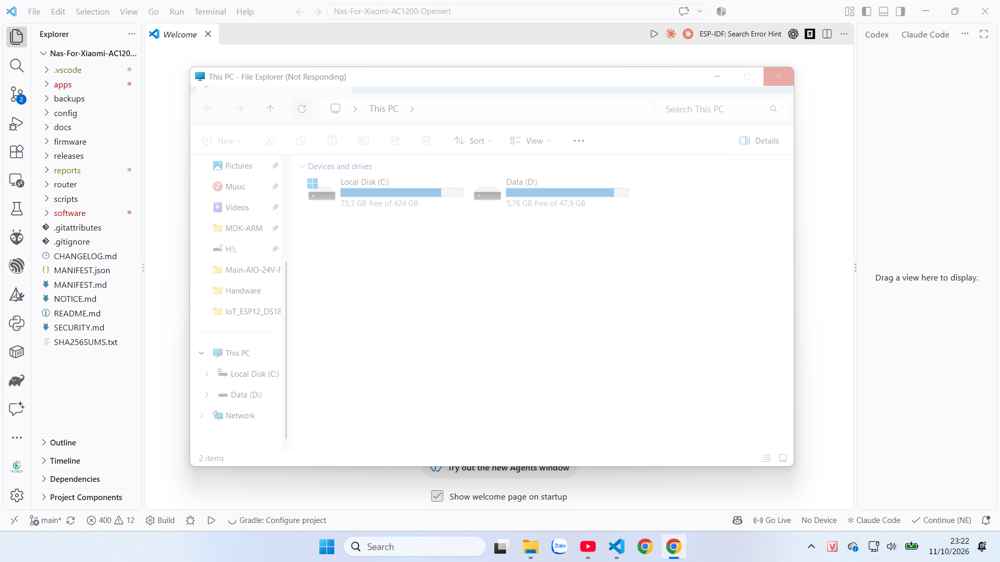

### 02 — Cập nhật kho APK

**Kết quả xác minh:** LuCI hiện ra dòng OK: 11042 distinct packages available.

Các ảnh ở các bước sau chỉ được thêm vào README sau khi đã thao tác, và phải kiểm tra file PNG thực sự được lưu.

## Mục tiêu cài đặt

- Giữ OpenWrt hiện tại, WAN DHCP và LAN 192.168.1.1/24.
- Đặt mật khẩu root an toàn và bảo vệ SSH; tuyệt đối không đưa mật khẩu hoặc Tailscale auth key vào Git.
- Cài Tailscale từ kho APK **chính thức OpenWrt 25.12**, tự động khởi động.
- Truy cập LuCI/SSH từ tailnet (hoặc MagicDNS) thay vì mở cổng quản trị ra WAN.
- Chỉ quảng bá subnet 192.168.1.0/24 khi cần quản lý các máy khác trong LAN. Không bật exit node mặc định.
- NAS/SMB chỉ sử dụng sau khi phần cứng USB và NTFS được kiểm tra độc lập.

## Các bước thực hiện (lệnh mẫu — chưa mặc nhiên được chạy)

### 1. Đặt password root

Vào System → Administration → Router Password; đặt mật khẩu mạnh, lưu vào trình quản lý mật khẩu riêng tư, xác minh bằng cách đăng nhập lại LuCI. Không chụp màn hình trường chứa mật khẩu.

### 2. Kiểm tra sức khỏe OpenWrt

~~~sh
ubus call system board
ip -4 addr
ip route
ping -c 3 1.1.1.1
nslookup openwrt.org
df -h
free -m
~~~

### 3. Cài Tailscale trên OpenWrt 25.12 (dùng APK, KHÔNG dùng opkg)

~~~sh
apk update
apk add tailscale
/etc/init.d/tailscale enable
/etc/init.d/tailscale start
tailscale version
~~~

### 4. Đăng ký router vào Tailscale

~~~sh
tailscale up --hostname=openwrt-mi-router-3g --accept-dns=false
tailscale status
tailscale ip -4
tailscale netcheck
~~~

Mở URL auth sinh ra bởi lệnh tailscale up và xác nhận trên tài khoản người dùng. Không giả định IP trước reset 100.91.1.101 còn hiệu lực.

### 5. Firewall và quản trị an toàn

Tạo interface quản lý cho tailscale0 và firewall zone riêng theo hướng dẫn OpenWrt. Chỉ cho phép inbound qua tailscale0 tới dịch vụ cần (LuCI/SSH, SMB nếu NAS sẵn sàng). Không mở cổng 22, 80, 443 hoặc 445 trực tiếp từ WAN. Subnet router cần cấu hình forward/NAT, quảng bá route và duyệt trong Tailscale Admin; không cần bật cho truy cập chỉ trên router.

### 6. Kiểm tra sau triển khai

~~~sh
/etc/init.d/tailscale status
tailscale status
tailscale ip -4
tailscale netcheck
logread | tail -n 100
~~~

Test trên điện thoại sử dụng 4G/5G hoặc thiết bị ở mạng khác, kiểm tra SSH/LuCI, ACL, reconnect, reboot, tự khởi động. Build/installed không thay thế kiểm tra thực tế.

## Lỗi NAS trước reset: không tự khôi phục

Trước reset, kernel ghi USB disconnect và Buffer I/O error trên sda1; ntfs3 đánh dấu volume dirty. Script giám sát NAS trước đây lặp lệnh dừng ksmbd mỗi 5 giây khi không có share mount. Không chạy format, ntfsfix, fsck hoặc mount ghi dữ liệu lên ổ trước khi kiểm tra/backup dữ liệu. Kiểm tra cáp/box/nguồn, SMART và filesystem riêng trước khi phục hồi NAS1/NAS2/PRIVATE VeraCrypt.

## Kiểm soát rủi ro

1. Chụp ảnh mỗi mốc UI đã thực hiện; ẩn dữ liệu xác thực.
2. Không restore nguyên cấu hình cũ từ trước reset.
3. Giữ kết nối LAN trong toàn bộ quá trình chỉnh firewall/VPN.
4. Sau khi cài đặt, kiểm tra reboot, test lại Internet/DHCP/SSH/LuCI và lưu log kết quả; nêu rõ phần chưa test.
5. Không đưa state Tailscale, keys, passphrase VeraCrypt vào repo.

## Tài liệu tham khảo

- OpenWrt Tailscale: https://openwrt.org/docs/guide-user/services/vpn/tailscale/start
- OpenWrt downloads: https://downloads.openwrt.org/
- Tailscale subnet router: https://tailscale.com/docs/features/subnet-routers
- Tailscale auth keys: https://tailscale.com/docs/features/access-control/auth-keys

## Lưu trữ lịch sử

Bản README trước reset được sao lưu nguyên vẹn tại reports/2026-10-11-clean-rebuild/README-before-reset.md. Các thông số Tailscale, SMB và mount cũ chỉ mang tính lịch sử, chưa được chứng thực lại sau Factory Reset. Các thư mục dự án hiện có khác được giữ nguyên.

## Nhật ký triển khai tiếp nối (12/10/2026, sau factory reset)

Các thao tác sau được thực hiện trực tiếp trên **một tab LuCI** hiện có bằng công cụ điều khiển trình duyệt, kết hợp chẩn đoán SSH. Thư mục NAS/USB chưa được mount, format, fsck, ntfsfix hoặc ghi dữ liệu.

### Bằng chứng đã kiểm tra

| Hạng mục | Trạng thái kiểm chứng | Lệnh / giao diện |
|---|---|---|
| SSH host fingerprint | ED25519 `SHA256:qXMHQKUxALpxCzg0HamL7k1HXT38gzDdK5LEGvyqOVA` | SSH đã ghim khóa host sau reset; khóa cũ trong known_hosts được giữ nguyên |
| SSH root | Thành công | SSH đăng nhập qua địa chỉ LAN bằng thông tin chủ thiết bị cung cấp |
| Firmware | OpenWrt 25.12.5, kernel 6.12.94, Xiaomi Mi Router 3G | `ubus call system board` |
| LAN | 192.168.1.1/24, LAN1 liên kết 1 GbE | `uci show network.lan`, LuCI Overview |
| WAN | DHCP 10.2.28.22/24, gateway 10.2.28.1 | `uci show network.wan`, `ip -4 route` |
| Internet / DNS | ping 1.1.1.1: 2/2; DNS openwrt.org thành công | `ping -c 2 -W 2 1.1.1.1`; `nslookup openwrt.org` |
| Firewall WAN | `input REJECT`, `forward DROP` trên zone WAN; không thấy redirect trong bản audit | `uci show firewall` |
| APK index | 11042 gói | Software → Update Lists; lệnh chạy bởi LuCI: `apk update` |
| Gói Tailscale | Cài thành công `tailscale 1.102.3-r1`, `kmod-tun` | Software → install; lệnh chạy bởi LuCI: `apk add tailscale` |
| Quản trị LuCI Tailscale | Cài thành công `luci-app-tailscale-community` | LuCI `apk add luci-app-tailscale-community` |
| Tailscale autostart | Hiện `Đã bật` tại System → Startup, priority 80 | LuCI Startup; thao tác Start đã gửi |
| Runtime Tailscale | **CHƯA ĐẠT**: Tailscale LuCI health check báo stopped, Login đang chờ URL | Services → Tailscale |
| Tailscale cấu hình | Backend `nftables`; Accept Routes, Exit Node, Advertise Exit Node, Shields Up, Tailscale SSH, Disable MagicDNS đều chưa bật | LuCI Tailscale → General Settings |
| MagicDNS/tailnet | **CHƯA KIỂM CHỨNG**: phải đăng nhập Tailscale và kiểm tra DNS trong admin console | Không kết luận từ checkbox LuCI |
| Remote access | **CHƯA KIỂM THỬ**: không có Tailscale IPv4 xác minh | Cần test qua thiết bị ngoài LAN |
| Khởi động lại | **CHƯA KIỂM THỬ** kể từ khi cài gói | Không giả định daemon tự kết nối lại |
| NAS | Không thao tác | Giữ nguyên ổ USB và filesystem |

### Ảnh chụp thực tế mới

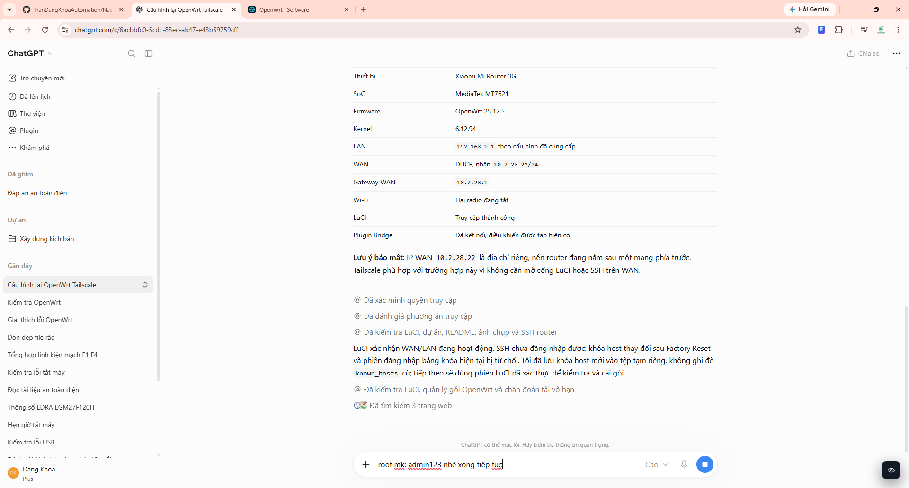

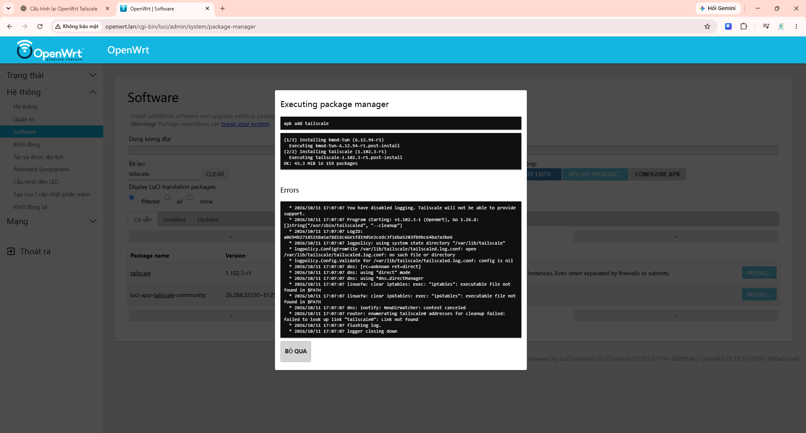

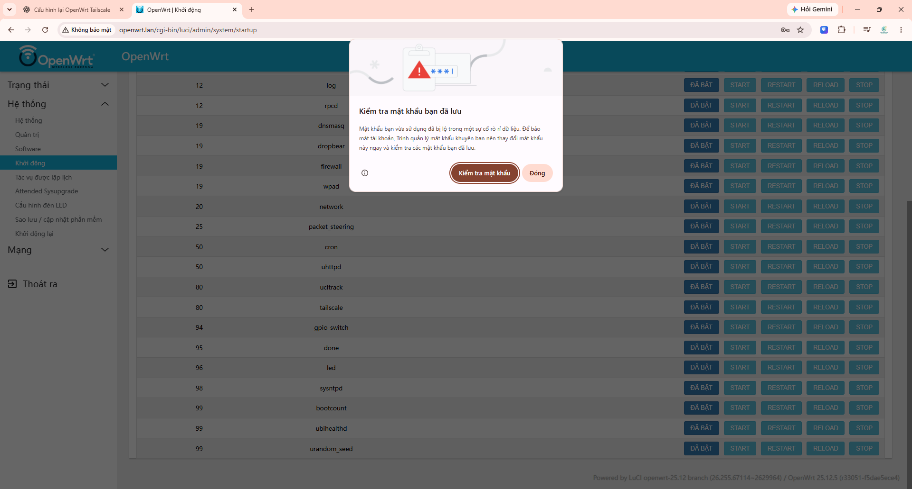

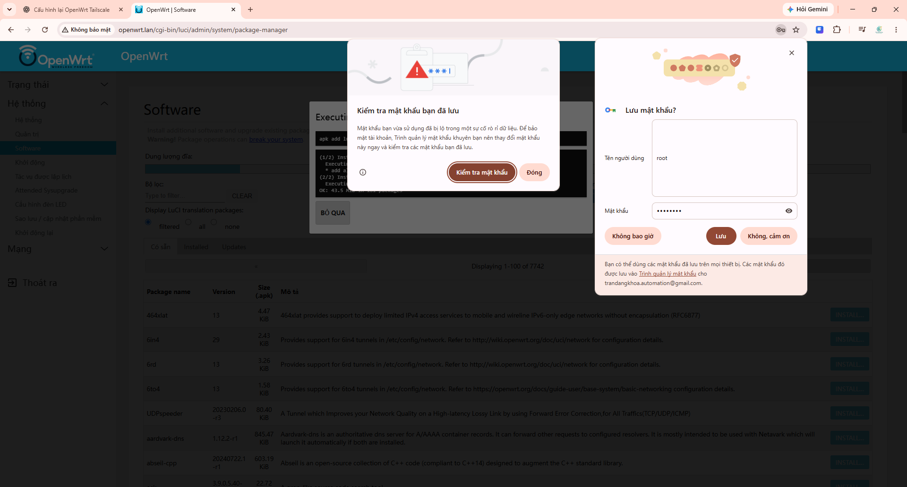

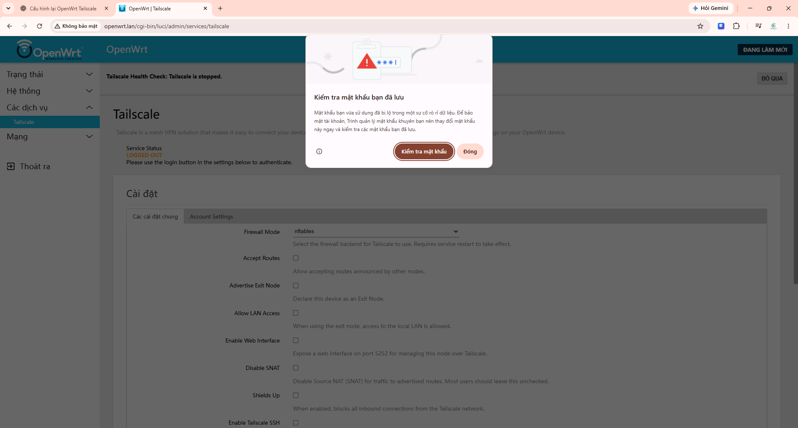

### Kiểm tra tiếp theo

1. Khắc phục daemon stopped dựa trên log thực tế. Gói Tailscale phát log cleanup `iptables` và `ip6tables` không tồn tại; trên OpenWrt 25.12 dùng nftables, cần phân biệt thông báo cleanup với lỗi khởi động thật. Không thêm iptables một cách ngẫu nhiên.
2. Sau khi `tailscale status` hoạt động: login với hostname riêng, `--accept-dns=false` nếu thiết bị giữ vai trò router; tài khoản Tailscale bắt buộc được chủ thiết bị xác thực.
3. Chỉ tạo zone/interface `tailscale0` cho quyền quản trị router. **Không quảng bá LAN subnet, không bật exit node, không cho phép forwarding tailnet→LAN** khi chưa có yêu cầu mở rộng.
4. Chỉ mở LuCI/SSH từ LAN và tailnet hợp lệ; không thêm rule WAN cho TCP 22, 80, 443. Cân nhắc khóa SSH key-based thay vì mật khẩu yếu.
5. Test port qua Tailscale IP và tên MagicDNS, xem firewall counters, test mạng di động tách LAN, reboot rồi kiểm tra reconnect; mọi mục chưa chạy vẫn đánh dấu chưa kiểm chứng.

**Lưu ý an toàn:** Không lưu mật khẩu quản trị, auth URL/token, thiết lập state chứa khóa hoặc private SSH key vào repository.

### Cập nhật chẩn đoán: LuCI RPC phản hồi chậm

- Sau khi nhấn **Services → Tailscale → Login**, dialog `Requesting Login URL... Please wait.` tồn tại mà chưa trả URL. Trước đó health check LuCI báo **Tailscale is stopped**.
- Các view **Status → System Log** và **System → Reboot** hiện chỉ hiển thị `Đang tải…`, chưa hiển thị log hay nút reboot. **Không tuyên bố đã reboot** hoặc đã xử lý root cause.
- Kiểm tra TCP từ Windows tới router sau khi phát sinh lỗi: TCP **22 mở**, **80 mở**, **443 timeout**. Kết quả này chỉ chứng minh socket LAN còn truy cập, không chứng minh rpcd hay Tailscale khỏe.
- **Chưa sửa firewall, không bật route LAN, không mở cổng WAN.** Không can thiệp NAS.
- Ảnh minh họa khi System Log chưa tải:

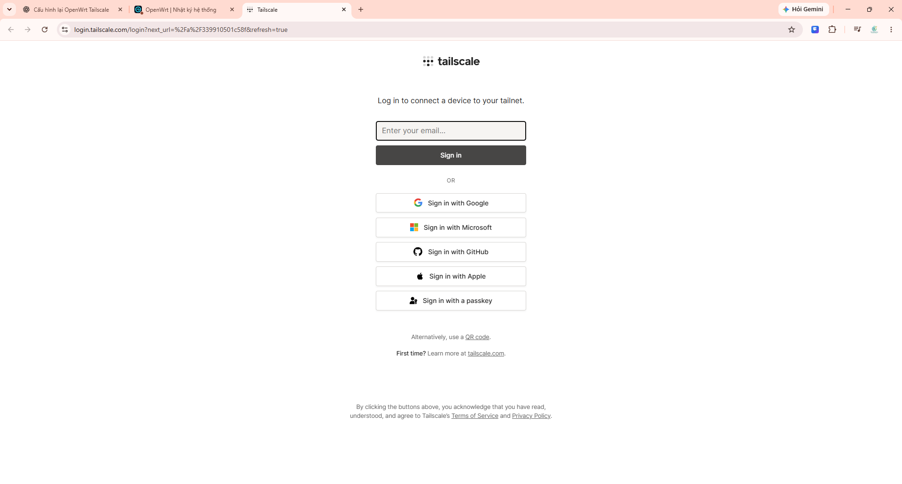

#### Chẩn đoán tiếp theo — lệnh dự kiến, CHƯA CHẠY sau sự cố

~~~sh
/etc/init.d/tailscale status
tailscale status
ps w | grep -E '[t]ailscale|[r]pcd'
logread | grep -Ei 'tailscale|procd|rpcd|oom|error' | tail -n 100
lsmod | grep -i tun
nft list ruleset
df -h
~~~

**Mức xác nhận:** Gói APK đã cài, autostart đã bật, nhưng chưa chứng minh daemon hoạt động, đăng nhập tailnet, truy cập từ bên ngoài, MagicDNS hoặc tự kết nối sau reboot. Tránh khẳng định OpenWrt+Tailscale đã hoàn tất khi chưa có bằng chứng tương ứng.

## Kiểm chứng sau reboot ngày 12/10/2026

Thực hiện trực tiếp bằng SSH, PowerShell trên Windows, Plugin Bridge Web trên **một tab LuCI hiện có** và tab Tailscale Admin Console. Không format, mount, sửa hoặc xóa dữ liệu NAS/HDD; không reset hay flash router. Bảng này cập nhật các trạng thái cũ ở phía trên, nhưng giữ nguyên nhật ký cũ.

| Tiêu chí | Kết quả | Bằng chứng thực tế |
|---|---|---|
| Đúng router/firmware | **PASS** | `ubus call system board`: Xiaomi Mi Router 3G, OpenWrt 25.12.5, kernel 6.12.94 |
| SSH host key sau reset | **PASS** | ED25519 `SHA256:qXMHQKUxALpxCzg0HamL7k1HXT38gzDdK5LEGvyqOVA` trùng fingerprint đã ghi trước đó; dùng tệp known_hosts riêng, không ghi đè khóa cũ |
| `rpcd`, `uhttpd`, log và tài nguyên | **PASS cho kiểm tra hiện tại** | Hai dịch vụ báo `running`; `logread` qua SSH đọc được; load trước reboot 0.00 và RAM khả dụng khoảng 149 MB, overlay dùng 15%; không thấy bằng chứng OOM hoặc tiến trình chết |
| Trang System Log và Reboot | **PASS sau reboot** | Mở từ menu LuCI qua IP Tailscale: System Log thoát `Đang tải…`; Reboot hiển thị nút thao tác. Không bấm reboot lần hai. Yêu cầu điều hướng trực tiếp bằng công cụ đôi lúc trả 403 và yêu cầu đăng nhập lại; chưa xác định chắc nguyên nhân của hiện tượng phiên này |
| Router Tailscale runtime | **PASS** | `/etc/init.d/tailscale status` → `running`; `tailscale status` có `openwrt`; `tailscale ip -4` → `100.114.53.95`; LuCI hiển thị RUNNING |
| Router Tailscale tự chạy sau reboot | **PASS** | Đã chạy `sync; reboot`; uptime từ khoảng 56 phút về 1 phút. Sau reboot `/etc/rc.d/S80tailscale` vẫn tồn tại, daemon `running`, cùng IP `100.114.53.95`; Admin Console báo `Connected` |
| LAN, WAN, DNS, Internet sau reboot | **PASS** | LAN `192.168.1.1/24`, WAN DHCP `10.2.28.22/24`, gateway `10.2.28.1`; ping `1.1.1.1` 2/2; `nslookup openwrt.org` thành công; router phân giải `openwrt.tail7e45a2.ts.net` ra `100.114.53.95` |
| Windows Tailscale | **PASS trong phiên hiện tại** | Trước đó service chạy nhưng CLI `NoState`, adapter chỉ có `169.254.83.107`. Sau khi mở `tailscale-ipn.exe`, CLI chuyển `Running`, IP `100.85.51.71`. Đã đặt `--unattended=true`; sau khi đóng tiến trình GUI, service vẫn Running và `tailscale ping` tới router thành công |
| MagicDNS trên Windows | **PASS ở mức DNS hệ điều hành/CLI** | Đã áp `tailscale set --accept-dns=true` và xóa DNS cache; NRPT trỏ `tail7e45a2.ts.net` đến `100.100.100.100`; `Resolve-DnsName` và SSH bằng tên đầy đủ đều thành công. Chrome hiển thị trang trắng khi mở LuCI bằng tên này; network event ghi `net::ERR_BLOCKED_BY_CLIENT` (chưa xác định thành phần chặn). **LuCI qua tên trong Chrome chưa đạt**; LuCI qua IP Tailscale hoạt động |
| SSH/LuCI qua tailnet | **PASS từ máy Windows hiện tại** | `Test-NetConnection` TCP 22/80 dùng interface `Tailscale`, địa chỉ nguồn `100.85.51.71`; SSH bằng public key đến `100.114.53.95` và tên MagicDNS thành công; LuCI qua `http://100.114.53.95` tải Overview, System Log và Reboot |
| SSH key của người dùng | **PASS** | Đã thêm **public key** hiện có, fingerprint `SHA256:a5AQZ0oxGbjC4J3O6x+PjFgUihp4H3VMszYMEyrbsFA`, vào `/etc/dropbear/authorized_keys`; SSH key đăng nhập thành công qua LAN và tailnet. Đã đặt `dropbear.main.RootPasswordAuth='off'` và xác nhận SSH key vẫn hoạt động |
| Firewall quản trị | **PASS cho rule và phép thử hiện tại** | Zone `tailscale` gắn `tailscale0`: input/forward REJECT, chỉ cho phép TCP 22/80 và ICMP echo tới router. `fw4 check` đạt trước và sau reboot; counter rule cho phép và từ chối tăng. TCP 53 hoạt động trên LAN nhưng bị từ chối qua tailnet. WAN vẫn `input REJECT`, `forward DROP`, không thêm rule WAN cho 22/80/443; không quảng bá subnet hoặc bật exit node |
| Truy cập thực sự từ Internet ngoài LAN | **CHƯA KIỂM CHỨNG** | Windows vẫn nối Ethernet `192.168.1.185` vào LAN router; Wi-Fi không kết nối. Dù gói quản trị đi qua interface Tailscale, Tailscale chọn endpoint trực tiếp tại cùng địa điểm (`10.2.28.22` trong một lần ping, `192.168.1.185` trong log sau đó). Chưa thử bằng điện thoại 4G/5G hoặc máy ở mạng khác |
| Thiết bị Tailscale cũ `openwrt-nas` | **FAIL — không còn trong danh sách** | Admin Console lúc đầu có `openwrt-nas` (`100.91.1.101`) và `galaxy-a15`; sau đó còn hai máy. Configuration logs ghi `Delete node` cho `openwrt-nas`, `galaxy-a15` và node Windows cũ lúc **00:40 ngày 12/10/2026**, actor hiển thị tên tài khoản. Phiên thao tác này không gửi lệnh xóa; log không đủ để xác định phiên nào gây ra việc xóa. Không tự tạo lại hoặc xóa thêm thiết bị |
| Mật khẩu root LuCI | **FAIL — cần đổi** | Mật khẩu chủ thiết bị cung cấp còn yếu. SSH root bằng mật khẩu đã tắt; LuCI vẫn dùng mật khẩu này qua LAN/tailnet. Cần đổi bằng giao diện nhập bí mật riêng, không lưu trong repository |
| NAS/HDD | **KHÔNG CAN THIỆP** | Không chạy format, mount, fsck, ntfsfix, thao tác SMB hoặc sửa dữ liệu ổ đĩa |

### Ảnh chụp mới đã lưu và kiểm tra

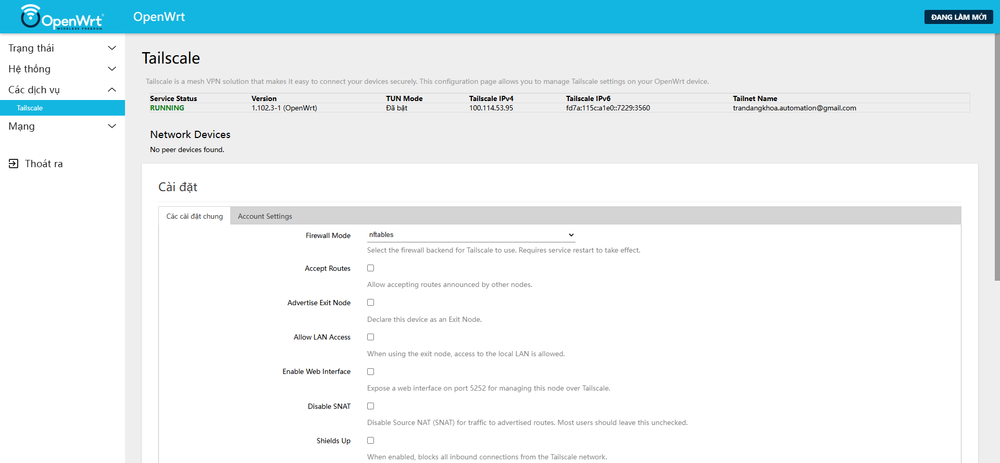

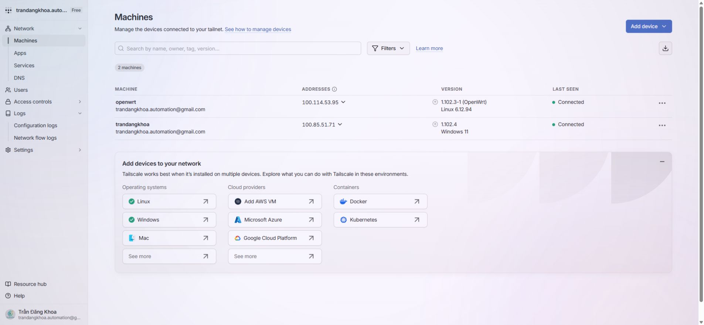

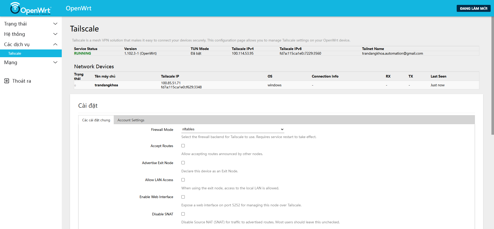

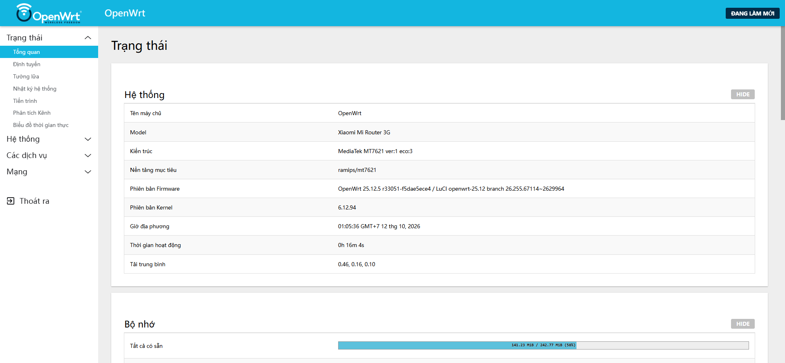

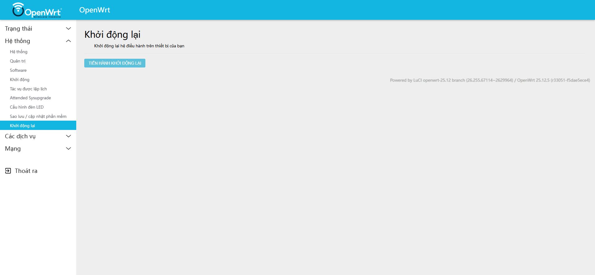

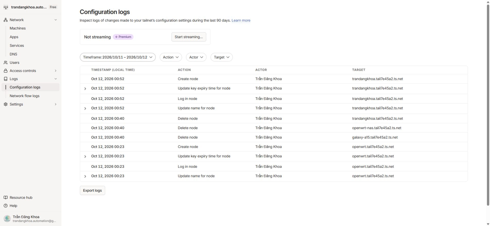

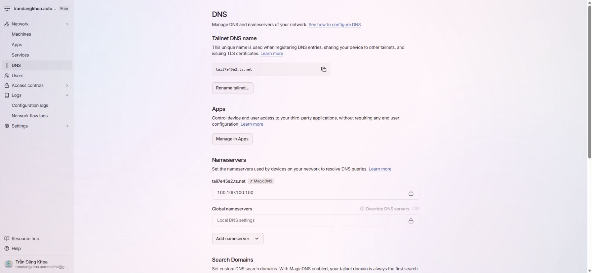

### Giới hạn còn lại

1. Chưa thử SSH/LuCI từ một mạng ngoài LAN thực sự. Cần thử bằng thiết bị đang dùng 4G/5G hoặc một mạng khác, rồi xác nhận interface Tailscale, SSH và HTTP LuCI.
2. Chrome chưa tải được LuCI bằng tên MagicDNS: request bị `net::ERR_BLOCKED_BY_CLIENT`; DNS hệ điều hành, SSH theo tên và LuCI theo IP Tailscale vẫn đạt. Chưa xác định chính xác extension/chính sách phía trình duyệt gây chặn; không gộp phép thử này vào PASS của trình duyệt.
3. Nguyên nhân gốc của các lần LuCI `Đang tải…`/403 trước đây chưa được chứng minh; sau reboot, các trang được thử từ menu đã tải. Theo dõi thêm nếu lỗi tái phát.
4. Đổi mật khẩu root LuCI sang mật khẩu mạnh qua một kênh nhập bí mật an toàn. Không lưu mật khẩu vào README, ảnh hoặc log.
5. `openwrt-nas` và `galaxy-a15` không còn trong Admin Console; cần chủ tailnet kiểm tra audit/thiết bị cũ nếu muốn đăng ký lại. Không có thao tác khôi phục danh tính node cũ trong lần kiểm tra này.

### Kiểm tra tiếp lúc 01:21–01:23 ngày 12/10/2026

| Hạng mục | Kết quả | Bằng chứng |
|---|---|---|
| Router và Windows Tailscale sau thêm 32 phút uptime | **PASS** | Router vẫn `running`, IP `100.114.53.95`; Windows IP `100.85.51.71`, `Resolve-DnsName openwrt.tail7e45a2.ts.net` trả `100.114.53.95`; SSH bằng khóa qua tailnet thành công |
| Dịch vụ LuCI và tải máy | **PASS tại thời điểm kiểm tra** | `rpcd` và `uhttpd` cùng `running`; load 0.10/0.08/0.08, RAM available 147900 KiB; không thấy OOM trong phần log mới |
| LuCI System Log | **PASS trong lần thử này** | Cùng tab OpenWrt chuyển từ tên MagicDNS sang IP tailnet, Overview và System Log đều hết `Đang tải…`, hiện nội dung log. Ảnh 17 |
| MagicDNS ở lớp mạng | **PASS** | `curl` tới `http://openwrt.tail7e45a2.ts.net/cgi-bin/luci/` kết nối đúng `100.114.53.95`, HTTP 403 khi không có phiên đăng nhập; `tailscale ping` thành công. Chrome vẫn lỗi khi mở tên này; hiện tượng thuộc phía trình duyệt, chưa xác định extension hoặc chính sách cụ thể |
| Đổi mật khẩu root LuCI | **CHƯA THỰC HIỆN** | Đã mở trang **Hệ thống → Quản trị → Mật khẩu bộ định tuyến** trên tab LuCI hiện có và để trống hai ô cho chủ thiết bị tự nhập mật khẩu mới rồi LƯU; ảnh 18. Chưa coi là PASS trước khi kiểm tra lại |
| Ngoài LAN thực sự | **CHƯA KIỂM CHỨNG** | Windows vẫn dùng Ethernet trong LAN; chưa có phép thử qua điện thoại 4G/5G hoặc đường mạng độc lập |

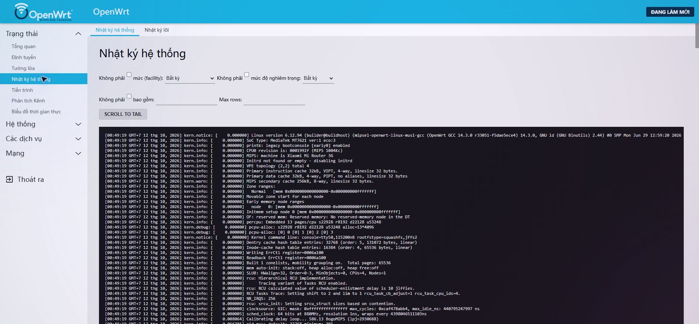

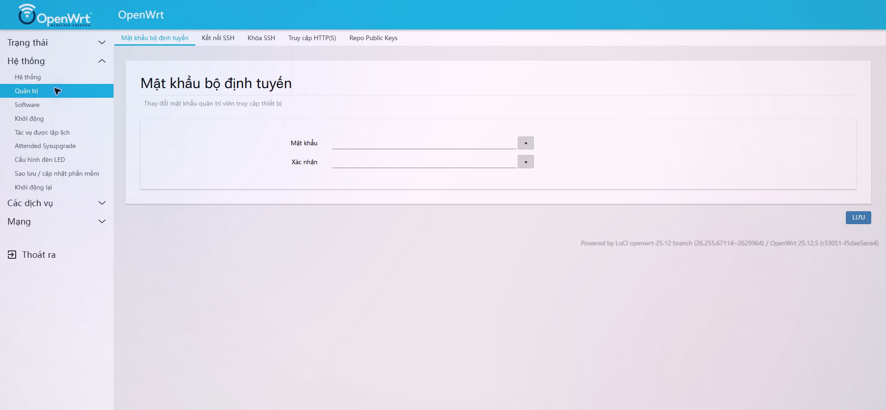

### Theo dõi độ ổn định lúc 10:27–10:28 ngày 12/10/2026

| Hạng mục | Kết quả | Bằng chứng |
|---|---|---|
| Tailscale sau 9 giờ 38 phút uptime | **PASS tại thời điểm kiểm tra** | `/etc/init.d/tailscale status` vẫn `running`, `tailscale ip -4` vẫn `100.114.53.95`; Windows CLI vẫn `100.85.51.71` và thấy router active |
| LuCI backend | **PASS tại thời điểm kiểm tra** | `rpcd` và `uhttpd` đều `running`; load 0.08/0.08/0.02; SSH bằng khóa qua tailnet tiếp tục thành công |
| WAN, định tuyến và firewall | **PASS tại thời điểm kiểm tra** | `fw4 check` thành công, WAN zone vẫn input REJECT/forward DROP, rule Tailscale chỉ nêu TCP 22/80; default route qua `10.2.28.1`, DNS `openwrt.org` thành công, ping `1.1.1.1` 2/2 |
| Đổi mật khẩu root | **CHƯA THỰC HIỆN** | `/etc/shadow` vẫn có mtime 23:55:49 ngày 11/10, trước lúc chuẩn bị trang đổi mật khẩu; chưa có bằng chứng chủ thiết bị đã LƯU mật khẩu mới. Cần chủ thiết bị tự nhập và lưu theo quy tắc Computer Use |
| Kiểm tra Chrome/LuCI tiếp theo | **TẠM THỜI KHÔNG KIỂM TRA ĐƯỢC** | Phiên Chrome từng có tab OpenWrt hiện không còn trong danh sách trình duyệt có thể điều khiển; không tạo tab LuCI mới theo yêu cầu một tab |
| Truy cập ngoài LAN | **CHƯA KIỂM CHỨNG** | Windows vẫn có Ethernet nối LAN; chưa có thiết bị ở mạng độc lập để thử |

Các dòng PASS ở đây là kiểm tra tại thời điểm nêu trên; không thay thế phép thử ngoài LAN thực sự. Không thao tác NAS/HDD.

### Khả năng kiểm thử ngoài LAN tại 10:28 ngày 12/10/2026

Máy Windows có Wi-Fi nhưng đang ngắt kết nối; Ethernet vẫn nhận `192.168.1.185` từ LAN OpenWrt. Có profile Wi-Fi đã lưu cho mạng khác, nhưng phiên PowerShell hiện không có quyền quản trị để vô hiệu hóa Ethernet hoặc ép tuyến kiểm thử. Chỉ nối thêm Wi-Fi trong khi Ethernet còn hoạt động sẽ không chứng minh gói Tailscale đi từ ngoài LAN. Vì vậy **chưa chạy phép thử ngoài LAN** và không đánh dấu DONE cho tiêu chí này. Cần điện thoại dùng dữ liệu di động có Tailscale hoặc một máy ở mạng độc lập, hoặc một phiên thử có thể tách Ethernet an toàn.

### Xác minh lại LuCI lúc 10:47 ngày 12/10/2026

Phiên LuCI cũ hiển thị thông báo **Phiên hết hạn** sau nhiều giờ. Chủ thiết bị cung cấp lại thông tin đăng nhập; đăng nhập trên đúng tab OpenWrt hiện có qua `http://100.114.53.95` thành công, và `logread` ghi `luci: accepted login` từ `100.85.51.71`. Hai ô đặt mật khẩu mới hiện để trống trên **Hệ thống → Quản trị → Mật khẩu bộ định tuyến**. Mật khẩu root **chưa đổi**: mtime `/etc/shadow` vẫn là 23:55:49 ngày 11/10. Không lưu mật khẩu trong báo cáo.

Thử lại tên `http://openwrt.tail7e45a2.ts.net/cgi-bin/luci/` ngay trên cùng tab Chrome vẫn trả `net::ERR_BLOCKED_BY_CLIENT`; trở về IP tailnet thì LuCI tải được. DNS và đường tailnet đã được kiểm chứng riêng ở trên, nên đây là lỗi phía client/trình duyệt chưa cô lập được thành phần chặn. Không có thay đổi firewall hoặc router trong lần thử này.

| Tiêu chí | Kết quả |
|---|---|
| Đăng nhập lại LuCI qua IP Tailscale sau khi phiên hết hạn | **PASS** |
| LuCI qua tên MagicDNS trong Chrome | **FAIL — `ERR_BLOCKED_BY_CLIENT`** |
| Mật khẩu root mạnh | **CHƯA THỰC HIỆN — chủ thiết bị cần tự nhập và lưu mật khẩu mới** |
| Truy cập từ mạng ngoài LAN | **CHƯA KIỂM CHỨNG** |

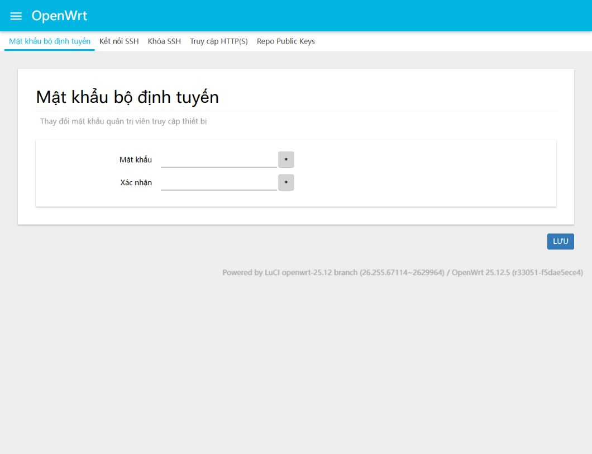

### Kiểm tra tiếp lúc 11:18 ngày 12/10/2026

Chủ thiết bị xác nhận sẽ tự đổi mật khẩu root sau; vì vậy mục này **hoãn theo yêu cầu**, chưa đạt PASS. Không thay mật khẩu bằng tác vụ tự động và không lưu mật khẩu đã cung cấp vào README/ảnh.

| Tiêu chí | Kết quả | Bằng chứng |
|---|---|---|
| Router chạy liên tục 10 giờ 29 phút | **PASS tại thời điểm kiểm tra** | Tailscale, `rpcd`, `uhttpd` đều `running`; load 0.11/0.04/0.01 |
| Firewall quản trị | **PASS tại thời điểm kiểm tra** | `fw4 check` đạt; WAN input REJECT/forward DROP; zone `tailscale0` input/forward REJECT, chỉ rule TCP 22/80 và ICMP echo cho quản trị |
| Windows → router qua tailnet | **PASS từ máy hiện tại** | Windows Tailscale `100.85.51.71`; `Test-NetConnection` TCP 22 và 80 đều thành công trên interface `Tailscale`; SSH bằng khóa theo tên MagicDNS thành công |
| MagicDNS hệ điều hành | **PASS** | Windows phân giải `openwrt.tail7e45a2.ts.net` ra `100.114.53.95` |
| LuCI theo FQDN MagicDNS trong Chrome | **FAIL — phía client** | FQDN vẫn `net::ERR_BLOCKED_BY_CLIENT`; Chrome profile đang có AdGuard và Urban VPN, nhưng chưa chứng minh tiện ích nào gây lỗi. Công cụ trình duyệt từ chối mở `chrome://extensions` do chính sách chỉ cho `http:`/`https:`; không tìm đường vòng và không tự tắt tiện ích. Tên ngắn `openwrt` được kiểm thử thành công ở phần tiếp theo |
| Mật khẩu root mạnh | **HOÃN THEO CHỦ THIẾT BỊ** | Trang LuCI đổi mật khẩu đã mở và để trống; chủ thiết bị sẽ tự đổi sau |
| Truy cập từ Internet ngoài LAN | **CHƯA KIỂM CHỨNG** | Phép thử trên Windows hiện tại vẫn dùng Ethernet cùng LAN; cần thiết bị/mạng độc lập |

Không thay đổi cấu hình router hay dữ liệu NAS/HDD trong lần kiểm tra này.

### LuCI qua tên MagicDNS ngắn lúc 11:20 ngày 12/10/2026

Windows `Resolve-DnsName openwrt -Type A` trả CNAME `openwrt.tail7e45a2.ts.net` và IP `100.114.53.95`. Trên **chính tab OpenWrt hiện có**, Chrome mở được `http://openwrt/cgi-bin/luci/`; đăng nhập thành công, Overview hiển thị model/firmware và **System Log tải nội dung**. `logread` trên router ghi phiên đăng nhập lúc 11:20:16 từ **`100.85.51.71`**, xác nhận đi qua tailnet của Windows chứ không phải địa chỉ LAN `192.168.1.185`. Sau phép thử, tab được đưa về trang đổi mật khẩu qua IP Tailscale để chủ thiết bị dùng sau.

| Tiêu chí | Kết quả |
|---|---|
| MagicDNS tên ngắn `openwrt` trên Windows | **PASS — phân giải về `100.114.53.95`** |
| LuCI Overview/System Log qua `http://openwrt` trên Chrome | **PASS từ máy Windows hiện tại** |
| LuCI qua FQDN `openwrt.tail7e45a2.ts.net` trên Chrome | **FAIL — vẫn bị `ERR_BLOCKED_BY_CLIENT`** |
| Truy cập từ mạng Internet ngoài LAN | **CHƯA KIỂM CHỨNG** |

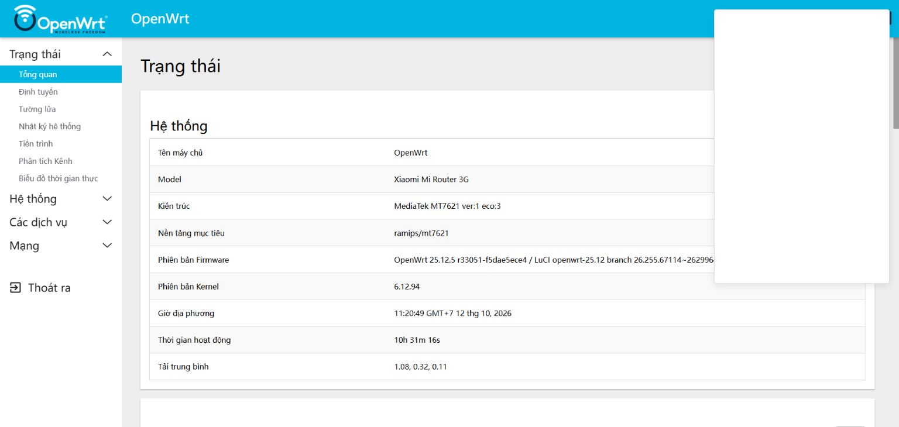

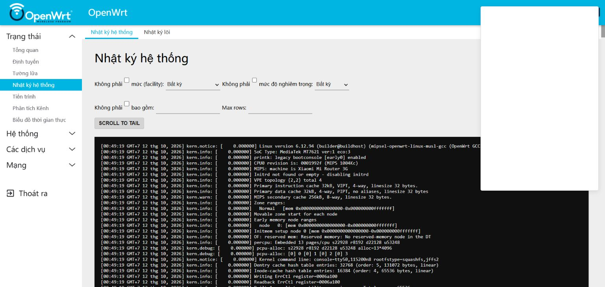

### Kiểm thử sau khi rút Ethernet lúc 11:24–11:27 ngày 12/10/2026

Chủ thiết bị đã rút dây LAN khỏi Windows. `Get-NetAdapter` xác nhận **Ethernet Disconnected**, Wi-Fi **Up** ở `192.168.0.104/24` qua gateway `192.168.0.1`; LAN OpenWrt là `192.168.1.0/24`. Windows còn địa chỉ/tuyến cũ gắn với adapter Ethernet đã ngắt, nhưng default route đang hoạt động qua Wi-Fi. Đây là phép thử **ngoài LAN OpenWrt**, không phải phép thử từ một địa điểm hoặc ISP khác. Router vẫn nối WAN `10.2.28.22/24` qua `10.2.28.1`.

| Tiêu chí | Kết quả | Bằng chứng |
|---|---|---|
| Kết nối Windows ngoài LAN OpenWrt | **PASS** | Ethernet `Disconnected`; Wi-Fi `192.168.0.104/24`, default gateway `192.168.0.1`, khác LAN router `192.168.1.0/24` |
| Đường Tailscale từ Wi-Fi tới router | **PASS** | Windows `100.85.51.71`; `tailscale ping` nhận pong qua DERP `hkg`; `tailscale status` hai phía ghi peer active qua relay `hkg`. Lệnh ping có exit code 1 vì chưa lập được kết nối trực tiếp sau 3 lần thử, nhưng các pong relay đều thành công |
| Cổng quản trị qua tailnet | **PASS** | `Test-NetConnection 100.114.53.95` với TCP 22 và 80 đều `True`, interface `Tailscale`, source `100.85.51.71` |
| Đường LAN trực tiếp từ Wi-Fi hiện tại | **KHÔNG TRUY CẬP ĐƯỢC** | `Test-NetConnection 192.168.1.1 -Port 80` trả `False`, interface `Wi-Fi`, source `192.168.0.104`; củng cố rằng phép thử LuCI thành công ở trên đi qua tailnet |
| Cổng quản trị trên IP WAN riêng từ Wi-Fi hiện tại | **KHÔNG TRUY CẬP ĐƯỢC** | `Test-NetConnection 10.2.28.22` tới TCP 22/80 đều `False` từ Wi-Fi `192.168.0.104`. Kết quả chỉ áp dụng cho mạng thử này; không thay thế việc kiểm tra rule firewall hoặc một phép quét từ Internet công cộng |
| SSH bằng khóa và host key đã xác minh | **PASS** | Đăng nhập SSH qua `100.114.53.95` và `openwrt.tail7e45a2.ts.net` thành công với `StrictHostKeyChecking=yes`; router trả uptime hơn 10 giờ, daemon Tailscale `running`, IP `100.114.53.95` |
| LuCI qua IP tailnet | **PASS** | Trên đúng tab OpenWrt hiện có, Overview và System Log tải nội dung, không kẹt `Đang tải…`; ảnh 22–23 |
| MagicDNS và LuCI tên ngắn | **PASS** | `Resolve-DnsName openwrt` và FQDN trả `100.114.53.95`; SSH qua FQDN thành công; LuCI Overview qua `http://openwrt` tải đầy đủ trên Wi-Fi ngoài LAN; ảnh 24 |
| Backend LuCI | **PASS tại thời điểm thử** | `/etc/init.d/rpcd status`, `/etc/init.d/uhttpd status` và `/etc/init.d/tailscale status` đều `running`; load lúc đầu `0.01, 0.18, 0.11`; RAM LuCI hiển thị còn khoảng 137 MiB có sẵn |
| Truy cập từ địa điểm/ISP khác | **CHƯA KIỂM CHỨNG** | Wi-Fi hiện tại là mạng khác LAN OpenWrt; chưa có phép thử ở một vị trí/ISP độc lập. Không suy rộng kết quả sang tình huống đó |
| Mật khẩu root mạnh | **CHƯA ĐẠT, HOÃN THEO CHỦ THIẾT BỊ** | Chưa đổi mật khẩu LuCI; SSH bằng mật khẩu đã tắt. Chủ thiết bị xác nhận sẽ tự đổi sau |

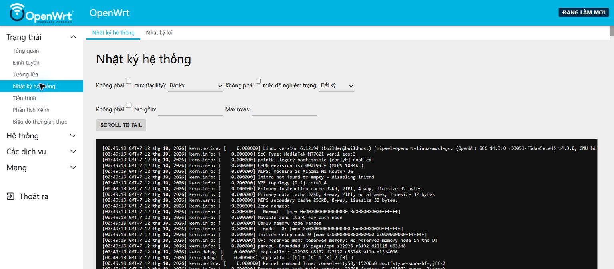

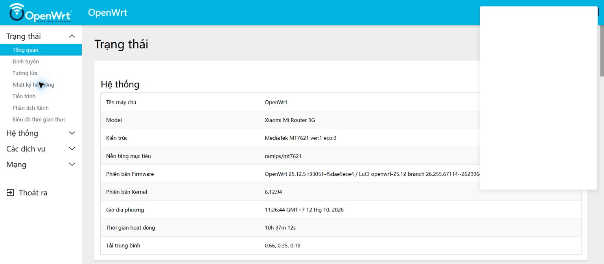

Không sửa firewall, reboot lại hoặc thao tác ổ NAS/HDD trong phép thử này. Các kiểm chứng reboot, firewall và WAN ở các mục trước vẫn là trạng thái gần nhất của những hạng mục đó. Chrome vẫn chặn riêng FQDN MagicDNS với `ERR_BLOCKED_BY_CLIENT`; tên ngắn `openwrt`, SSH theo FQDN và IP tailnet đã hoạt động.

Lúc 11:28, sau phép thử, Windows vẫn dùng Wi-Fi, Ethernet `Disconnected`; router vẫn chạy Tailscale, `rpcd`, `uhttpd`, `fw4 check` đạt, IP Tailscale không đổi. `/etc/shadow` vẫn có mtime 23:55 ngày 11/10, nên **chưa có bằng chứng mật khẩu root đã được đổi**. Log gần nhất chỉ có cảnh báo khởi động Tailscale đã qua ở đầu uptime và các lần đăng nhập LuCI thành công; không có bằng chứng mới để xác định nguyên nhân gốc của hiện tượng LuCI từng treo. Không suy diễn từ các cảnh báo khởi động đó.

### Xác nhận quản trị qua một đường Internet khác lúc 11:32–11:34 ngày 12/10/2026

Theo yêu cầu tập trung vào vận hành ngoài LAN và hoãn đổi mật khẩu, kiểm tra lại khi Windows đã chuyển sang Wi-Fi `10.31.110.127/24`, gateway `10.31.110.104`; Ethernet vẫn `Disconnected`. Đây là mạng khác với cả LAN OpenWrt `192.168.1.0/24` và Wi-Fi `192.168.0.0/24` dùng trong phép thử trước. `tailscale netcheck` trên Windows và router đều phát hiện IPv4 công cộng, và hai địa chỉ này **khác nhau**; không ghi địa chỉ công cộng vào báo cáo. Điều đó xác nhận hai đầu dùng đường ra Internet khác nhau tại thời điểm thử, nhưng không đủ để khẳng định nhà mạng hoặc vị trí địa lý khác nhau.

| Tiêu chí | Kết quả | Bằng chứng |
|---|---|---|
| Đường mạng ngoài LAN | **PASS** | Windows Wi-Fi `10.31.110.127/24`, gateway `10.31.110.104`, Ethernet `Disconnected`; router LAN `192.168.1.0/24`, WAN `10.2.28.22/24` |
| Hai đầu có đường ra Internet khác nhau | **PASS** | `tailscale netcheck` trên Windows và router đều chạy thành công, IPv4 công cộng phát hiện được và khác nhau; không lưu giá trị IP công cộng |
| Tailscale Windows ↔ router | **PASS** | Windows `100.85.51.71`, router `100.114.53.95`; `tailscale ping` có 3 pong qua DERP `hkg`. Exit code 1 chỉ biểu thị không lập được đường trực tiếp sau 3 lần thử, không phải mất kết nối qua relay |
| Cổng quản trị tailnet | **PASS** | `Test-NetConnection 100.114.53.95` TCP 22/80 đều `True`, interface `Tailscale`, source `100.85.51.71` |
| SSH thật qua MagicDNS | **PASS** | SSH dùng khóa và host key đã xác minh tới `openwrt.tail7e45a2.ts.net` thành công; router trả uptime hơn 10 giờ 43 phút và peer Windows active qua relay `hkg` |
| LuCI qua IP tailnet | **PASS** | Cùng tab OpenWrt hiện có tải đầy đủ Overview và System Log; không kẹt ở `Đang tải…`; ảnh 25–26 |
| LuCI qua tên ngắn MagicDNS | **PASS** | `Resolve-DnsName` trả `100.114.53.95`; cùng tab mở `http://openwrt/cgi-bin/luci/` và hiển thị model/firmware/router uptime |
| Dịch vụ và firewall sau reboot | **PASS tại thời điểm này** | `/etc/init.d/tailscale`, `rpcd`, `uhttpd` đều `running`; `fw4 check` đạt; router vẫn giữ IP Tailscale `100.114.53.95` |
| FQDN MagicDNS trong Chrome | **FAIL phía client** | Trình duyệt còn trả `ERR_BLOCKED_BY_CLIENT` cho FQDN; tên ngắn và SSH theo FQDN hoạt động. Chưa xác định được thành phần chặn |
| Mật khẩu root mạnh | **HOÃN THEO CHỦ THIẾT BỊ** | Chưa đổi; chủ thiết bị yêu cầu để sau. SSH root bằng mật khẩu vẫn tắt |

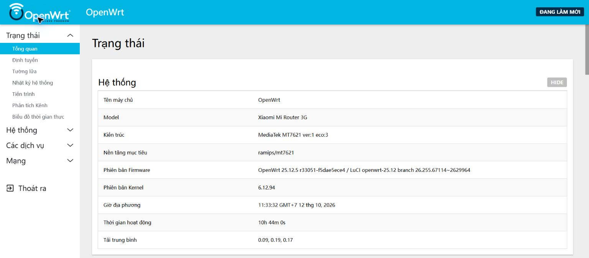

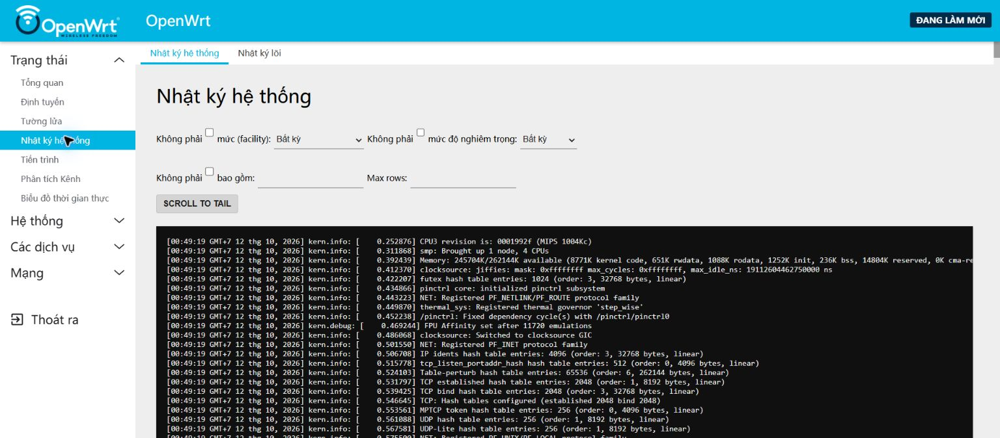

**Kết luận phạm vi này:** quản trị OpenWrt bằng Tailscale qua một đường Internet khác đã được kiểm chứng thực tế bằng SSH và LuCI. Không mở cổng quản trị ra WAN công cộng, không thay đổi NAS/HDD. Phần đổi mật khẩu và lỗi Chrome với FQDN được ghi riêng, không làm giảm kết quả PASS của IP tailnet và tên ngắn MagicDNS.

### Chẩn đoán NAS sau câu hỏi của chủ thiết bị — 12/10/2026, 11:40–11:44 ICT

**NAS chưa được khôi phục sau factory reset.** Ban đầu router thấy box USB Mass Storage `13fd:0840` nhưng không có `/dev/sdX`, vì chưa cài `kmod-usb-storage`/`kmod-scsi-core`. Đã cài hai driver từ kho OpenWrt 25.12.5 chính thức; sau đó kernel thấy ổ WDC 1 TB và `/dev/sda1`–`/dev/sda4`. Đã cài `blkid` và `smartmontools` để đọc nhận dạng và SMART. Không cài KSMBD, không mount, không chạy sửa filesystem, không mở khóa VeraCrypt, không ghi lên các phân vùng.

| Phân vùng hiện thấy | Nhận dạng chỉ đọc | Đối chiếu bản NAS cũ |
|---|---|---|
| `sda1` ~16 MiB | Microsoft reserved partition | Không phải NAS1 |
| `sda2` ~831.5 GiB | NTFS, nhãn `Data`, UUID `2CF24485F24454EC` | UUID **khác** NAS1 cũ `01DC8764756E6240` |
| `sda3` ~50 GiB | NTFS, nhãn `Data2`, UUID `549638DD9638C0F2` | UUID **khác** NAS2 cũ `78F6F2BBF6F278A8` |
| `sda4` ~50 GiB | NTFS, nhãn `Data3`, UUID `08820F9C820F8D7E` | Được nhận là NTFS, không chứng minh đây là PRIVATE VeraCrypt cũ |

SMART tổng thể trả `PASSED`; các bộ đếm reallocated/pending/uncorrectable/CRC hiện bằng 0 và ATA error log không có lỗi. Kết quả này không bảo đảm toàn bộ dữ liệu/file system nguyên vẹn. `/etc/init.d/ksmbd` và `/etc/config/ksmbd` chưa tồn tại; TCP 445 từ Windows qua Tailscale trả `False`, nên Windows chưa thể mở share NAS. **Không triển khai snapshot NAS cũ theo số `/dev/sdaX` hoặc các UUID cũ lên ổ hiện tại.** Cần chủ thiết bị xác nhận đây có phải ổ định dùng làm NAS và cho phép phạm vi mount/chia sẻ trước khi tiếp tục.

### Khôi phục NAS mới — 12/10/2026, 11:45–12:06 ICT

Chủ thiết bị xác nhận đây là ổ WDC 1 TB cần dùng và cho phép khôi phục NAS đọc/ghi. Trước khi ghi, đã cài `kmod-fs-ntfs3` và gắn cả ba phân vùng **chỉ đọc** để kiểm tra: `Data` dùng khoảng 123,2 MiB, `Data2` và `Data3` mỗi phân vùng khoảng 90,1 MiB; mỗi thư mục gốc chỉ thấy `System Volume Information`. Đã tháo cả ba mount chỉ đọc sau kiểm tra. Chủ thiết bị sau đó chọn **dùng ổ hiện tại làm NAS mới**. Điều này không chứng minh dữ liệu NAS cũ đã được khôi phục; các UUID cũ không khớp và trên cây tệp hiện tại không thấy dữ liệu người dùng.

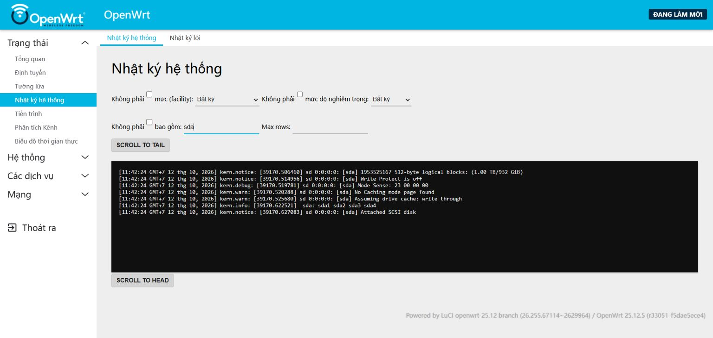

Đã cài từ kho chính thức `block-mount`, `kmod-fs-ksmbd`, `ksmbd-server`, `luci-app-ksmbd` và `shadow-useradd`. Không format, chia lại phân vùng hoặc chạy sửa NTFS. Fstab gắn theo **UUID**, filesystem `ntfs3`, các tùy chọn `rw,uid=1000,gid=1000,umask=077,iocharset=utf8,noexec,nosuid,nodev`; tài khoản hệ thống `nas` UID/GID 1000 không có quyền đăng nhập shell. Cấu hình fstab tự gắn khi boot hoặc khi cắm ổ.

| Phân vùng hiện tại | UUID | Điểm gắn | Share SMB | Windows |
|---|---|---|---|---|
| `Data` ~831,5 GiB | `2CF24485F24454EC` | `/mnt/nas` | `NAS1` | `N:` |
| `Data2` ~50 GiB | `549638DD9638C0F2` | `/mnt/nas2` | `NAS2` | `M:` |
| `Data3` ~50 GiB | `08820F9C820F8D7E` | `/mnt/data3` | `DATA3` | `Z:` |

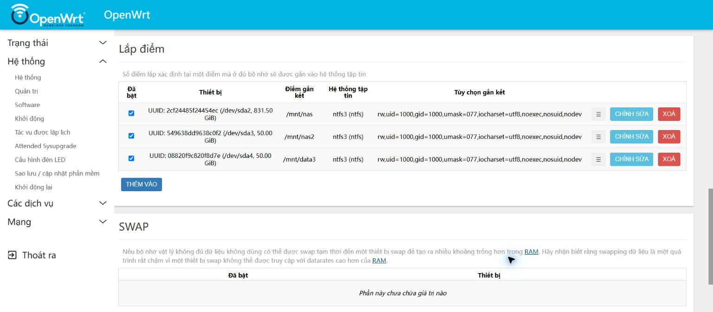

KSMBD chỉ cấu hình ba share trên, `read_only=no`, `users=nas`, `guest_ok=no`, `create_mask=0600`, `dir_mask=0700`; SMBv1 và guest IPC vẫn tắt. Template KSMBD có `interfaces = |INTERFACES| tailscale0`, `bind interfaces only = yes` để lắng nghe `br-lan` và `tailscale0`. **Không thêm `tailscale0` làm interface do netifd quản lý:** lần thử `ifup tailscale` đã gỡ IP khỏi TUN, làm SSH/LuCI qua tailnet mất tạm thời. Đã xóa interface thử nghiệm, restart daemon Tailscale giữ nguyên đăng nhập; `100.114.53.95`, TCP 22/80 và SMB hoạt động lại. Firewall chỉ thêm rule TCP 445 từ zone `tailscale`; WAN vẫn REJECT và không có rule mở SMB/SSH/LuCI. Bản sao cấu hình trước khi sửa nằm trên router tại `/root/*before-nas-20261012`.

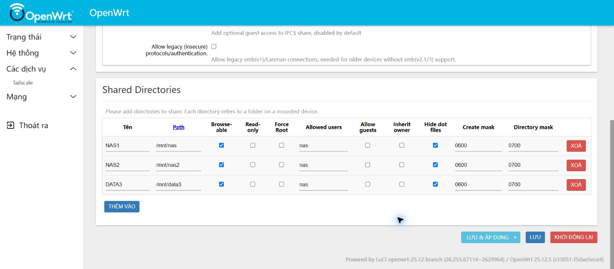

Mật khẩu SMB mạnh được tạo ngẫu nhiên, lưu trong cơ sở dữ liệu KSMBD trên router và **Windows Credential Manager của tài khoản Windows hiện tại** cho `100.114.53.95` và `192.168.1.1`; không ghi mật khẩu hoặc hash vào Git, README hay ảnh. Nếu dùng máy khác hoặc muốn đổi mật khẩu, đăng nhập SSH bằng khóa đã xác minh rồi chạy `ksmbd.adduser -u nas`, tự nhập mật khẩu mới hai lần tại prompt và cập nhật Windows Credential Manager; không gửi mật khẩu vào chat. Mật khẩu SMB độc lập với mật khẩu root LuCI.

**Cách mở NAS trên Windows:** bật Tailscale, mở File Explorer → **This PC**. Ba ổ đã map cố định là **N: NAS1**, **M: NAS2**, **Z: DATA3**. Hoặc dán lần lượt `\\100.114.53.95\NAS1`, `\\100.114.53.95\NAS2`, `\\100.114.53.95\DATA3` vào thanh địa chỉ. Sau khi Windows đăng nhập lại, các ổ persistent sẽ tự kết nối khi Tailscale và router sẵn sàng; nếu báo mất kết nối, mở lại ổ sau khi Tailscale lên. `DATA3` là NTFS thường, **không phải** PRIVATE VeraCrypt cũ.

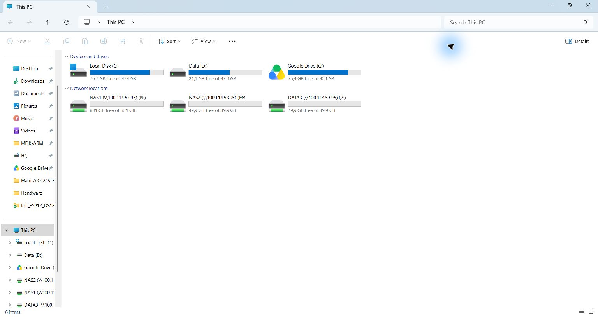

| Phép thử | Kết quả và bằng chứng |
|---|---|
| Mount đọc/ghi trước reboot | **PASS:** `mount` thấy `/dev/sda2`, `sda3`, `sda4` trên ba điểm gắn bằng `ntfs3 (rw)`; LuCI hiển thị ba UUID được bật |
| KSMBD có xác thực qua tailnet | **PASS:** TCP 445 từ Windows có source `100.85.51.71` qua interface `Tailscale`; `net use` mở cả ba share với credential lưu an toàn |
| Ghi/đọc/xóa qua SMB trước reboot | **PASS:** tạo file kiểm tra nhỏ, đọc lại đúng nội dung rồi xóa thành công trên NAS1, NAS2, DATA3 |
| Reboot và tự khởi động | **PASS:** `sync; reboot`; sau reboot uptime ~1 phút, `tailscale`, `ksmbd`, `rpcd`, `uhttpd` đều `running`, Tailscale IP vẫn `100.114.53.95`; cả ba mount vẫn `ntfs3 (rw)`; `fw4 check` đạt |
| SMB từ mạng khác LAN OpenWrt sau reboot | **PASS:** Windows Ethernet `Disconnected`, Wi-Fi `192.168.0.104/24`, khác LAN `192.168.1.0/24`; TCP 445 đi qua interface `Tailscale`; tạo/đọc/xóa file thử trên cả ba share tiếp tục thành công |
| Firewall WAN | **PASS theo cấu hình nftables:** chain `input_wan` không có TCP 22/80/445, cuối chain nhảy `reject_from_wan`; chain `input_tailscale` cho đúng TCP 22/80/445 và ICMP echo |
| Ổ hiển thị trong File Explorer | **PASS:** `net use` và File Explorer hiện N:, M:, Z: với dung lượng tương ứng; ảnh 30 |
| Dữ liệu NAS cũ hoặc PRIVATE | **CHƯA KHÔI PHỤC:** UUID không trùng snapshot cũ; ba phân vùng chỉ có thư mục hệ thống trước khi thử ghi. Không tự nhận DATA3 là VeraCrypt |

LuCI yêu cầu đăng nhập lại sau reboot, như kỳ vọng khi phiên cũ hết hiệu lực; lần xác minh hậu reboot đã dùng SSH, TCP, SMB và mount thực tế. Chưa thử mở lại trang LuCI sau khi nhập mật khẩu root. Mật khẩu root mạnh vẫn được chủ thiết bị hoãn, cần tự đổi tại **Hệ thống → Quản trị**.

### Nếu sau này muốn dùng BitLocker cho một phân vùng NAS

**Hiện chưa bật BitLocker trên ổ NAS.** BitLocker áp dụng cho phân vùng/block volume, không mã hóa trực tiếp ổ mạng N:/M:/Z: bằng cách chọn ký tự share. Trước khi mã hóa phân vùng trên ổ WDC bằng Windows, cần sao lưu dữ liệu, dừng share tương ứng, `sync` và tháo mount sạch trên router, rồi cắm **ổ vật lý** sang Windows. Chỉ mã hóa đúng phân vùng đã chọn; không thay đổi phân vùng khác. Cất **khóa khôi phục 48 chữ số** ở nơi tách khỏi chính ổ được mã hóa và kiểm tra đã tìm được khóa trước khi tháo ổ. Khi gắn lại router, cấu hình `ntfs3`/UUID hiện tại của phân vùng đó sẽ không còn dùng trực tiếp được cho tới khi có cơ chế mở khóa BitLocker; không tiếp tục ghi lên thiết bị mã hóa như NTFS thường.

Phương pháp được Microsoft hỗ trợ để **mở khóa** trên Windows: kết nối ổ vào Windows, dùng giao diện mở khóa BitLocker và nhập mật khẩu hoặc khóa khôi phục. Nếu dùng dòng lệnh với ký tự ví dụ `E:`: `manage-bde -status E:`, rồi `manage-bde -unlock E: -password` để được hỏi mật khẩu mà không đặt mật khẩu trong lệnh. Để **giải mã vĩnh viễn và tắt BitLocker**, sau khi mở khóa dùng `manage-bde -off E:` và chờ `manage-bde -status E:` xác nhận giải mã hoàn tất; đây là tác vụ khác với chỉ mở khóa. Nếu quên mật khẩu, tìm khóa khôi phục bằng **Key ID** trong Microsoft Account/tài khoản cơ quan/bản in hoặc USB đã lưu; Microsoft không thể tạo lại khóa bị mất. [Lệnh mở khóa của Microsoft](https://learn.microsoft.com/en-us/windows-server/administration/windows-commands/manage-bde-unlock), [hướng dẫn giải mã](https://learn.microsoft.com/en-us/windows-security/operating-system-security/data-protection/bitlocker/operations-guide), [tìm khóa khôi phục](https://support.microsoft.com/en-us/windows/security/encryption/find-your-bitlocker-recovery-key).

Về mặt kỹ thuật, `cryptsetup open --type bitlk` trên Linux có thể mở phân vùng BitLocker bằng mật khẩu hoặc recovery passphrase để tạo mapper rồi mới mount filesystem bên trong. Dự án cryptsetup ghi rõ có giới hạn với thiết bị đang giải mã dở và không hỗ trợ mở bằng TPM/SmartCard. Trên kho OpenWrt 25.12.5 của chính router, `apk update` đạt 11.042 gói và có `cryptsetup 2.8.0-r1`, `kmod-dm 6.12.94-r1`, `kmod-crypto-xts 6.12.94-r1`; các gói này **chưa được cài hay thử mở BitLocker**, nên chưa coi là giải pháp NAS tự mở khóa. Cần kiểm tra hiệu năng MT7621, cách nhập khóa an toàn và boot recovery trên chính phân vùng cụ thể trước khi mã hóa. Không đưa mật khẩu/khóa khôi phục vào UCI, README, Git hoặc command line. [Tài liệu BITLK của cryptsetup](https://gitlab.com/cryptsetup/cryptsetup/-/blob/main/man/cryptsetup.8.adoc?ref_type=heads).

## Kiểm tra tiếp ngày 12/10/2026 sau khi sắp xếp README

- SSH qua `100.114.53.95` ban đầu bị chặn bởi host key chưa được ghim cho địa chỉ Tailscale. Fingerprint ED25519 hiện tại `SHA256:qXMHQKUxALpxCzg0HamL7k1HXT38gzDdK5LEGvyqOVA` khớp fingerprint đã xác minh sau reset. Đã lưu khóa mới trong tệp `known_hosts` **riêng** trên Windows, giữ khóa cũ của `192.168.1.1` nguyên trạng; SSH bằng khóa thành công.
- Router uptime khoảng 3 giờ 54 phút lúc kiểm tra; `tailscale`, `ksmbd`, `rpcd`, `uhttpd` đều `running`; Tailscale IP vẫn `100.114.53.95`. Ba mount `/mnt/nas`, `/mnt/nas2`, `/mnt/data3` đều `ntfs3 (rw)`; RAM available khoảng 140 MiB. `fw4 check` đạt, zone Tailscale giữ TCP 22/80/445; route WAN và DNS `openwrt.org` hoạt động.
- Windows Tailscale backend `Running`, IP `100.85.51.71`, thấy router active. TCP 22/80/445 tới IP tailnet đều thông, TCP 445 có source `100.85.51.71` trên interface `Tailscale`. Lần này Windows đang ở Wi-Fi `192.168.1.179` cùng LAN router, nên **không** coi lần kiểm tra này là phép thử ngoài LAN mới; bằng chứng ngoài LAN ở các mốc trước.
- Ba map bền vững `N:`, `M:`, `Z:` ban đầu hiện **Unavailable** trong `net use`, mặc dù KSMBD và TCP 445 hoạt động. Chạy lại `net use` từng ổ với đúng UNC và `/persistent:yes` đã sử dụng credential lưu sẵn; `Get-SmbMapping` trả **OK** cho cả ba và `Test-Path` trả `True`. Không nhập, đọc hoặc ghi mật khẩu SMB trong lần này.
- Tab LuCI duy nhất còn mở tại trang mount, nhưng phiên cũ đã hết hạn và hiện màn hình đăng nhập. HTTP trả `403` cùng header `x-luci-login-required: yes`, phù hợp với yêu cầu đăng nhập; chưa chứng minh trang nội bộ LuCI sau reboot NAS. Cần chủ thiết bị tự đăng nhập trên tab đang mở để kiểm tra giao diện.
- `logread` có một lần Tailscale `PollNetMap: unexpected EOF` rồi nhận netmap mới sau 2 giây; trạng thái hiện vẫn `running`. Không thấy lỗi mới liên quan `rpcd`, `uhttpd`, `ksmbd` hoặc `ntfs3` trong phần log kiểm tra.

## Phát hiện ổ có BitLocker và ngừng NAS an toàn — 12/10/2026, 16:04–16:15 ICT

Chủ thiết bị báo đã thêm một ổ có mã hóa và yêu cầu kiểm tra lại. Lúc 16:04 kernel ghi USB disconnect của ổ `/dev/sda` trong khi còn thao tác ghi: `Buffer I/O error` và mất ghi đồng bộ trên `sda2`–`sda4`; `ntfs3` đánh dấu các volume dirty. Ba UUID fstab cũ `2CF24485F24454EC`, `549638DD9638C0F2`, `08820F9C820F8D7E` không còn trong `block info`; không có mount tại `/mnt/nas`, `/mnt/nas2`, `/mnt/data3`. Chưa thể phân biệt nguyên nhân ngắt kết nối là thao tác thay ổ, cáp/box/nguồn hay lỗi khác. Không sửa filesystem khi chưa rõ tình huống.

Lúc 16:13 kernel nhận **một** ổ USB 1 TB `/dev/sdb`, model SMART `WDC WD10PURX-64E5EY0`, serial `WCC2E6YEU14S`; SMART tổng thể `PASSED` khi đọc với `smartctl -d sat -i -H /dev/sdb`. Bản NAS trước không lưu serial nên **chưa xác định** đây là cùng ổ đã thay bố cục phân vùng hay một ổ vật lý khác. `blkid` nhận `sdb2` NTFS nhãn `DangKhoa`, UUID `A8E46416E463E4D2` (~831,5 GiB) và `sdb3` BitLocker nhãn `TRANDANGKHOA Data-DangKhoa 12/10/2026`, UUID `1a518101-853b-45d0-ae99-beac1d47c63a` (~100 GiB). `sdb1` là phân vùng nhỏ khác. Không mount, mở khóa, sửa hoặc ghi lên các phân vùng mới. `cryptsetup` chưa cài và `/dev/mapper` không tồn tại.

KSMBD vẫn chạy khi ba mount vắng mặt. Đã `/etc/init.d/ksmbd stop` và `disable` tạm thời, **không xóa** cấu hình SMB/fstab; trạng thái sau đó `inactive`, Windows thử TCP 445 qua Tailscale trả `False`. Ba map `N:`, `M:`, `Z:` hiện không truy cập được, phù hợp việc dừng dịch vụ. Tailscale router vẫn `running`, IP `100.114.53.95`, SSH hoạt động. Chủ thiết bị sau đó xác nhận **đã chủ ý thay ổ**. Khi cắm lại ổ cũ cần kiểm tra filesystem sau sự kiện mất ghi trước khi cho phép ghi. Chưa được phép gắn UUID mới vào share cũ hoặc mở khóa BitLocker.

**Quyết định tiếp theo của chủ thiết bị:** chỉ kiểm tra và ghi tài liệu cho ổ WDC đang cắm. Không mount NTFS `sdb2`, không mở khóa hoặc mount BitLocker `sdb3`, không cài `cryptsetup`, không tạo share mới và không sửa fstab theo UUID mới. Bằng chứng nhận dạng hiện có đến từ `blkid`, `/proc/partitions`, `smartctl` và log kernel qua SSH; chưa có ảnh LuCI của ổ mới vì tab hiện yêu cầu chủ thiết bị đăng nhập lại. Các ảnh ở README phản ánh các bước NAS trước khi thay ổ và được ghi chú là lịch sử.

## Khôi phục NAS từ xa trên ổ thay thế — 12/10/2026, từ 16:29 ICT

Chủ thiết bị **thay đổi phạm vi**: muốn truy cập từ xa cả `sdb2` NTFS và `sdb3` BitLocker. Trước khi ghi, `sdb2` được mount `ntfs3 (ro)` tại `/tmp/verify-sdb2`, đúng UUID `A8E46416E463E4D2`, dung lượng 831,5 GiB, dùng khoảng 123,2 MiB, một mục ở thư mục gốc; sau kiểm tra đã tháo mount chỉ đọc. Không chụp hoặc công bố tên tệp người dùng. Các bản sao cấu hình fstab, ksmbd, template trước khi đổi được đặt trên router tại `/root/*before-newdisk-20261012`.

Đã cài từ kho OpenWrt chính thức `cryptsetup 2.8.0-r1`, `kmod-dm 6.12.94-r1`, `kmod-crypto-xts 6.12.94-r1` và dependencies; overlay còn khoảng 74,5 MiB trống. `cryptsetup bitlkDump /dev/sdb3` đọc được BitLocker version 2, AES-CBC-EBOIV, 128 bit, một slot mật khẩu và một slot recovery passphrase. Lệnh này chỉ đọc metadata, không mở khóa; không in hay lưu khóa. Sau đó một phiên terminal tương tác chạy `cryptsetup open --type bitlk /dev/sdb3 nas_bitlocker` và đang đợi chủ thiết bị tự nhập mật khẩu tại prompt không hiện ký tự. **Chưa có kết quả mở khóa hoặc mount `sdb3`.**

`sdb2` đã được gắn `ntfs3 (rw)` tại `/mnt/dangkhoa` theo đúng UUID, uid/gid 1000 và tùy chọn `umask=077,noexec,nosuid,nodev`. Ba mục fstab cũ đã tắt; mục mới dùng UUID `A8E46416E463E4D2`. Ba share NAS1/NAS2/DATA3 cũ đã được thay bằng share `DANGKHOA` chỉ cho user `nas`, không guest; cấu hình cũ có bản sao trên router. Điểm mount không có ổ bên dưới có quyền `000` để tránh ghi nhầm vào overlay nếu ổ mất. KSMBD chỉ nghe `br-lan` và `tailscale0`, bật tự khởi động sau khi mount và `fw4 check` đều đạt.

Windows lúc thử dùng Wi-Fi `192.168.0.104` ngoài LAN OpenWrt, Ethernet không có địa chỉ hợp lệ; TCP 445 tới `100.114.53.95` đi qua interface Tailscale với source `100.85.51.71`. Đã map `P:` → `\\100.114.53.95\DANGKHOA` bằng credential `nas` lưu sẵn, `net use` báo OK. Tệp kiểm tra nhỏ được tạo, đọc lại đúng nội dung và xóa trên `P:` thành công. **Chưa reboot sau cấu hình ổ mới**; share BitLocker chưa sẵn sàng. Một lần SSH timeout đúng lúc Windows chuyển đường mạng Ethernet sang Wi-Fi, sau đó Tailscale ping và SSH qua đường WAN hoạt động lại; không có bằng chứng router bị treo.

### Chuẩn bị tự mở BitLocker theo yêu cầu chủ thiết bị — 12/10/2026

Chủ thiết bị muốn `sdb3` tự mở khi cắm vào router và đã chọn **lưu bí mật mở khóa trên router**. Đây là quyết định có đánh đổi bảo mật: ai có quyền root hoặc sao chép được flash router có thể lấy bí mật mở ổ. Chỉ giữ recovery key ở nơi riêng. Windows BitLocker auto-unlock trên máy Windows không chuyển tự động sang OpenWrt.

Đã cài `/usr/sbin/nas-bitlocker-manager`, `/usr/sbin/nas-bitlocker-provision`, `/etc/hotplug.d/block/95-nas-bitlocker` và init `/etc/init.d/nas-bitlocker`, quyền `0700`, chỉ xử lý UUID BitLocker đang thấy. Dịch vụ init **chưa enable**. Script Windows `scripts/provision-bitlocker-passphrase.ps1` kiểm tra fingerprint ED25519 đã ghim, nhận mật khẩu bằng `Read-Host -AsSecureString`, chuyển qua SSH stdin, thử `cryptsetup open --test-passphrase`; chỉ khi đúng mới lưu `/etc/nas-bitlocker/passphrase` trên router với quyền `0600`. Tệp này nằm ngoài repository. Phép thử bằng khóa giả được router từ chối (`No key available with this passphrase`) và xác nhận không có tệp khóa lưu, mapper hoặc mount. Không ghi mật khẩu hay recovery key vào nhật ký.

Kiểm tra cuối khi chưa có bí mật: `P:` vẫn là SMB mapping **OK**, TCP 445 từ Windows qua Tailscale kết nối được; trên router `tailscale` và `ksmbd` đều `running`, `fw4 check` đạt, overlay còn 74,5 MiB, `sdb3` vẫn locked. **Chưa nạp khóa thật, mở volume, tạo share, bật boot hay kiểm chứng hotplug/reboot.** Chủ thiết bị đã được hướng dẫn tự chạy script Windows để nhập kín; prompt Terminal mở từ Codex trước đó không hiện trong giao diện và đã bị hủy, nên không còn phiên nào chờ nhập.

### Khóa xác minh đúng nhưng kernel thiếu dm-zero; reboot kiểm tra phần còn lại — 12/10/2026

Chủ thiết bị đã tự chạy script PowerShell và nhận thông báo `Passphrase verified and stored root-only on router`. Trên router, `/etc/nas-bitlocker` là `drwx------`, tệp `passphrase` là `-rw-------`; nội dung không được in ra. `cryptsetup open --type bitlk` với đúng UUID không tạo được mapper: `device-mapper: reload ioctl on nas_bitlocker (253:0) failed: Invalid argument` và `Cannot activate device, kernel dm-zero module is missing.` `cryptsetup status nas_bitlocker` là inactive. Đây là thiếu kernel target sau bước xác minh mật khẩu; không có bằng chứng mật khẩu sai. `kmod-dm` của firmware này chỉ chứa `dm-crypt`, `dm-log`, `dm-mirror`, `dm-mod`, `dm-region-hash`; không thấy `dm-zero.ko` trong `/lib/modules/6.12.94` hay gói `kmod-dm-zero`/`dislocker` trong kho APK. Mã nguồn OpenWrt 25.12.5 đặt `CONFIG_DM_ZERO=n` trong `package/kernel/linux/modules/block.mk`. Đã chuyển hook mới ra `/root/95-nas-bitlocker.disabled` và giữ init chưa enable để không thử lỗi mỗi lần cắm; tệp khóa root-only vẫn còn theo lựa chọn của chủ thiết bị. Chưa mount hoặc chia sẻ BitLocker.

Đã reboot router sau khi `sync` và `fw4 check` đạt. Lúc khởi động, Tailscale mất kết nối khoảng một phút rồi tự trở lại `100.114.53.95`; `tailscale ping` từ Windows trả pong qua `10.2.28.22:41641`. Router sau reboot: `rpcd`, `uhttpd`, `tailscale`, `ksmbd` đều running, `fw4 check` đạt; RAM available ~141 MiB, overlay trống 74,5 MiB. Tên thiết bị đổi từ `sdb` sang `sda`, nhưng `sda2`/`sda3` vẫn đúng UUID. `sda2` tự mount `/mnt/dangkhoa` dạng `ntfs3 rw`. Windows vẫn đang dùng Wi-Fi ngoài LAN OpenWrt, Ethernet ngắt; `P:` tự trở lại `OK`, `Test-Path P:\` đúng, TCP 22/80/445 đều phản hồi, File Explorer mở được thư mục. Hai ảnh thực tế đã lưu: `screenshots/31-current-dangkhoa-p-after-reboot.jpg` và `32-current-dangkhoa-p-this-pc.jpg`. **Chưa thử ghi/đọc/xóa lại sau reboot**: lệnh tạo rồi xóa tệp kiểm tra trên SMB bị hệ thống tự động từ chối với lý do chung `blocked by policy`; không thử lách bằng shell khác. Phép thử này đã đạt trước reboot.

Đã tải SDK chính thức `openwrt-sdk-25.12.5-ramips-mt7621_gcc-14.3.0_musl.Linux-x86_64.tar.zst` vào thư mục tạm trên Windows và xác minh SHA-256 `9962084f4131610e90e48bc864c6ceade0b238f15f335de5f672910532b20e9c` để đánh giá hướng dựng riêng module. Chưa xây/nạp module thử nghiệm hay flash firmware; BitLocker auto-unlock vẫn **FAIL**, không đánh dấu DONE.
