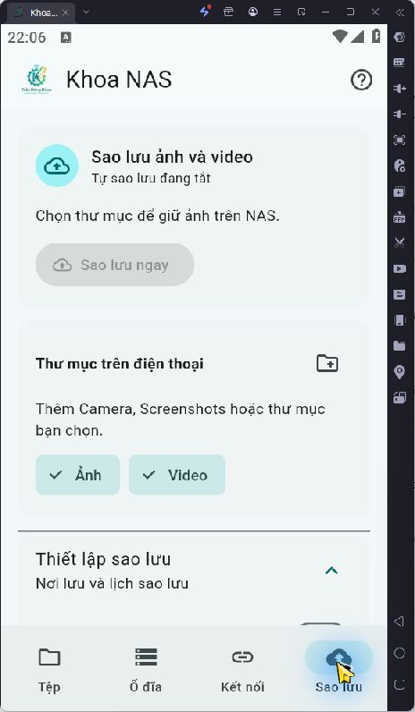
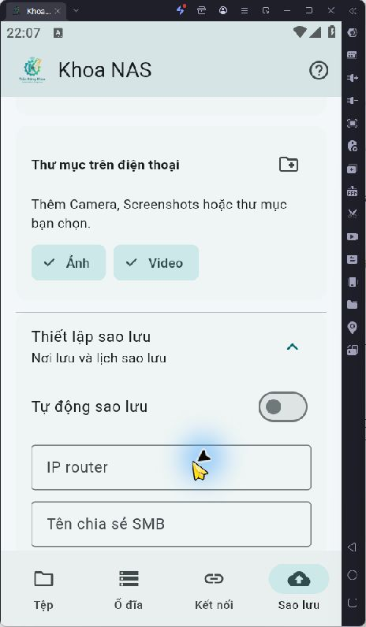
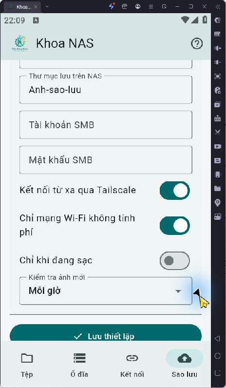
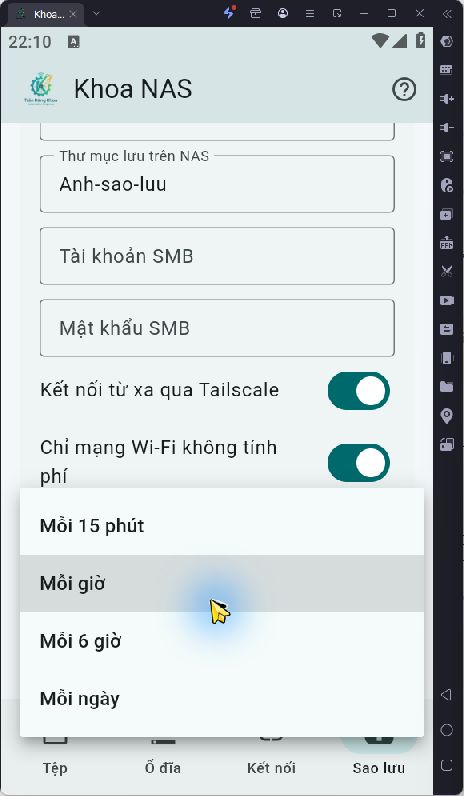
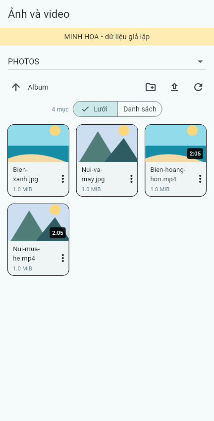

# Khoa NAS 2.3 — kiểm thử và hướng dẫn bổ sung ngày 30/10/2026

## Kết quả chính

Đã bổ sung chọn thiết bị từ Tailscale nhúng, lưới/danh sách, xem ảnh/video trực tiếp, thumbnail/thời lượng, cắt/xoay ảnh giữ bản gốc, và sao lưu nền có thể chỉnh thư mục/lịch/điều kiện. Đã dựng APK ARM64 và x86_64; cùng chứng thư ký với bản 2.0/2.1. Bản 2.1 đã cài đè lên Samsung SM-A155F giữ dữ liệu; chủ máy chọn để APK 2.3 cài sau, vì vậy **không ghi nhận đã cài 2.3 lên Samsung**.

Bộ phát hành gồm ZIP cài sẵn, app Android, tiện ích Windows và router archive có checksum, cùng workflow phát hành từ tag Git. Không chứa thông tin đăng nhập riêng; cài mới vẫn phải chọn ổ và nhập mật khẩu/đăng nhập Tailscale trên thiết bị.

## Sự cố router và giới hạn quan trọng

Trong lần thử nâng cấp thật, check-only đạt và core LuCI installer đã báo hoàn tất. Bước bootstrap gọi start Tailscale trên dịch vụ đang chạy tạo log `tailscaled --cleanup`, kết nối SSH bị reset. Sau đó router vẫn trả lời ping Tailscale qua relay Hong Kong, nhưng TCP SSH 22 và HTTP 80 không truy cập được. Chưa xác định đầy đủ nguyên nhân mất truy cập bên trong router vì không còn phiên quản trị.

Đã sửa bootstrap để kiểm tra tiến trình `tailscaled` và trạng thái dịch vụ trước khi start. Có kiểm thử hồi quy: tiến trình còn chạy thì không gọi status/start; status running thì không gọi start; thực sự dừng mới start. Không restart dịch vụ Tailscale đang chạy. **Sửa mã và kiểm thử giả lập chưa thay cho xác minh phục hồi router thật.** Người dùng cho biết router ở xa, không thể kết nối LAN trong phiên này. Trạng thái dịch vụ/ổ sau sự cố chưa đọc lại được. Không tiếp tục thử cài mù hay reset router.

Vì vậy chưa xác minh đầy đủ luồng 2.3 với NAS thật: streaming/codec, cắt-xoay rồi tải bản sửa, sao lưu nền sau đóng app/reboot, mất mạng rồi nối lại trên Samsung, kết nối 4G/5G và tốc độ mới. Bộ cài sửa chưa được kiểm thử lại trọn luồng trên router thật. Giao diện router đang chạy cũng chưa nhận link APK mới sau khi mất truy cập.

## Ma trận kiểm thử

| Phần | Kết quả | Bằng chứng/phạm vi |
|---|---|---|
| Flutter analyze | Đạt | Không có vấn đề phân tích mã |
| Flutter chức năng | 9 đạt | Lưới/danh sách ở 360px, thời lượng video, chạm media để mở thay vì tải; URL loopback; discovery không gửi credentials; giao diện kết nối; link không tin cậy; sao lưu mặc định tắt, quyền thư mục và lưu trước khi chạy |
| Native Go | 10 đạt, 1 bỏ qua | Đường dẫn/địa chỉ, cấm remote fallback LAN, peer tailnet được phép, HTTP Range/HEAD/suffix/416/seek, token/thu hồi URL, gửi tiếp tệp dở, không ghi đè, không sửa nguồn |
| SMB tích hợp | Bỏ qua lần này | Không có disposable fixture truy cập được; các kiểm thử SMB thật trong báo cáo 2.0 là kết quả lịch sử |
| Đóng gói | 4 đạt | Allowlist không chứa trạng thái máy; archive xác định/roundtrip; từ chối link/path traversal; guard start dịch vụ |
| NAS UI hiện có | 6 đạt | Kiểm thử JS tài khoản/đổi mật khẩu và quyền chia sẻ; không thay đổi backend tài khoản trong bản này |
| APK | Dựng thành công | ARM64 và x86_64, min SDK 26, target 36; chữ ký khớp 2.0 |
| LDPlayer index 2 | Mở được | App 2.3 không thoát khi mở; tab Sao lưu, điều kiện và lịch hiển thị, mặc định không bật/không có nguồn |
| Tự sao lưu dữ liệu cá nhân | Không thực hiện | Không chọn hoặc tải ảnh riêng của chủ máy trong kiểm thử |
| Editor/codec trên NAS thật | Chưa xác minh | Cần kết nối SMB hoạt động; plugin build được nhưng chưa đủ chứng minh lưu ảnh/codec thật |

Kiểm thử gửi tiếp dùng filesystem fixture thật với kết nối mất giả lập: gửi dở không xuất hiện dưới tên hoàn tất, lượt sau nối đúng bytes, tệp nguồn không đổi, bản hoàn tất không tải trùng, tệp khác có sẵn không bị ghi đè. Đây không phải phép đo mạng SMB.

## Ảnh thực tế trên LDPlayer

Tab Sao lưu có trạng thái gọn, nút chạy, danh sách thư mục và chọn ảnh/video. Thêm thư mục mở trình chọn Android; người dùng tự chọn và cấp quyền đọc. Chưa cấp quyền hoặc nhập thông tin riêng trong lần chụp này.

## Minh họa lưới ảnh/video

Ảnh dưới là **render widget thật với dữ liệu/ảnh fixture tự tạo**, không phải thư viện ảnh cá nhân hoặc bằng chứng đã stream được NAS. Nhãn minh họa có ngay trong ảnh. Video hiển thị thời lượng 2:05 từ metadata fixture.

## Thay đổi kỹ thuật và giới hạn

- Backup dùng WorkManager 2.11.1, phiên SMB riêng, AES-GCM/Android Keystore cho profile, SAF giữ quyền đọc những thư mục được chọn. Không xin toàn bộ bộ nhớ hoặc tạo Android VPN.
- Tự động mặc định tắt. Save giữ mật khẩu khi để trống chỉ với cùng host/user/chế độ. Thay địa chỉ/tài khoản/chế độ phải nhập lại. Stop hủy lịch và tắt tự động. Khi sửa thiết lập phải lưu rồi mới chạy thủ công.
- Sao lưu một chiều, tên đích có mã phiên bản; tệp tạm được đổi tên khi hoàn tất và không overwrite. Ảnh sửa nhận theo metadata mới; provider thiếu timestamp dùng content hash. NAS xóa bản đã hoàn tất không tự khiến chỉ mục tải lại; đổi thư mục đích để tạo tập sao lưu mới.
- Video/ảnh online dùng loopback HTTP token ngẫu nhiên, Range/HEAD/seek, thu hồi khi ngắt/đổi share. Cache preview giới hạn 80 mục, preview queue giới hạn. Codec và dung lượng ảnh phụ thuộc thiết bị; ảnh nguồn >12 MiB có thể chỉ hiện biểu tượng nhưng vẫn có thể mở/tải.
- Editor tải ảnh vào cache riêng, mở crop/rotate rồi hỏi lưu JPEG mới trong cùng thư mục; không sửa bản gốc. Ảnh GIF/PNG trong suốt/metadata có thể thay đổi khi chuyển JPEG. Chặn quay lại trong khi xử lý và kiểm tra kết nối/thư mục không đổi trước khi gửi bản sửa.
- Tối ưu upload 1 MiB thay vì fallback 32 KiB; download giữ giới hạn EOF để không phát sinh đọc vượt cuối trên KSMBD. HTTP media buffer 1 MiB, preview 64 KiB. Không bỏ signing hoặc mã hóa để tăng tốc.
- Lịch chạy nền có thể bị Android hoãn. Force-stop ngừng chạy cho đến mở lại app; hết thời gian sẽ thử lại và tiếp tục tệp dở. Chưa phải một dịch vụ sao lưu đám mây có phiên bản/kiểm tra toàn vẹn từ đầu tới cuối như Google Photos.

## Tốc độ upload/download

Đường Windows → router đo trong phiên này dùng **DERP Hong Kong**, ping Tailscale khoảng 49–57 ms, chưa thiết lập direct. Đây là bằng chứng có relay/độ trễ, không phải phép đo Mbps hoặc đường Samsung. Router MT7621, SMB signing, mã hóa, USB/NTFS/BitLocker và băng thông upload Internet phía NAS đều có thể giới hạn thêm. Chưa có số đo sau tối ưu nên không công bố tốc độ tăng bao nhiêu.

Tài liệu tham khảo: [Tailscale connection types](https://tailscale.com/docs/reference/connection-types), [Android WorkManager](https://developer.android.com/develop/background-work/background-tasks/persistent/getting-started/define-work), [quyền chọn thư mục SAF](https://developer.android.com/training/data-storage/shared/documents-files), [image_cropper](https://pub.dev/packages/image_cropper).

## Cách dùng và kiểm thử lại

1. [Cài APK/bộ cài](../../docs/INSTALL.md). Giữ dữ liệu bằng cài đè cùng chữ ký; không cần gỡ app.
2. [Bật sao lưu và sửa ảnh](../../docs/ANDROID-BACKUP.md). Nhập mật khẩu trực tiếp trong app, không đưa vào chat/Git.
3. Khi có người tại router: vào LAN đúng thiết bị, kiểm tra Tailscale/firewall/uHTTPd/SSH và log sự cố; phục hồi quản trị rồi xác minh SMB/mount/khóa trước khi nâng cấp lại. Không format, không gỡ BitLocker, không restore snapshot cấu hình cũ.
4. Dùng thư mục thử riêng với ảnh/video không riêng tư: thử tạo/đọc, phát/tua, cắt/xoay/lưu bản sao, bật sao lưu, chờ chạy nền, gián đoạn mạng và nối lại; đối chiếu hash nguồn/đích, kiểm tra không ghi đè/xóa bản gốc. Sau đó mới xác nhận đầy đủ với dữ liệu thực tế.

Lệnh tái kiểm thử: `go test -v ./nasnet` tại `software/android/native`; `flutter analyze` và `flutter test` tại `software/android`; `python -m unittest discover -s distribution -p 'test_*.py'`; `node --test router/luci-disk-manager/tests/smb-dialog.test.cjs`.

Ảnh minh họa có thể tạo lại bằng test opt-in `report_capture_test.dart` với biến `KHOANAS_VISUAL_OUTPUT` trỏ tới thư mục ảnh và Flutter/material font cài ở `C:/flutter`. Test minh họa không tính vào 9 kiểm thử chức năng.

## Xác minh phát hành công khai

[Release khoanas-2026.10.30.1](https://github.com/TranDangKhoaAutomation/Nas-For-Xiaomi-AC1200-Openwrt/releases/tag/khoanas-2026.10.30.1) đã được [workflow GitHub Actions](https://github.com/TranDangKhoaAutomation/Nas-For-Xiaomi-AC1200-Openwrt/actions/runs/41079806138) kiểm tra và phát hành thành công từ commit `fa0896a`. Đường tải APK, Ready.zip và SHA256SUMS qua `releases/latest/download/` đều trả HTTP 200.

Đã tải lại ZIP công khai, đối chiếu digest do GitHub cung cấp, CRC ZIP, từng nội dung giải nén với payload local và toàn bộ SHA-256 bên trong: đều đạt. ZIP nén trên GitHub/Linux có bytes/digest khác ZIP local do runtime nén, nhưng từng tệp bên trong giống hệt; dùng SHA256SUMS cùng release khi kiểm tra tệp tải. Metadata artifact, digest và kết quả nằm trong [release-verification.json](release-verification.json). Probe cuối vẫn không vào được SSH/HTTP router, nên các giới hạn NAS thật ở trên giữ nguyên.
