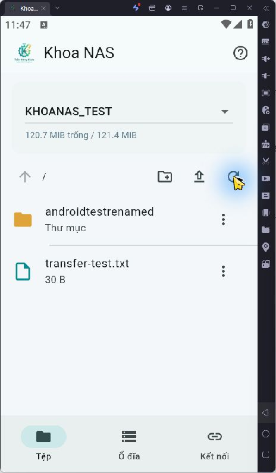
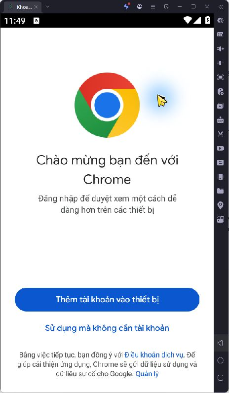

# Khoa NAS 2 — kiểm thử Android ngày 30/10/2026

Xem [kiểm tra cuối cùng và báo cáo PDF](../2026-10-30-final-verification/README.md).
Lần kiểm tra cuối đã dọn bổ sung bản ghi tài khoản thử trong passwd/group vì router thiếu
`userdel`; kết quả dọn ghi ở báo cáo cũ chưa bao quát bản ghi này.

Ứng dụng đã build và chạy trong LDPlayer 9.5.32, máy ảo riêng `KhoaNAS-Test`, Android 9,
x86_64, 540×960/DPI 240, 2 CPU/2 GB RAM, không bật root. Không cài ứng dụng Tailscale riêng.

## Bản triển khai

- [Mã nguồn/build](../../software/android/README.md), [APK và SHA-256](../../releases/android/README.md).
- Flutter 3.47.2/Dart 3.13.2, Material 3, logo GitHub của chủ repo, ba mục Tệp/Ổ đĩa/Kết nối.
- Go 1.27.3, Tailscale 1.104.4, go-smb2 1.1.0, gomobile/gobind v0.0.0-20261011034528-197770444867.
  Đã trích `libgojni.so` từ APK x86_64 và kiểm tra build info để xác nhận phiên bản thực sự đóng gói.
- Hai APK release cho arm64-v8a/x86_64; `apksigner verify` thành công, chữ ký v2.
  Khóa Android debug cục bộ, không đưa khóa ký vào Git. minSdk 26, targetSdk 36.
- Manifest APK chỉ có INTERNET, ACCESS_NETWORK_STATE và quyền receiver nội bộ; không có
  VpnService, quyền đọc toàn bộ bộ nhớ hoặc quyền quản lý tất cả tệp.

## Kết quả

| Kiểm tra | Kết quả |
|---|---|
| `flutter analyze` | Không có lỗi/cảnh báo |
| Flutter tests | 5 bài qua: màn nhỏ, che mật khẩu, reconnect thất bại, liên kết SMB hợp lệ/nguy hiểm không tự xác thực |
| Go tests | Đường dẫn không thoát share, giới hạn địa chỉ, từ xa không rơi về LAN khi chưa có node, SMB round-trip qua |
| SMB thử nghiệm | Thư mục riêng trên RAM router, tài khoản tạm không có quyền vào dữ liệu NAS |
| Giao diện LDPlayer | Duyệt share, tạo thư mục, đổi tên, tải xuống bằng Android Documents, tải lên từ bộ chọn tệp, xác nhận và xóa bản sao test: qua |
| Nội dung truyền | Tệp 30 byte tải xuống rồi tải lên khớp bằng `cmp`; test native cũng so khớp tệp hơn 128 KiB, từ chối ghi đè |
| Dung lượng | Số allocation unit × sector/unit × byte/sector; thư mục RAM hiển thị khoảng 121 MiB, khớp `df` |
| Trạng thái ổ thật | RPC có xác thực bằng tài khoản tạm chỉ được `nas.disks.status`; hiển thị DangKhoa 831.5 GiB và BitLocker 100 GiB đều đọc/ghi |
| Khởi tạo Tailscale | Qua, mở Chrome; tiến trình app còn hoạt động, không có crash log |
| Đăng nhập tailnet thật, SMB qua Tailscale, 4G/5G | Chờ chủ tài khoản; chưa xác nhận end-to-end |

Không thực thi tháo gắn/mở khóa trên ổ thật trong bài thử Android. Các thao tác này gọi module
`nas.disks` có xác thực, giữ nguyên cơ chế xử lý UUID và từ chối NTFS dirty của router.
Phân vùng dữ liệu thật không dùng cho CRUD thử nghiệm.

Tailscale dùng TCP netstack trực tiếp sau khi xác nhận route thuộc tailnet. `tsnet.Dial`
có thể dùng mạng hệ thống cho địa chỉ ngoài tailnet, nên app không dùng đường fallback đó.
Không có auth key chung trong APK. Mật khẩu SMB chỉ lưu bằng secure storage khi người dùng
chọn Nhớ đăng nhập; mật khẩu và session quản trị không lưu. Android Backup bị tắt.

Hai lỗi đã xử lý trong quá trình thử: Android không có thư mục HOME/tmp thông thường nên
log/state phải đặt trong vùng riêng của app; luồng tải xuống phải giới hạn theo kích thước
tệp và không để `File.WriteTo` bỏ qua buffer. Xác minh chữ ký SMB vẫn bắt buộc.

## Ảnh giao diện

Tài khoản SMB/RPC, ACL, session và thư mục thử nghiệm tạm đã được xóa sau kiểm thử.
Không đưa mật khẩu, node state, URL xác thực hoặc khóa BitLocker vào repo.
