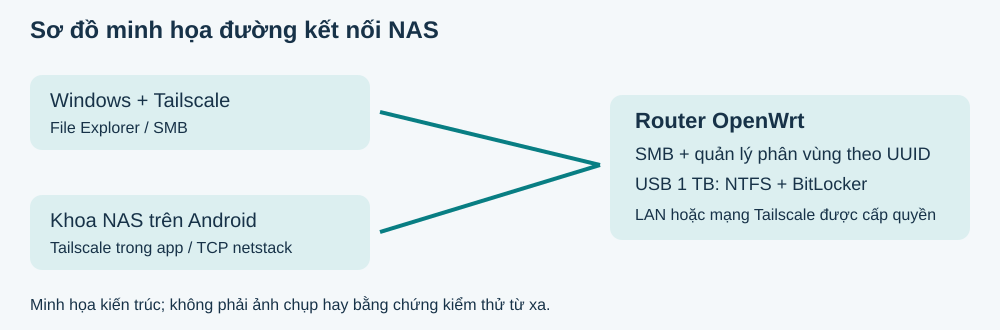
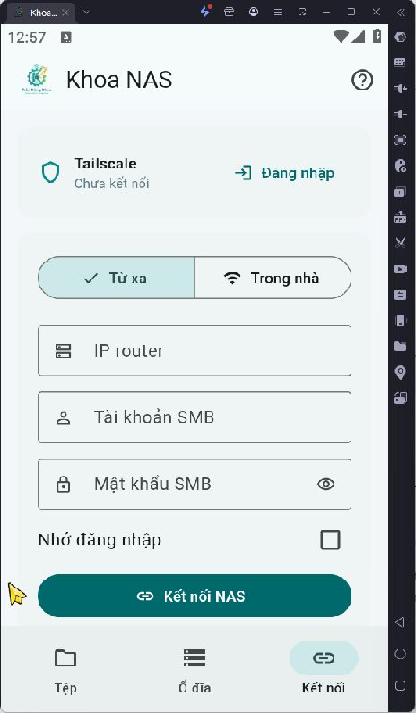
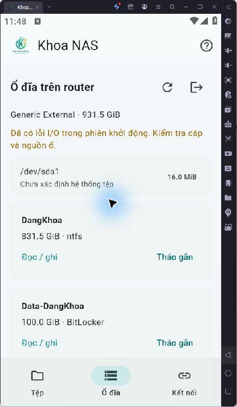
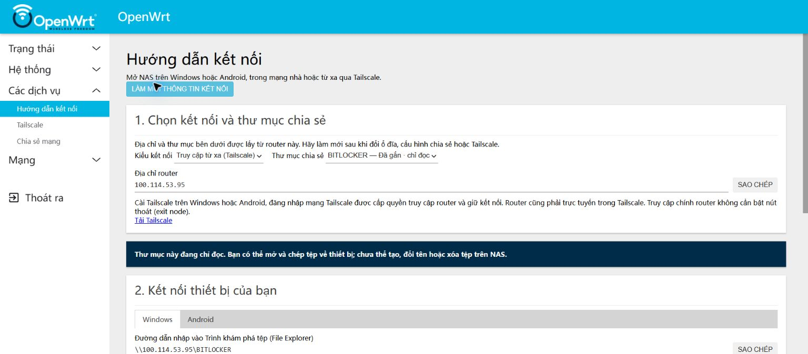
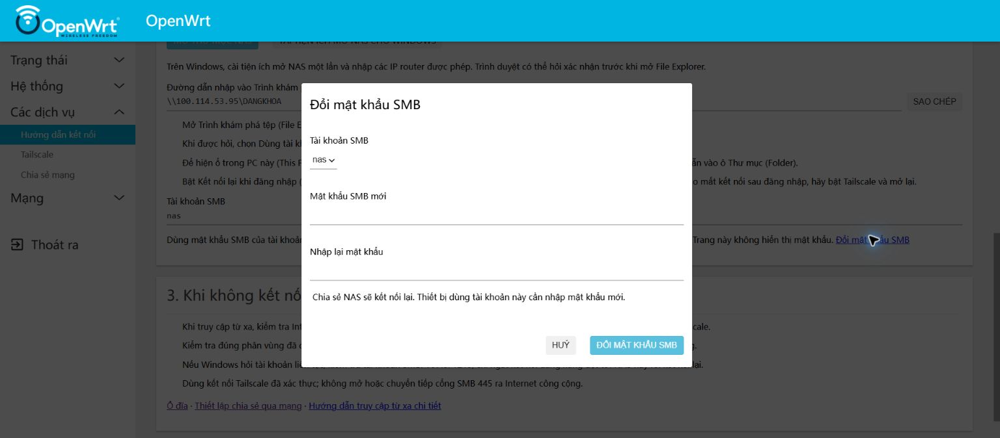
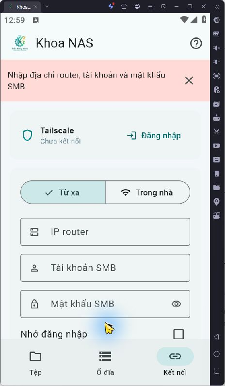

# Khoa NAS - Báo cáo kiểm thử cuối và hướng dẫn sử dụng

[Tải báo cáo PDF 11 trang](Bao-cao-kiem-thu-va-huong-dan-KhoaNAS.pdf) · [Bằng chứng JSON](evidence.json)

Ngày 30/10/2026, múi giờ Asia/Bangkok. Bản được kiểm tra: `45e0abb`.

## Khoa NAS: kiểm thử cuối

Kết luận: các chức năng nội bộ đã kiểm tra đạt. Chưa đủ điều kiện xác nhận toàn bộ luồng truy cập từ xa trên Android.

Theo lựa chọn của chủ tài khoản, lần này kiểm thử nội bộ trước; không đăng nhập Tailscale thật, không nhập mật khẩu quản trị/SMB của người dùng vào app.

| Phạm vi | Kết quả mới |

| --- | --- |

| Windows → hai share | 4/4 bài tạo, ghi, đổi tên, đọc đối chiếu và xóa qua LAN/IP Tailscale đạt. Mỗi bài 524.325 byte. |

| Android / mã nguồn | Flutter analyze sạch; 5 Flutter tests đạt; 4 Go tests đạt, có SMB round-trip thực với tài khoản thử tạm. |

| APK / tải xuống | Hai SHA-256 giữ nguyên bản phát hành; hai APK xác minh chữ ký v2; hai liên kết HTTP 200. |

| Router / dữ liệu | DangKhoa và BitLocker đều mount rw; KSMBD/Tailscale chạy; tự gắn đang bật; khóa BitLocker quyền 600. |

| Chưa xác minh lại | Android qua tailnet thật, điện thoại arm64 thực, 4G/5G; reboot mới; thao tác tháo gắn/mở khóa trên ổ thật từ app. |

Bản ứng dụng là bản thử nghiệm ký khóa Android debug cục bộ, chưa phải bản phát hành Play Store. Lần này giữ nguyên APK và mã ứng dụng đã phát hành; chỉ bổ sung bằng chứng và tài liệu.

Thời điểm thu bằng chứng cuối: 2026-10-30T13:06:02.648317+07:00. Nguồn đầy đủ: evidence.json đi cùng báo cáo.

## 1. Hệ thống và đường kết nối

Router OpenWrt 25.12.6, Xiaomi Mi Router 3G; ổ USB quảng cáo 1 TB tương ứng khoảng 931,5 GiB. Đơn vị TB và GiB khác nhau, không phải mất dung lượng.

| Phân vùng | Trạng thái xác minh |

| --- | --- |

| sda1 / 16 MiB | Phân vùng dự trữ, chưa xác định hệ thống tệp; không format. |

| DangKhoa / 831,5 GiB | NTFS; /mnt/dangkhoa; share DANGKHOA; đọc/ghi; tự gắn bật. |

| Data-DangKhoa / 100 GiB | BitLocker; /mnt/bitlocker; share BITLOCKER; đã mở và đọc/ghi; có khóa đã lưu. |

Hình minh họa kiến trúc, không phải ảnh chụp kiểm thử. LAN dùng 192.168.1.1; kết nối Tailscale dùng 100.114.53.95. IP có thể thay đổi sau reset hoặc đăng ký lại thiết bị.

Tailscale trong Android chỉ vận chuyển lưu lượng của Khoa NAS, không tạo VpnService cho toàn điện thoại. Các ứng dụng khác không tự được truy cập NAS nhờ kết nối này. Router vẫn cần trực tuyến trong đúng tailnet.

## 2. Ma trận kiểm thử mới

| Bài kiểm tra | Kết quả / bằng chứng |

| --- | --- |

| Flutter analyze | PASS: không có lỗi/cảnh báo. |

| Flutter tests | PASS 5/5: bố cục 360×640, che mật khẩu, reconnect thất bại xóa phiên cũ; liên kết hợp lệ chỉ điền địa chỉ; từ chối URL có mật khẩu hoặc IP công cộng. |

| Go tests | PASS 4/4: chặn vượt đường dẫn; giới hạn IPv4; chế độ từ xa không rơi về LAN; SMB round-trip thực. |

| Windows opener | PASS 2/2 nhóm kiểm tra: share root hợp lệ; chặn IP công cộng và payload ngoài phạm vi. |

| Windows SMB | PASS 4/4: LAN/Tailscale × DANGKHOA/BITLOCKER. Tệp ngẫu nhiên 524.325 byte/bài; so khớp dữ liệu; dọn sạch. |

| Go SMB thực | PASS với tệp 491.523 byte, tạo/đổi tên thư mục, upload, từ chối ghi đè, download so khớp, xóa. Tài khoản thử chỉ trỏ tới RAM router. |

| Giao diện LDPlayer mới | Mở app, ba tab và kiểm tra biểu mẫu trống: đạt. CRUD qua UI đã có ảnh/bằng chứng ở phiên trước; không trình bày là vừa lặp lại toàn bộ. |

| Router | Hai mount rw; hai share không guest; dịch vụ chạy; khóa 600. Chưa reboot trong lần kiểm tra này. |

Trong quá trình chạy lại, bộ fixture Windows gửi CRLF thay cho LF khiến thông tin tài khoản thử không khớp. Đã đổi sang gửi byte UTF-8; chạy lại Go đạt 4/4. Một bản ghi thử có CR làm KSMBD tạm không khởi động; đã xóa đúng bản ghi thử, khôi phục dịch vụ và chạy lại cả bốn bài Windows SMB thành công. Mật khẩu nas không bị thay đổi.

Dọn bổ sung bản ghi khoa_apptest cũ trong passwd/group do router không có userdel. Không có tài khoản, ACL, session hoặc thư mục thử mới được giữ lại sau kiểm tra.

## 3. Android: kết nối trong nhà

1. Cài APK arm64-v8a cho điện thoại phổ biến; x86_64 cho LDPlayer. Yêu cầu Android 8 trở lên. Chọn đúng kiến trúc; không dùng APK Android v1 lịch sử.

2. Mở Kết nối → Trong nhà. Điền IP 192.168.1.1 (hoặc IP LAN hiện tại của router), tài khoản nas và mật khẩu SMB. Nhấn Kết nối NAS.

3. Sang Tệp và chọn DANGKHOA hoặc BITLOCKER. Danh sách share lấy thật từ router, không cố định tên ổ sda/sdb.

Chỉ chọn Nhớ đăng nhập trên thiết bị tin cậy. Mật khẩu được lưu bằng secure storage khi chọn; không gửi mật khẩu qua liên kết smb://.

## 4. Android: quản lý tệp

| Nút / thao tác | Cách dùng |

| --- | --- |

| Mũi tên lên | Về thư mục cha. |

| Biểu tượng thư mục + | Tạo thư mục; nhập tên rồi Lưu. |

| Mũi tên tải lên | Chọn tệp bằng bộ chọn tệp Android; chờ hoàn tất rồi làm mới. |

| Chạm vào tệp | Tải xuống; chọn nơi lưu trong Android Documents rồi Lưu. |

| Menu ba chấm | Đổi tên, tải xuống hoặc xóa; xóa có hộp xác nhận. Thư mục có dữ liệu không bị xóa đệ quy. |

| Tên trùng / hủy truyền | Upload từ chối ghi đè. Nếu mất mạng hoặc hủy, kiểm tra tệp chưa hoàn tất trước khi thử lại. |

## 5. Android: ổ đĩa và từ xa

Ổ đĩa: nhập tài khoản LuCI riêng. Xem dung lượng và chế độ gắn thực tế. Mở khóa/gắn hoặc tháo gắn sẽ gọi module nas.disks của router; khi chưa có khóa đã lưu app hỏi mật khẩu BitLocker. Đóng tệp đang dùng trước khi tháo gắn.

Từ xa: Kết nối → Từ xa → Đăng nhập Tailscale. Hoàn tất thiết lập trình duyệt, tự đăng nhập đúng tailnet và chấp thuận thiết bị theo chính sách của bạn. Điền IP Tailscale router rồi đăng nhập SMB.

Chưa kiểm thử bước đăng nhập thật trong lần này theo lựa chọn của bạn. Phép thử còn lại: tắt Wi-Fi điện thoại, dùng 4G/5G, mở và truyền một tệp thử; kiểm tra route qua Tailscale tích hợp. Không dùng kết quả Windows qua Tailscale để thay cho bài Android này.

## 6. Windows: mở và ánh xạ ổ

1. Trong mạng nhà, mở File Explorer và nhập \\192.168.1.1\DANGKHOA hoặc \\192.168.1.1\BITLOCKER. Khi ở xa, bật Tailscale trên Windows rồi thay IP bằng 100.114.53.95.

2. Nếu Windows hỏi đăng nhập: chọn Use a different account, nhập nas và mật khẩu SMB. Đây không phải mật khẩu BitLocker hoặc mật khẩu root router.

3. Muốn hiện trong This PC: chọn Map network drive, chọn ký tự ổ trống, dán UNC vào Folder, bật Reconnect at sign-in; dùng Connect using different credentials nếu cần.

4. Muốn nút Mở thư mục NAS hoạt động từ LuCI: cài KhoaNAS-Open một lần, cho phép đúng IP LAN/Tailscale của router. Tiện ích đăng ký giao thức khoanas:// theo người dùng hiện tại.

5. Lỗi 1219: xem net use để tìm kết nối đang dùng tài khoản khác tới đúng router; ngắt riêng kết nối xung đột rồi đăng nhập lại. Không xóa tất cả map mạng khác.

## 7. LuCI: hướng dẫn và mật khẩu

Mở http://192.168.1.1/cgi-bin/luci/admin/services/nas-connect hoặc cùng đường dẫn qua IP Tailscale. Chọn loại kết nối và share, rồi chọn Windows/Android. Địa chỉ và share lấy từ cấu hình thực tế.

Đổi mật khẩu SMB: bấm liên kết Đổi mật khẩu SMB dưới tài khoản, chọn user, nhập mật khẩu mới hai lần và tự lưu. Các thiết bị phải kết nối lại. Không thay mật khẩu root hay BitLocker bằng thao tác này.

## 8. Bảo vệ dữ liệu và xử lý lỗi

| Tình huống | Xử lý |

| --- | --- |

| Ổ chỉ đọc | Kiểm tra mount mode và quyền SMB riêng. Nếu NTFS dirty, tháo an toàn và kiểm tra trên Windows; không force ghi. |

| Cảnh báo I/O | Giữ sao lưu, kiểm tra cáp USB/nguồn/ổ. Dmesg còn lỗi cũ ở uptime khoảng 36-37 nghìn giây; chưa thấy dòng mới trong mẫu cuối. Đây không thay cho SMART dài hạn. |

| App báo thiếu thông tin | Nhập đủ IP, tài khoản, mật khẩu. Biểu mẫu trống được chặn trước khi kết nối. |

| SMB bị từ chối | Phân biệt mật khẩu SMB với LuCI và BitLocker; kiểm tra share mount thật. Không bật guest để tránh xử lý tài khoản. |

| Không tới router từ xa | Kiểm tra Internet, tailnet đúng, thiết bị được duyệt và quyền ACL/grants. Không mở cổng 445 ra Internet. |

| Đổi ổ USB | Quét lại trên LuCI; cấu hình nhận theo UUID. Không dùng tên sda để gán khóa cho ổ thay thế. |

| Đăng nhập hết hạn | Đăng nhập lại LuCI/Tailscale. Không đưa token, recovery key hoặc mật khẩu vào báo cáo/chat. |

Auto-unlock đang bật và khóa lưu có quyền -rw-------. Điều này xác nhận cấu hình hiện tại, không phải một lần reboot mới. Nếu ai có quyền root hoặc bản sao flash chứa khóa, họ có thể lấy khóa mở ổ. Giữ recovery key riêng.

Kết nối ứng dụng đang tập trung vào sử dụng khi app mở. Chưa có đồng bộ nền, phát trực tiếp video, kiểm thử dài hạn mất mạng hoặc đo hiệu năng thực tế để cam kết tốc độ.

## 9. Bằng chứng và công việc còn lại

Bản APK không thay đổi trong lần kiểm tra cuối. Chữ ký Android v2 xác minh thành công; đây là kiểm tra tính toàn vẹn gói, không phải chứng nhận Play Store hoặc đánh giá bảo mật độc lập.

KhoaNAS-v2.0.0-arm64-v8a.apk
Bytes: 40427235
SHA-256: 7b651f800d882f6261c4f82ba51ca388
92b83d6c3cca7250df3be1a58ae8ddf7

KhoaNAS-v2.0.0-x86_64.apk
Bytes: 43551799
SHA-256: 7d15d15fd9149c7021c97d8735ed02b6
f3b93dcbcfaed6ff0d89a17fa1c34dcb

| Bằng chứng | Ý nghĩa |

| --- | --- |

| evidence.json | Trạng thái mount/share, dịch vụ, hash APK/EXE, bốn kết quả SMB cùng hash dữ liệu truyền, thời điểm chụp. |

| Ảnh mới | android-connect-current.png; android-validation-current.png. |

| Ảnh tham chiếu | Android files/disks; Qt6 Windows; hướng dẫn LuCI; biểu mẫu SMB. Được ghi rõ trong từng chú thích. |

| Còn phải làm | Android đăng nhập tailnet thật và thử qua 4G/5G; điện thoại arm64 thật; reboot xác minh auto-unlock RW mới; kiểm thử dài hạn mất mạng/nguồn. |

Không reboot, format, sửa filesystem hoặc thay mật khẩu thật trong đợt kiểm tra này. Phiên đăng nhập router trên trình duyệt có thể hết hạn; báo cáo không giả lập giao diện router khi chưa có phiên hợp lệ.

Tài liệu nguồn: software/android/README.md, docs/REMOTE-ACCESS.md, reports/2026-10-30-android-integrated/README.md và releases/android/README.md trong cùng repository.

## 10. Phụ lục: ảnh kiểm tra mới

Kết quả này được quan sát trực tiếp trên LDPlayer ở lần kiểm thử cuối. Nó chứng minh kiểm tra biểu mẫu; không chứng minh kết nối Tailscale hoặc xác thực SMB thành công.

| Đường SMB Windows | Kết quả / số byte |

| --- | --- |

| 192.168.1.1 / DANGKHOA | PASS / 524325 |

| 192.168.1.1 / BITLOCKER | PASS / 524325 |

| 100.114.53.95 / DANGKHOA | PASS / 524325 |

| 100.114.53.95 / BITLOCKER | PASS / 524325 |

Các tệp thử dùng tên KhoaNAS-QA- ngẫu nhiên; chỉ xóa đúng tệp và thư mục vừa tạo. Bốn checksum đầy đủ nằm trong evidence.json để có thể đối chiếu lại.
