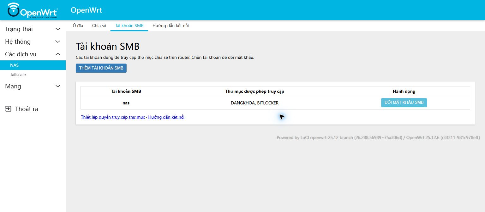
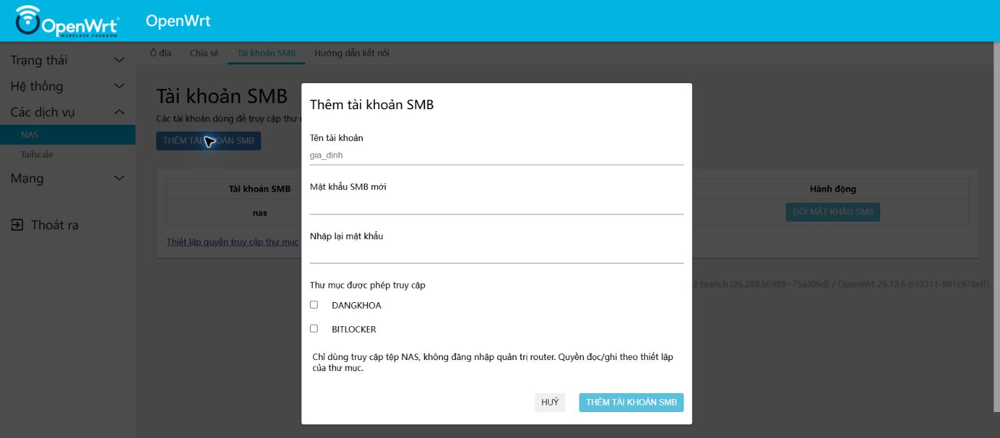
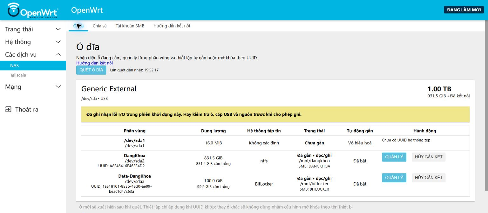

# Hoàn thiện menu NAS và thêm tài khoản SMB

Cập nhật **30/10/2026**, kiểm tra trực tiếp trên OpenWrt 25.12.6 qua Tailscale và Chrome. Phạm vi lần này là LuCI, API tài khoản và tài liệu; không reboot router.

## Giao diện đã gộp

Chỉ còn một mục **Các dịch vụ → NAS**, dùng tab LuCI gốc:

| Tab | Chức năng |
|---|---|
| Ổ đĩa | Danh sách ổ/phân vùng, mount, BitLocker và tự mở theo UUID |
| Chia sẻ | Share, đường dẫn và người dùng được phép; giữ view KSMBD gốc |
| Tài khoản SMB | Thêm tài khoản, chọn share được phép và đổi mật khẩu |
| Hướng dẫn kết nối | Windows/Android, LAN/Tailscale, mở thư mục và sao chép đường dẫn |

Đã bỏ các mục menu NAS trùng ở Hệ thống/Các dịch vụ. Bốn đường dẫn cũ vẫn là alias nội bộ, đã mở bằng Chrome và xác minh đúng nội dung/tab: `/admin/system/disks`, `/admin/services/ksmbd`, `/admin/services/nas-accounts`, `/admin/services/nas-connect`.

**Tailscale** giữ trang riêng vì có đăng nhập/cấu hình mạng riêng. Các trang Trạng thái, Hệ thống và Mạng vẫn phục vụ quản trị router. Không xóa view, driver, cấu hình chia sẻ hoặc dữ liệu để thu gọn menu.

## Thêm tài khoản

1. Mở **Các dịch vụ → NAS → Tài khoản SMB → Thêm tài khoản SMB**.
2. Nhập tên mới, mật khẩu và xác nhận. Tên gồm 1–31 chữ thường/số/gạch dưới/gạch ngang, bắt đầu bằng chữ.
3. Đánh dấu từng thư mục được phép truy cập rồi lưu.
4. Trên Windows/Android, kết nối bằng tài khoản và mật khẩu mới.

Tài khoản chỉ dùng SMB, không có mật khẩu Unix hoặc shell quản trị. Quyền đọc/ghi theo share. Hệ thống không tự bật khách, Force Root hoặc cấp quyền cho share chưa chọn. Tên đã tồn tại trong Unix/KSMBD bị từ chối.

## Kết quả kiểm thử

| Hạng mục | Kết quả |
|---|---|
| 6 kiểm thử JavaScript với RPC giả lập | Đạt: xác nhận/độ dài byte/xuống dòng, tên và lựa chọn share, xóa ô mật khẩu trước RPC, lỗi/trùng tài khoản, điều hướng sau tạo |
| 5 vector NT hash độc lập | Đạt: chuỗi rỗng, ASCII, tiếng Việt/emoji, gạch dưới/gạch ngang, 128 byte; từ chối UTF-8 sai |
| Các dạng bật Force Root | Đạt: từ chối `1`, `yes`, `true`, `on` và chữ hoa |
| 7 yêu cầu tạo không hợp lệ trên router | Đạt: tên chứa ký tự lệnh, mật khẩu ngắn/xuống dòng, không chọn share, root đã tồn tại, ID share sai/không tồn tại |
| Tạo tài khoản tạm thực tế | Đạt: từ chối tạo trùng, UID/GID dữ liệu khác root, shell `/bin/false` |
| SMB có xác minh chữ ký | Đạt: đăng nhập, đọc tệp thử do `nas` sở hữu, ghi vào DANGKHOA; BITLOCKER chưa được cấp quyền bị chặn |
| Đổi mật khẩu tài khoản thử | Đạt với tiếng Việt/emoji; đăng nhập và phân quyền SMB kiểm tra lại thành công |
| Giả lập lỗi ghi mật khẩu sau tạo danh tính | Đạt: dọn danh tính mới, không để lại tài khoản nửa chừng |
| HTTP RPC không có phiên đăng nhập | Đạt: `nas.smb.create` trả `Access denied` |
| Chrome | Đạt: 4 tab, mục NAS mặc định mở Ổ đĩa, thêm/hủy form, tiếng Việt và 4 alias cũ |
| Sau dọn | Không còn tài khoản/thư mục thử; hash DB SMB, passwd, shadow, group khớp trước thử; cả hai share trở lại đúng user `nas` |
| Dịch vụ/Windows hiện có | KSMBD/RPC đang chạy; Windows mở được cả hai share qua phiên hiện có |

Tệp thử nằm trong thư mục tên ngẫu nhiên `KhoaNAS-account-QA-*`, chỉ tạo/đọc/xóa dữ liệu do lần thử này tạo. Mật khẩu `nas`, root và BitLocker thật không bị đổi. Không đưa khóa, hash mật khẩu, phiên đăng nhập hoặc mật khẩu thử vào báo cáo/repo.

## Thực hiện và giới hạn

- `nas.smb.create` chỉ cấp cho quyền ghi quản trị NAS. `connection_info` thêm ID UCI của share, không thêm bí mật. API đổi mật khẩu giữ nguyên tên/tham số.
- Tài khoản mới dùng cùng UID/GID khác root với chủ sở hữu dữ liệu. Phân quyền theo **share**, không tách chủ sở hữu từng tệp giữa các tài khoản. Share được chọn phải đã gắn, cùng UID/GID; nếu không API từ chối để quản trị viên xử lý quyền dữ liệu trước.
- Mật khẩu chuyển UTF-8 sang UTF-16LE, tạo NT hash bằng `digest.md4` trong tiến trình; thay DB nguyên tử, quyền 0600. Mật khẩu rõ không qua argv, tiến trình con hoặc tệp tạm. Cần `ucode-mod-digest` và `shadow-useradd`.
- Cách này thay prompt của KSMBD 3.5.6: [mã nguồn prompt](https://github.com/cifsd-team/ksmbd-tools/blob/3.5.6/adduser/user_admin.c#L27) gọi `tcgetattr()` mà không kiểm tra lỗi trước khi dùng termios. Khi stdin là pipe, đã tái hiện hash mật khẩu không ổn định. Vector độc lập và SMB thực tế đã xác minh cách thay thế.
- Thao tác tài khoản có khóa chung. Đã thử rollback khi ghi mật khẩu lỗi; chưa giả lập mất điện/lỗi flash giữa giao dịch. Bản sao trước triển khai chỉ trên router ở `/root/nas-complete-20261030`.
- Chỉ bỏ khai báo menu KSMBD trùng; view/ACL gốc giữ nguyên. Nâng gói LuCI/KSMBD có thể khôi phục menu gốc; chạy lại installer để gộp. Installer sao lưu khai báo menu trước sửa.
- Cảnh báo I/O cũ vẫn giữ trên trang ổ đĩa. Lần này không thử lại reboot tự mở hoặc Android qua 4G/5G.

[Mã và kiểm thử](../../router/luci-disk-manager/README.md) · [Hướng dẫn sử dụng](../../docs/REMOTE-ACCESS.md). [Báo cáo kiểm thử trước](../2026-10-30-final-verification/README.md) giữ nguyên mốc kiểm thử và ảnh lịch sử.
