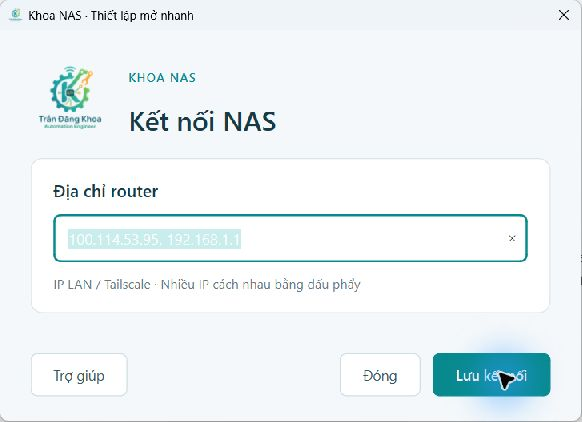

# Qt 6 và quyền ghi NAS — 30/10/2026

Tiện ích Windows chuyển sang Qt 6/PySide6, dùng logo GitHub của chủ repo trong cửa sổ, thanh tiêu đề và EXE. Giao diện chính chỉ giữ logo, địa chỉ router và nút Lưu kết nối; hướng dẫn nằm trong Trợ giúp. Cấu hình IP được phép hiện có được giữ, không chứa mật khẩu.

Hai phân vùng NAS đã được tháo gắn an toàn khỏi router, cắm trực tiếp vào Windows và kiểm tra:

- Windows nhận E: là NTFS lớn và F: là phân vùng BitLocker đã mở.
- Cả hai ban đầu có cờ dirty. Kiểm tra CHKDSK chỉ đọc không phát hiện lỗi cấu trúc.
- CHKDSK /f trên E: và F: đều exit 0; `fsutil dirty query` xác nhận cả hai NOT Dirty.
- Sau tháo an toàn và cắm lại router, manager dùng UUID hiện có, gắn cả hai bằng NTFS3 **rw**, không dùng force.
- KSMBD bật lại, hai share được đặt `read_only=no` theo mount thực tế.
- Từ Windows, trên từng share DANGKHOA và BITLOCKER qua IP Tailscale: tạo tệp kiểm tra riêng, đọc lại đúng nội dung rồi xóa; cả hai thành công.

Đã kiểm chứng RW sau lần tháo/cắm này, chưa reboot lại ở chế độ RW. Reboot tự mở trước đó đã kiểm chứng ngày 29/10 ở chế độ RO. Lỗi I/O đã từng xuất hiện trước lần chuyển ổ; giữ bản sao lưu và theo dõi nếu tái diễn. Không đưa bản sao dữ liệu riêng, khóa BitLocker hoặc log riêng tư vào Git.

Kiểm tra app gồm cú pháp Python, bộ kiểm tra liên kết/giới hạn đích NAS, catalog biểu tượng/logo và các thành phần Qt đóng gói. Quy trình build được sửa để không nhầm ICU từ PATH với API ICU của Windows.

Bản EXE đã khởi chạy thành công trên Windows 11 x64 và nút Lưu kết nối xác nhận trạng thái Hoàn tất. Qt DLL, logo, icon và văn bản giấy phép có trong gói; EXE không đóng gói `icuuc.dll` bên thứ ba trùng tên với thư viện Windows.
