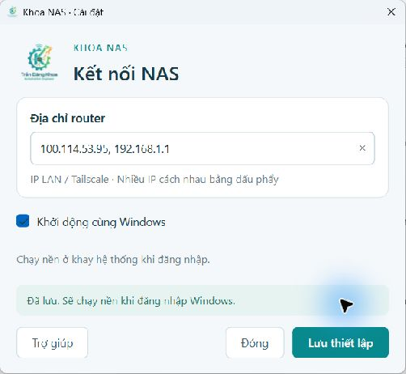
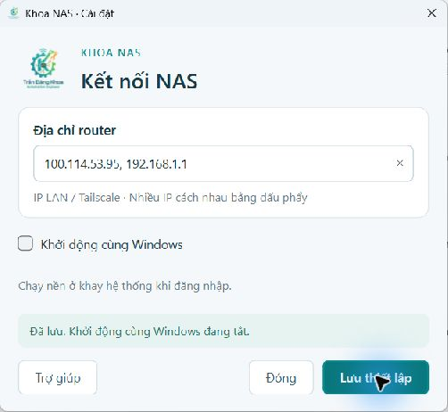

# Khoa NAS Windows 1.1.0 — 31/10/2026

## Thay đổi

Thêm ô **Khởi động cùng Windows** trong cửa sổ cài đặt, chạy nền ở khay hệ thống khi đăng nhập. Mở lại từ **Khoa NAS** trong Start Menu hoặc nhấp đôi biểu tượng khay. Có thể tắt tùy chọn rồi lưu; app không tự mở cửa sổ, thư mục NAS, map ổ hoặc bật Tailscale lúc đăng nhập.

Tệp tải về cài/chuyển về một bản cố định; shortcut, giao thức `khoanas://` và lệnh logon dùng cùng bản cài. Một khóa file và named pipe Qt giới hạn một phiên cho mỗi người dùng. Mở nhiều lần chỉ kích hoạt cùng cửa sổ. Khi cập nhật giữ IP và lựa chọn startup hiện có; lần đầu mặc định tắt.

## Vì sao Windows Search hiện nhiều mục

Kiểm kê tìm thấy 7 EXE trong các thư mục kết quả build/kiểm thử và 1 EXE cũ trong Downloads, ngoài bản đã cài và bản phân phối trong repo. Những tệp cùng tên có thể cùng xuất hiện trong Search; không chứng minh đã cài 8 ứng dụng khác nhau.

Đã chuyển 8 bản sao đó vào kho lưu riêng ngoài Documents/Downloads, có manifest SHA-256 và đường dẫn cũ để khôi phục. Không xóa dữ liệu NAS, cấu hình kết nối hoặc các tệp không thuộc KhoaNAS-Open. Đã tạo đúng một shortcut **Khoa NAS** tại Start Menu của người dùng. Windows Search có thể còn mục cũ cho tới khi lập chỉ mục lại; không reset chỉ mục toàn hệ thống.

Các gói phát hành mới được build trong vùng AppData phục vụ công cụ, thay vì rải thêm EXE vào Documents. Bản phân phối trong Git vẫn được giữ để người dùng khác tải; người dùng hiện tại mở bằng shortcut cố định.

## Kiểm thử

| Hạng mục | Kết quả |
|---|---|
| Python/Qt unit + IPC | 11 đạt |
| Startup mặc định | Không tự bật trên lần cài đầu |
| Bật/tắt Run | Kiểm tra trên Windows thật; chỉ thêm/xóa giá trị KhoaNAS-Open của tài khoản hiện tại |
| Đường dẫn có khoảng trắng | Command line được quote đúng, protocol argument luôn được quote |
| Giữ cấu hình | Danh sách IP cũ được giữ, không yêu cầu nhập lại |
| Một phiên | Kiểm thử named pipe thật giữa tiến trình, lần thứ hai không chiếm lock |
| Liên kết/IPC không hợp lệ | Từ chối host công cộng, lệnh shell, đích chưa được cho phép |
| EXE | Dựng PyInstaller/Qt 6 thành công, cài đè và đối chiếu hash bản cài với bản phân phối |
| Lệnh logon thật | Chạy --background không mở cửa sổ; owner trả lời IPC; gọi thêm 2 lần đều exit 0 |
| Cài đặt bản cuối | Mở được, đọc đúng IP đã lưu và trạng thái startup |
| ZIP phát hành | Checksum ngoài/trong và CRC đều đạt |
| Reboot/logoff thật | Chưa thực hiện, không làm gián đoạn phiên Windows của người dùng |

Đường dẫn cài được chuẩn hóa theo tệp EXE thật để tránh khác biệt AppData khi công cụ được mở từ ứng dụng Windows đóng gói. Chỉ mục Start Menu/giao thức/Run đều dùng cùng bản cài; không đưa đường dẫn cá nhân cố định vào EXE.

## Ảnh kiểm thử trên Windows

Mở **Khoa NAS → Khởi động cùng Windows → Lưu thiết lập**. Chọn **Đóng** để ẩn xuống khay khi đã bật; **Thoát** trong khay chỉ thoát phiên hiện tại. Muốn tắt cho lần đăng nhập sau, bỏ tích trong cài đặt rồi lưu.

## Tài liệu và phạm vi

[Hướng dẫn đầy đủ](../../software/windows-open-nas/README.md) · [Bản Windows](../../releases/windows-open-nas/README.md) · [Bộ cài](../../docs/INSTALL.md).

Thay đổi này không triển khai lại router hoặc đổi Android 2.3. Không kiểm tra lại NAS/SMB đọc ghi hay tình trạng mạng của router trong phiên 31/10; các giới hạn kiểm thử router trước đây vẫn nằm trong [báo cáo 30/10](../2026-10-30-android-2.3/README.md).

Tham khảo: [Windows Run/RunOnce](https://learn.microsoft.com/en-us/windows/win32/setupapi/run-and-runonce-registry-keys), [Qt QSystemTrayIcon](https://doc.qt.io/qtforpython-6/PySide6/QtWidgets/QSystemTrayIcon.html), [Qt QLocalServer](https://doc.qt.io/qtforpython-6/PySide6/QtNetwork/QLocalServer.html).
